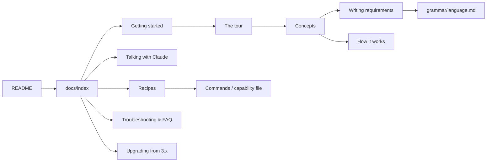

# User documentation for shopsystem-bdd 4.0 (design, b170 and b247)

The person, quote-20 (2026-11-10), on b170: "make some nice user documentation for the plugin ... I trust you to make
some delightful docs." b247 adds that `docs/capability-format.md` and `docs/design-model/` still teach `codified-1`,
which 4.0.0 refuses.

This design says who the docs are for, how they sound, which pages there are and what each holds, what happens to
the two stale documents, which diagrams there are, and how a test keeps the docs true. It was written after reading
the plugin as a user meets it: `README.md`, `.claude-plugin/plugin.json`, the five skills, the three agents,
`hooks/hooks.json`, every command's `--help`, `grammar/language.md`, `grammar/constructs.md`, `grammar/packs/`,
`docs/`, the 4.0 design (`.shop/records/2026-11-09-cnl-4/design.md`), the workflow design
(`.shop/records/2026-11-04-workflow-simplification/design.md`) and `spec/capabilities/backlog.md` with its generated
`features/backlog.feature`. Every requirement line quoted below was run through `model parse` on main at 4.0.0.

## 1. What is there today, as a reader meets it

- **`README.md` is 618 lines, and most of it is a changelog.** Its first screen is one 60-word sentence, a list of
  skill and agent names, and two pointers to documents that teach the old language. From "## 4.0.0" down it is
  release notes, newest first, back to 0.x. Nothing tells a newcomer what a day with the plugin looks like.
- **`docs/capability-format.md`** (451 lines, b247) still says a file is codified when it has `language: codified-1`
  (lines 46, 59, 315, 438, 442), teaches EARS lines in the 1.x grammar, coined adjectives and their prose
  definitions, and `formulated_as`-era layout. 4.0.0 refuses every one of those files.
- **`docs/design-model/`** (5 files, 1,616 lines, b247) is design model v5 of 2026-11-03: initiatives, parts,
  work-items, job-threads, the work-queue, telingo, and the 1.x requirement grammar. Two parts are still live: the
  graph of kinds, edges and rules that `model check` enforces (`scripts/model.lp` cites `grammar.md` §1-§4), and the
  idea of records. The rest is history.
- **`grammar/language.md`** (1,992 lines) and **`grammar/constructs.md`** (1,241 lines, generated) are accurate and
  checked by tests, but they are references for the grammar's builders: every rule is stated, then shown on lines
  about stages and sessions from the 1.x vocabulary of the test fixture. A writer can learn from them, but slowly.
- **The skills** (`skills/*/SKILL.md`) are the best description of the workflow there is. They are written for
  Claude: dense, imperative, full of red-flag tables. A person reading them learns what Claude will do, not why.
- **`--help`** is each command's contract. It is exact, but long, and `model --help` still describes
  `codified-1` as the typed glossary (stale text, not behaviour).

So the plugin has a lot of true writing, almost none of it addressed to the person who uses it.

## 2. Who the docs are for

The docs have four readers. Each page names the one it is written for, in its first paragraph.

1. **The person who talks with Claude** (a product owner, a tech lead, a developer on a team). They say what they
   want in plain English; Claude shapes items, writes lines, runs batches and opens pull requests. They need to know
   what will happen when they say something, what they will be shown, what is asked of them (merging a pull
   request, accepting a request) and what they can safely ignore. They rarely type a command.
2. **The writer and reviewer of requirement lines** (often the same person, on a pull request). They read lines in
   the backlog and the pull request, and sometimes write or reword one. They need the controlled language as a
   writer's guide, with pairs of "this, not that", and the meaning of a refusal.
3. **The developer who builds against the generated features.** They write the pytest-bdd step handlers, read a
   scenario's tags, see an `unbuilt:` id run as an expected failure, and fix a red test. They need the capability
   file, the feature file, the step vocabulary and the command reference.
4. **The maintainer of a repository on an older release.** They run `migrate upgrade` and reword what it names.

Claude is not a reader of these docs. The skills stay Claude's instructions; the docs explain the same workflow to
people and link to the skills for anyone who wants to see what Claude is told.

## 3. The voice

The house style of this repository (the spec, the skills, the records) is exact and compressed: long sentences of
clauses, no articles where they can go, ids in every line. That is right for a spec and wrong for a newcomer. The
docs keep its precision and drop its density.

- **Warm and plain.** Write to "you". Contractions are fine. Say what a thing is for before what it is called.
- **Short sentences.** One idea a sentence; a paragraph of three or four. A sentence over 25 words is split.
- **Concrete first.** Show the line, the command, the output; then say what it means. Never a paragraph of
  abstraction before the first example.
- **Real examples only.** Every requirement line comes from this repository's spec (or the example context of
  §6.13) and parses; every command exists; every output is pasted from a real run, not typed from memory. When
  output is shortened, the cut is marked `...`.
- **One word, one meaning.** Use the glossary's words: item (not ticket or story), batch (not sprint, though the
  concepts page may say "like a sprint" once), line or requirement line (not spec, rule or statement), capability,
  group, scenario, request, record, decision. Define a word the first time a page uses it, or link to the concepts
  page.
- **No fluff.** None of: "simply", "just", "easily", "powerful", "seamless", "robust", "effortless", "leverage",
  "magic", "out of the box", exclamation marks. A claim about the plugin is shown, not asserted.
- **Honest about edges.** Where the language cannot say something yet, the docs say so and link the known limit
  (`grammar/language.md`, "What the language cannot say yet"). Where a step is by hand (a new capability file, the
  glossary), the docs say so.
- **Spelling:** the spec's British spelling (behaviour, recognise).
- **Delight** comes from the reader getting somewhere fast: a tour they can follow, a refusal that turns into a good
  line in front of them, a diagram that answers "where am I?". Not from jokes or emoji.

A sample of the voice, for the writer to match (the opening of the concepts page's "requirement line"):

> A requirement line is one sentence that says what the software does. It is plain English, but a small, strict
> kind: the plugin parses every line, and a line that could mean two things is refused before anyone builds it.
>
> ```reading
> While an item is `idea`, when the person runs `work shape` on the item, `work` shall set the status of the item to `shaped`.
> shall [x2: agent the person (constant), x3: command `work shape` (parameter), x4: tool `work` (constant)]
>   while [x1: item]
>     status(x1) = `idea`
>   when
>     run(e1, subject: x2, object: x3, on: x1)
>   response
>     initiates(e2, subject: x4, status(x1) = `shaped`)
> ```
>
> Read it in three parts. **While** is the state the item is in. **When** is what someone does. **Shall** is what
> `work` must do in answer.

## 4. The shape of the set

The pages follow the four kinds of documentation (tutorial, how-to, reference, explanation), so a reader knows
what kind of page they are on:

| kind | pages |
|---|---|
| front door | `README.md`, `docs/index.md` |
| learning (tutorial) | `docs/getting-started.md`, `docs/tour.md` |
| doing (how-to) | `docs/talking-with-claude.md`, `docs/recipes.md`, `docs/upgrading.md`, `docs/troubleshooting.md` |
| knowing (explanation) | `docs/concepts.md`, `docs/writing-requirements.md`, `docs/how-it-works.md` |
| looking up (reference) | `docs/reference/commands.md`, `docs/reference/capability-file.md`, `docs/reference/design-model.md`, and the existing `grammar/language.md`, `grammar/constructs.md`, `grammar/packs/*.md` |
| history | `CHANGELOG.md`, `docs/history/` |

Every page ends with "Next:" and two or three links, so a reader can walk the set in order: README, getting
started, tour, concepts, writing requirements, then whatever they need.



## 5. What replaces `docs/capability-format.md` and `docs/design-model/` (b247)

- **`docs/capability-format.md`** is rewritten as **`docs/reference/capability-file.md`** for `codified-2`: the
  layout of `spec/`, `spec/index.md` (frontmatter `id`, `language: codified-2`, `imports:`; purpose, constraints,
  composition, glossary, relations, upstreams), a capability file (frontmatter, `## Terms`, `## Relations`,
  `## Behaviour` with groups and given blocks, `retired:`, `unbuilt:`, `## Dropped`, `## Implementation, may
  change`), `spec/universal.md`, decision files, and the generated feature file. The old path keeps a five-line
  stub: one sentence saying the format moved, and a link, so links from other repositories and old records still
  land. Nothing of the 1.x grammar survives in it.
- **`docs/design-model/`** moves whole to **`docs/history/design-model-v5/`** (`git mv`, so its history follows),
  with a banner at the top of its README: "History. This is design model v5 of 2026-11-03, written for plugin 1.x
  and the `codified-1` language. The workflow it describes (initiatives, work-items, the work-queue) was retired in
  2.0.0 and its language in 4.0.0. For the current model see `docs/reference/design-model.md`." Its files are not
  edited otherwise: they are a record of how the plugin got here.
- **The live part of the design model** gets its own reference page, **`docs/reference/design-model.md`**: the
  standing artifacts and records a context keeps today (§6.11), the edges between them, and the rules `model check`
  enforces, by code, as `model rules` prints them. It replaces what `scripts/model.lp` cites: that comment, the
  prose of `spec/universal.md` (line 14) and the purpose paragraph of `spec/capabilities/design-model-check.md`
  (line 16), which name `docs/design-model/`, are pointed at the new page. Those are prose, not requirement lines,
  so no id is retired.
- **Tests that name the old paths** follow them: `tests/scripts/test_agents.py`
  (`test_no_doc_names_telingo_as_current` reads `docs/capability-format.md` and `docs/design-model/grammar.md`) reads
  the new pages instead; `tests/scripts/test_retirement.py` (`texts()`, `doc_less_old_examples`,
  `readme_less_history`) reads the new pages and `CHANGELOG.md`'s rule that history sections are exempt.
- **The README's release notes** move verbatim to **`CHANGELOG.md`**, newest first, each `## <version>: <title>`
  section as it is. The README links to it. `test_retirement.py`'s exemption of `## x.y.z:` sections moves with them.

## 6. The pages

Each brief says what the page covers, the examples to use, and its links. Lengths are targets, not limits.

### 6.1 `README.md`: the front door (≈ 120 lines)

For everyone, first. It answers in one screen: what the plugin is, what working with it looks like, how to install
it, where to go next.

- One-paragraph pitch in plain words: you talk with Claude about what you want; the plugin keeps it as plain-English
  requirement lines that tools parse and check; it turns them into Gherkin scenarios that are your acceptance tests;
  it builds ready work in batches, each closed by one reviewed pull request.
- A thirty-second picture: one line, the scenario generated from it (backlog g23, both verbatim), and one sentence
  each on what happened in between.
- The workflow diagram (§7, D1).
- Install (the two `claude plugin` commands, `tools install`), requirements in one short list.
- "Where next" table: getting started, the tour, talking with Claude, writing requirements, commands, upgrading.
- Skills and agents in two small tables with one plain sentence each.
- Links: `CHANGELOG.md`, `LICENSE`, this repository's own spec as the largest worked example (`spec/index.md`).

### 6.2 `docs/index.md`: the docs' home (≈ 60 lines)

The contents, by reader. Four short "if you are..." paths (§2's readers), each a list of three to five pages in
order, then every page with a one-line description, grouped by kind (§4). The map diagram of §4.

### 6.3 `docs/getting-started.md`: from nothing to a first green scenario (≈ 250 lines)

For the developer setting a repository up. A tutorial: every step is a command and its output.

1. What you need: Linux x86_64 (for `tools install`; elsewhere `$SHOPSYSTEM_GF`), Python 3 in a virtualenv,
   pytest, pytest-bdd, `gh` logged in, Claude Code.
2. Install the plugin; `tools install`; `tools probe`, with its real output (the grammar block: gf, pgf, clingo,
   gf-rgl).
3. How the commands are run. The person seldom types them: Claude runs them from the plugin's `scripts/`. To run
   one yourself, call it through the plugin's directory. The page shows one way to set that up (a shell variable
   for the installed plugin's root, and `python3 "$SHOP/scripts/work" backlog`), and says once that the rest of the
   docs write commands as `work backlog` for short. (The writer checks how Claude Code exposes the installed path;
   see §10.)
4. The smallest context: `spec/index.md` with `id`, `language: codified-2`, `imports: [cli]`, a purpose and a
   glossary of four or five terms; one capability file with two groups. Use the example context of §6.13
   (`docs/examples/notes-cli/`), copied file by file, so the page and the test read the same files.
5. `model lexicon` (what words you have), `model parse` on one line (its tree), `model parse --form` (its meaning).
6. `model check`, `model logic`, `features generate`: the feature file appears; show it.
7. Bind the feature: a `tests/scenarios/test_<capability>.py` with pytest-bdd's `scenarios()`, step definitions for
   the scenario's steps, and `-p work_items` so an `unbuilt:` id runs as a strict expected failure. `features vocab`
   lists the step templates. Run pytest; see red, then green.
8. Hand it to Claude: "From here on, tell Claude what you want." Link to the tour.

Links: tour, writing requirements, capability file reference, commands.

### 6.4 `docs/tour.md`: one feature from an idea to a merged batch (≈ 350 lines)

For everyone; the heart of the set. It follows one small, real feature through the whole loop, as a conversation
with Claude interleaved with the commands Claude runs and their real output.

**The feature.** "`work show` prints the status of an item", in this repository's own `backlog` capability. It is
small, it is new (backlog r15 prints only the title), and its line parses:

```reading
When the person runs `work show` on an item, `work` shall print the status of the item.
shall [x1: agent the person (constant), x2: command `work show` (parameter), x4: tool `work` (constant)]
  when [x3: item]
    run(e1, subject: x1, object: x2, on: x3)
  response [x5: status]
    status(x3) = x5
    print(e2, subject: x4, object: x5)
```

**Where it is run.** In a throwaway clone of this repository under a scratch directory, with a local bare remote as
`origin` and the suite's stand-in gh (`tests/scripts/stub_gh.py`, run as `$SHOPSYSTEM_WORK_GH`, its merge state
given by `$STUB_GH_STATE`), so the tour's batch, pull request and merge run for real without touching GitHub. The
page says this in one sentence, and shows the stand-in's pull request URL as it printed it. The writer records the
date, the commit and the plugin version the outputs came from in an HTML comment at the top of the page.

**The stops**, each a short section with "You say", "Claude does", the command, its output, and one paragraph of
what just happened:

1. The idea: you say it in your own words. `work idea`, `work quote` (your words kept), `work shape`.
2. The line: `model lexicon` finds the words; a first attempt that is refused, and the reword. Use the real
   refusal of "When the person runs `work show` on a shaped item, ..." (a state in the trigger's noun phrase:
   the refusal names the verb run's frames, `parsed up to:` and `nearest words`) and its fix with While, or a
   simpler first attempt the writer finds refused with a readable message. `model parse --form` read back in plain
   words. `work line b<n> --into backlog --group "..." "<line>"`.
3. Rate and ready: `work rate`, `work ready`, with the bar's output.
4. The backlog: `work backlog`, the item in `ready`.
5. The batch starts: `work batch start` (its lines laid on `batch-<n>`, the feature regenerated, the brief
   written). Show the new scenario in `features/backlog.feature` tagged `@g<n> @r<n>`.
6. The build: what the driver and the task's subagent do (red first; the id leaves `unbuilt:` in the commit that
   makes it pass; `Item: b<n>`). Show the task's commit and `work batch done`.
7. The pull request: `work batch review`, `work batch brief`, the `pr-reviewer`'s findings file, `work batch
   reviewed` and `-> awaiting-merge`.
8. Your part: you read and merge the pull request. `work batch merged`; the item is `delivered`. `measure batch`
   and `measure show`, a few lines of its tables.
9. Looking back: the line is now in `spec/capabilities/backlog.md`, its scenario in the feature, the item and
   batch files under `.shop/`. One diagram (D2) of the item's path through its states.

Links: talking with Claude, concepts, writing requirements, recipes.

### 6.5 `docs/talking-with-claude.md`: what to say, and what happens (≈ 150 lines)

For the person who talks with Claude. A table of things a person says and what follows, each row naming the skill
that takes it and the commands it runs, then a short section per skill in plain words:

| you say | Claude | you are asked to |
|---|---|---|
| "I'd like `work show` to print the status too." | shaping-items: an item with lines, readied, built | merge the pull request |
| "Build what's ready." | building-a-batch | merge the pull request |
| "Check your requests." | taking-in-a-request | accept a request |
| "Ask the payments context for refunds." | raising-a-request | read the proposed lines |
| "What did that batch cost?" | analyzing-a-batch | nothing |

What Claude will not ask you (to approve lines, to start a batch), and why: the readiness bar is the check, and
readying is the decision to build (the shaping-items skill). What you will see at session start (the hooks:
`migrate status --hook`, the names table, requests waiting). `work quote` and why your words are kept. The agents
(`pr-reviewer`, `architecture-reviewer`, `trial-runner`) in one sentence each. How to say "stop" or redirect: a
question on an item (`needs-input`) and `work answer`.

Links: tour, recipes, concepts.

### 6.6 `docs/concepts.md`: the words of the workflow (≈ 300 lines)

For every reader, as the page they come back to. One section per concept, each: one plain sentence of what it is,
where it lives (a path), what writes it (the command, from `model forms`), a real example, and a link to its
reference. In this order, so each builds on the last:

bounded context (`spec/index.md`), glossary and packs, capability, requirement line (with the voice sample of §3),
group, given block, universal condition, scenario and feature file, item (its states, D2), backlog (rank by score,
blockers), readiness bar, batch (its states, D3; task, driver, worktree), pull request review and finding, request
(D4), record, decision (its tiers), quote, measurement and defect.

Each concept's example is real: an item file from `.shop/backlog/` (a delivered one), `.shop/batches/32/plan.md`'s
task table, a request's frontmatter, a `review-1.md` finding, a decision's frontmatter with `tier:`.

Links: from every section to its reference; to how-it-works for the machinery.

### 6.7 `docs/writing-requirements.md`: the controlled language 4 for writers (≈ 400 lines)

For the writer and reviewer of lines. A guide, not the reference: `grammar/language.md` stays the reference and is
linked at every rule. Structure:

1. **The shape of a line**: the forms (event-driven, state-driven, unwanted behaviour, prohibition and restriction,
   necessity, permission, optional feature), each with one real line from this repository's spec. Clause order
   (Where, While, When/If, shall).
2. **Words**: the glossary as the lexicon; parts of speech (`noun`, `proper noun`, `attribute of K`, `verb, action`,
   `verb, state` with `Frame:`, `artifact`); packs (`cli`, `spec`, `time`) and `Redefines:`; relation rows and what
   a preposition means. `model lexicon`.
3. **Do and don't**, the core of the page: each pair a "don't" (refused, or parses but breaks a writing rule) and a
   "do" that parses, with one sentence of why. The pairs, from the skills' "Writing a line in 4.0" and the 4.0
   design's §6.2:
   - a state in the trigger's noun phrase ("on a shaped item") → While;
   - the passive with no agent ("When an item is readied") → the person, a session, `work` acts (real refusal:
     `does not parse at item`);
   - an option as a feature ("Where `--json` is given") → in the trigger, "runs `work backlog` with the `--json`
     option" (real refusal: the verb give needs a subject);
   - a long refusal ("exit with an error naming X and change nothing") → "shall refuse the command and name X",
     with `model explain backlog#r24`'s real output showing what is entailed;
   - "the item" with nothing before it → a line that gives it first (real refusal: no antecedent);
   - "does not V a K" in a While clause → "Vs no K" (real refusal of R4);
   - a coined adjective → the structure that holds it;
   - a sample value in a line → the group's given block (`w_example`);
   - two lines with one trigger and condition → one line, `shall A and B`;
   - "the batch status" → "the status of the batch".
4. **Reading a refusal**: `parsed up to:`, `nearest words`, `may follow`; a refusal that names a rule; two readings.
   Three real refusals, annotated.
5. **Reading a line's meaning**: `model parse --form` (referents, boxes), `model explain`. "A parse is not a
   meaning": read the form.
6. **What the language cannot say yet**: a short list of the known limits most writers meet (#8 a change of an
   attribute's value, #10 for each X its Y, #16 time and liveness, #17 a default value), each with what to do
   meanwhile, linked to `grammar/language.md`.

Example lines come from this repository's spec, because the docs test parses them against it (§9): `work`, items,
batches, requests. That is a feature: the plugin's own spec is the largest worked example there is.

Links: `grammar/language.md`, `grammar/constructs.md`, `grammar/packs/`, capability file reference, troubleshooting.

### 6.8 `docs/recipes.md`: short answers to "how do I ..." (≈ 300 lines)

For the developer and the person. Each recipe: the situation in one line, the steps (what to say to Claude, or the
commands), what you see. Recipes:

- add a word to the glossary (a term bullet with `work line --term`; a new verb's frames; `Redefines:`);
- add a relation row; a given block; a universal condition; an upstream (`work line --relation`, `--given`,
  `--universal`, `--upstream`);
- change a delivered line (`work line --retires <cap>#r<n>`; why ids are never reused);
- start a new capability (by hand today; the frontmatter; `model check`);
- see what a line means with everything around it (`model explain`);
- find what is ready and what blocks it (`work backlog`, `work depend`);
- park a question mid-batch and answer it (`work batch park`, `work answer`);
- abandon a batch (`work batch abandon`, `--discard`);
- record a defect after a merge (`measure defect`) and compare two batches (`measure compare`);
- write a design-decision (`work decision`) and a record (`work record`);
- watch requests while you work (`work watch --forward` with the Monitor tool);
- keep the person's words (`work quote`, `work show quote-<n>`);
- set batch knobs and prices (`.shop/delivery.toml`: `[batch]`, `[review] checks`, `[prices]`).

Links: commands, concepts, troubleshooting.

### 6.9 `docs/reference/commands.md`: every command (≈ 600 lines)

For looking up. One section per tool (`work`, `model`, `features`, `tools`, `measure`, `migrate`), one subsection
per subcommand (`work batch start` and its siblings as `work batch <x>`), each: one sentence of what it does, its
synopsis (from `--help`'s usage), the options that matter with one line each, what it writes and commits, one real
example with output where short. The page says at the top that `--help` is the contract and wins where they differ.
Hooks (`hooks/hooks.json`) get a closing section. A test (§9) fails when a subcommand of any tool has no subsection,
so a new command cannot go undocumented.

### 6.10 `docs/reference/capability-file.md`: the files of a spec (≈ 350 lines)

Replaces `docs/capability-format.md` (§5). For the developer and the writer. Walk through a real capability file,
`spec/capabilities/backlog.md`, section by section (frontmatter with `retired:` and `unbuilt:`, Purpose, Terms,
Relations, Behaviour groups g23 and g24), then `spec/index.md`'s sections (this repository's, abridged), a given
block (from `batch-measurement.md`'s g24), `spec/universal.md`, a decision file, and the generated
`features/backlog.feature` scenarios `@g23 @r23` and `@g24 @r24` beside their lines. Ids: groups and requirements,
`retired:`, renumbering by `work batch start`. Which files are written by commands and which by hand (`model forms`'s
table, verbatim).

### 6.11 `docs/reference/design-model.md`: what `model check` holds (≈ 200 lines)

Replaces the live part of `docs/design-model/` (§5). For the developer who meets a `v<n>` or `w_<x>` from
`model check`. The kinds of node a context keeps (bounded context, capability, requirement, group, scenario,
decision, record, item, batch, request, quote), the edges between them (D6; the writer takes the list from `model facts`, not from this brief), and every rule in `model rules`'s words,
grouped by what it guards, each with what to do when it fires. The page says that the table is `model rules`'s output
and the command is the authority.

### 6.12 `docs/how-it-works.md`: under the hood (≈ 250 lines)

For the curious developer. The pipeline from a line to a test (D5): the grammar built per context from the base
grammar over GF's resource grammar library, the packs, the glossary and the capabilities' terms; the parse and its
guards; the logical form and the reading rules R1-R12; facts; `model logic`'s one clingo solve and its findings L1-L8;
`features generate` writing steps in the step grammar 4; pytest-bdd and the `work_items` plugin. Then the workflow's
machinery: the readiness bar on a copy of `spec/`; a batch's branch and worktrees; the driver and the subagents; the
one review at the pull request; requests as GitHub issues with a fenced block of fields. Each part in two or three
paragraphs, with a link to its design record for the full story (`.shop/records/2026-11-09-cnl-4/design.md`,
`.shop/records/2026-11-04-workflow-simplification/design.md`).

### 6.13 `docs/examples/notes-cli/`: a small context for the getting-started page

A tiny bounded context that is not the plugin, so a newcomer sees the language outside `work`: a command-line notes
tool (`notes add`, `notes list`, `notes remove`) with `imports: [cli]`, a glossary of a handful of terms (note, title,
tag, the tool `notes`), one capability with three or four groups (one with a given block, one refusal), and its
generated feature file. The docs test (§9) runs `model check` and `features generate --check` on it, so getting
started cannot drift. If `model check` demands more of a context than such a small one holds (decisions, records),
the writer adds the least that satisfies it and says so on the page; if `features generate --check` cannot be run
on another root, the test runs it with that directory as its working directory.

### 6.14 `docs/troubleshooting.md`: when something refuses (≈ 250 lines)

For everyone who hit an error. Organised by what you see, each entry: the message (real, verbatim), what it means,
what to do. Sections:

- **A line is refused**: does not parse at a token; a verb's frame; no antecedent; R4; two readings; a line with no
  trigger (R12); a verb of the wrong aspect. Link to writing requirements.
- **`work ready` refuses**: the bar's reasons (an L1 clash, a group with no scenario, a bracketed placeholder, an
  unsettled request line).
- **A batch stops**: `done` refused (uncommitted work, a commit with no `Item:`, an id left in `unbuilt:`, tests);
  `review` refused (a merge conflict, a fix commit with no `Finding:`); `not pushed: <remote>: <reason>`.
- **`model check` and `codified-1`**: the file says `codified-1`; run `migrate upgrade`.
- **The tools**: `tools probe` shows a grammar tool missing; the first parse after a glossary change is slow
  (the grammar recompiles; terms first, then lines).
- **FAQ**: Why can't I edit a line in `spec/`? Why does every line need a "the person" or a tool? Why are sample
  values not in lines? Why one review per batch, not per task? Do I have to use GitHub? What does the plugin keep
  outside my repository (nothing but the grammar tools' install and the git-dir state of the hooks)? Can two
  sessions work at once? What does a batch cost, and how do I find out?

### 6.15 `docs/upgrading.md`: from 3.x to 4.0 (≈ 200 lines)

For the maintainer. What changed for you in 4.0 (one line per change, from `CHANGELOG.md`'s 4.0.0 section, in plain
words), then the steps:

1. Update the plugin; `tools install` (the RGL is new in 4.0); `migrate status`.
2. `migrate upgrade`: what it writes (each file's marker `codified-2`, the CLI pack import, verbs' aspects) and the
   report it prints, by file and id: lines grammar 4 refuses, adjectives and the lines that use them, example data,
   "exit with an error naming", verbs with no decided aspect, relation rows with no cardinality, terms the CLI pack
   defines too. Show a real report excerpt; the writer makes one by running `migrate upgrade` on a 3.x fixture
   (`tests/scripts/` has the upgrade's fixtures).
3. Reword each line it names: a new id, the old one in `retired:` (`work line --retires`), done as items so a batch
   lays them; the before/after pairs of writing requirements apply.
4. `model check`, `model logic`, `features generate`, the suite; then handlers for new steps.

A short section for repositories older than 3.0 (`migrate upgrade` applies every pending step in order; the 3.0.0
and 2.0.0 steps in one paragraph each, linking `CHANGELOG.md`), and for repositories on the old system
(`migrate run --context`).

### 6.16 `CHANGELOG.md` and `docs/history/`

`CHANGELOG.md` holds the README's release sections, moved verbatim (§5). `docs/history/README.md` says what the
folder is (documents kept as they were, not current) and lists `design-model-v5/`.

## 7. Diagrams

Mermaid, in fenced ```mermaid blocks, which GitHub renders. Each diagram is small (at most a dozen nodes), labels
use the glossary's words, and the prose around it says the same thing, so a reader without rendering loses nothing.

| id | diagram | kind | page |
|---|---|---|---|
| D1 | the workflow: you say it → item with lines → ready → batch → pull request → merged → delivered | flowchart LR | README, tour |
| D2 | an item's states: `idea`, `shaped`, `ready`, `in-batch`, `delivered`, `needs-input`, `refused`, `withdrawn`, each arrow labelled with the command | stateDiagram-v2 | concepts, tour |
| D3 | a batch's states: `building`, `in-review`, `awaiting-merge`, `merged`, `abandoned`, with the fix loop | stateDiagram-v2 | concepts |
| D4 | a request between two contexts on one GitHub issue: request, offer, fits or propose, outcome, turn, accept, resolve | sequenceDiagram | concepts, recipes |
| D5 | from a line to a test: glossary and packs → grammar → parse → logical form → facts → `model logic`; form → `features generate` → feature → pytest-bdd | flowchart TB | how-it-works |
| D6 | the kinds a context keeps and their edges (capability has groups has requirements; scenario tags requirement; item lays lines; batch builds items; request becomes item) | flowchart | design-model reference |
| D7 | the layers of a context's grammar: base grammar, packs, glossary, capability terms | flowchart BT | writing requirements, how-it-works |
| D8 | a batch's branches and worktrees: `main`, `batch-<n>`, `batch-<n>-b<j>` per task, merged back | gitGraph | how-it-works |

The states and transitions in D2 and D3 are taken from the glossary's values and the commands' help, and checked
by the writer against `scripts/backlog_moves.py` and `scripts/batch_*.py` before they are drawn.

## 8. Where the docs live, and links

All pages under `docs/`, Markdown, relative links only (they work on GitHub and in a checkout). Code and paths in
backticks. Commands are written as the tool's name (`work backlog`), with getting started saying once how they are
run. No page copies a long passage from another: it links. The module map in `CLAUDE.md` gets a row for the docs
test (§9).

## 9. How the docs stay true

A test, `tests/scripts/test_docs.py` (with any helpers in `tests/scripts/docs_testing.py`, each under 300 lines),
reads `README.md`, `CHANGELOG.md`'s newest section only, and every `docs/**/*.md` except `docs/history/`. It
checks five things:

1. **Lines with their meaning.** A fenced ```reading block is a line, then exactly what grammar 4 reads it as: its
   logical form as `model parse --form` prints it, or its refusal. This is the convention `grammar/language.md`
   already uses and `tests/scripts/test_spec_lf_read.py` already checks (its `reading()` function), here read
   against this repository's own spec (the root), so the docs' examples are the plugin's live words.
2. **Lines that parse.** A ```requirement block holds one or more lines, one a line; each parses to one meaning in
   this repository's grammar 4. For a do/don't pair where showing the form would be noise.
3. **Lines that are refused.** A ```refused block holds one or more lines; each is refused by `model parse`. A
   "don't" that parses but breaks a writing rule (a coined adjective, a sample value) is not put in a ```refused
   block; it goes in a plain ```text block under a sentence that says why.
4. **Commands that exist.** In a ```console block, each line that starts with `$ ` is a command. When its first
   word is one of `work`, `model`, `features`, `tools`, `measure`, `migrate` (bare, or as `python3 .../scripts/<x>`),
   its subcommand words must be ones that tool's argparse knows, and each `--option` must be one that subcommand's
   `--help` lists. Lines without `$ ` are output and are not checked. Other commands (`git`, `claude`, `gh`,
   `pytest`) are not checked.
5. **Coverage and links.** Every subcommand of every tool has a subsection in `docs/reference/commands.md` (read off
   each tool's argparse, as `test_retirement.py` reads `work`'s); every relative link in the docs resolves to a file
   (and an anchor, where the target is in the docs); and `docs/examples/notes-cli/` passes `model check` and
   `features generate --check` (§6.13).

The docs test needs the grammar tools, as the other grammar tests do: it calls `toolchain.require()`, which fails
the test naming `tools install`, never skips it. A change to the spec that breaks a docs example breaks the suite,
and the change's batch rewords the example: the docs move with the language.

Output in ```console blocks (everything that is not a `$ ` line) is not compared: outputs change for reasons that
do not matter to a reader (counts, ids, dates). The writer pastes real output and notes, in an HTML comment at the
top of the tour and getting started, the date, the commit and the plugin version it came from. A later release that
changes an output's shape is a docs task of that release.

## 10. Open points for the writer

- **How a person runs a command.** The skills run `python3 <skill base directory>/../../scripts/<tool>`. The
  installed plugin sits under `~/.claude/plugins/cache/shopsystem-bdd/shopsystem-bdd/<version>/`. The writer checks
  whether Claude Code offers a stable path or a `bin/` on `PATH` for plugins at the version in use, and documents
  the one way that works; if none is stable, a small shell function in getting started.
- **Starting a new context.** `model forms` says a capability file and glossary terms in `spec/index.md` have no
  command yet (plugin item b13). Getting started writes them by hand from the example context, and says so.
- **Binding the features.** This repository's own handler registry (`tests/scenarios/vocab.py`, `world_*.py`) is not
  shipped to consumers. Getting started shows plain pytest-bdd step definitions for the example context; the
  writer confirms what `features vocab --check` expects of a consumer's tests before describing it.
- **Stale text met while reading**, outside the docs: `model --help`'s contract describes `codified-1` as the typed
  glossary; `spec/index.md`'s "Where it stands" still describes `codified-1` capabilities parsing in the old grammar;
  a frame refusal repeats its kind ("command or command or ..."). The docs quote what the tools print; these are
  for their own items.
- **The tour's batch on a stand-in gh.** If `work batch merged` cannot be driven through the stand-in in a clone,
  the tour shows that step from a real merged batch of this repository (batch-32, pull request #46), labelled as
  such.

## 11. The work

One plan, carried by one fresh agent and reviewed once (CLAUDE.md), on its own branch, in this order: the docs test
first (red on the missing pages), the example context, the moves of §5 (stub, `git mv` of `docs/design-model/`,
`CHANGELOG.md`, the tests that name old paths), then the pages in reading order (README, index, getting started,
tour, talking with Claude, concepts, writing requirements, recipes, commands, capability file, design model, how it
works, troubleshooting, upgrading). Commits cite b170, and the moves of §5 cite b247.
