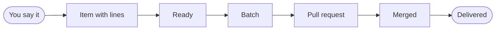

# shopsystem-bdd

A Claude Code plugin for building software from what you say you want.

You talk with Claude about what you want. The plugin keeps it as requirement lines: plain English, but a small,
strict kind that tools parse and check, so a line that could mean two things is refused before anyone builds it.
It turns each group of lines into a Gherkin scenario, and those scenarios are your acceptance tests. Ready work is
built in batches, and each batch ends in one reviewed pull request for you to merge.

This page is for everyone. It shows what the plugin does, how to install it, and where to read next.

## Thirty seconds of it

Here is a line from this repository's own spec (`spec/capabilities/items.md`, group g14):

```requirement
While the status of an item is `idea`, when the person shapes the item, the backlog service shall set the status of the item to `shaped`.
```

And here is the scenario the plugin wrote from it, in `features/items.feature`:

```gherkin
  @g14 @r14
  Scenario: An idea shaped becomes shaped
    Given an item i1
    And the status of the item i1 is `idea`
    When the person shapes the item i1
    Then the backlog service sets the status of the item i1 to `shaped`
```

"The person shapes the item" is a request: the person asks the backlog service for its operation `shape`. The line
says nothing of the command that asks it (`work shape`), which belongs to the CLI adapter, so the same line would hold
behind any other interface. It says "the status of an item" because `idea` is a noun: the vocabulary names each
value an adjective or a noun (`- **idea** (noun) → value item.status idea.` in `spec/vocabulary/tracking.md`), and an
adjective may also be said the short way, "an item is `shaped`", a noun only the full way. The scenario always names
the attribute, so whoever binds its steps never has to look it up.

What happened in between:

- `spec parse` read the line to exactly one meaning, built from the words of the context's vocabulary, each naming
  an element of its [domain model](docs/reference/domain-model.md).
- `spec logic` checked it against every other line, looking for two lines that clash.
- `features generate` wrote the scenario from that meaning: the While clause became Givens, the when clause a
  When (the request), the shall clause a Then (the response). Nobody wrote the feature file by hand.
- A developer bound the steps once in pytest-bdd, and the scenario now runs in the suite.

## What a context keeps

A bounded context (one repository's part of a product) keeps its specification in `spec/`, in four parts, and the
contract of each of its interfaces beside them:

| part | where | what it holds |
|---|---|---|
| the domain model | `spec/model/<area>.md` | the structure, no rules: objects with their attributes, lifecycles and relations; services with their operations, each operation's parameters, kinds of outcome and refusal reasons; events and actors |
| the vocabulary | `spec/vocabulary/<area>.md` | the words a line may use, each naming one element of the model: `shape` names the operation `backlog.shape` |
| the requirements | `spec/capabilities/<name>.md`, `spec/universal.md` | the business rules, one line each: what a service does when an operation is requested of it |
| the decisions | `spec/decisions/<nnnn>-<slug>.md` | the design choices, each with how it is held to: by a test, by a requirement line, or by a reviewer's judgement |
| the adapter contracts | `spec/adapters/` | beside the four: for each operation, how one interface requests it (the CLI's command and options) and how each outcome shows |

**Services and operations.** A line speaks of a service and the operations an actor requests of it: "the person
shapes the item" is a request of the backlog service's `shape`. Every operation answers with one response (its
outcome, `done`, `returned`, `refused`, `passed` or `failed`, with its content, errors and notices), whatever the
interface.

**Adapters and their contracts.** The CLI is one adapter; an HTTP service in front of the same model would be
another. Each adapter contract maps the operations to its interface and, under each operation, lists the requirement
lines that govern it, its refusals among them, so the business rules sit where the interface is used. `spec annotate`
writes those lists from the spec, and `spec check` fails a contract that has fallen behind the lines, or that names
a command or an option the program does not have.

**The plugin's own language.** The grammar every context's lines are parsed in is the plugin's, no part of a
context. Its construct catalogue (`grammar/constructs.md`) and rule catalogue (`grammar/rules.md`) are part of this
repository's specification: each entry says what its construct or rule is for and the items that brought and changed
it, and its example is its test.

**Records are kept, never cited.** An analysis, a design or a plan is kept under `.shop/records/` for good, and no
live part of the system stands on one: an item cites the person's quoted words, a request or a decision. A record
a choice must rest on is restated as a decision.

[Concepts](docs/concepts.md) has each of these with an example.

## How work moves



You say what you want. Claude shapes it into an item of the backlog and writes its requirement lines. When the
lines pass the readiness bar (they parse, they clash with nothing, their scenarios can be written), the item is
ready. Claude builds ready items together in a batch, and the batch ends in one pull request, reviewed once. You
merge it, and its items are delivered.

## Install

In an empty folder for your project, start Claude Code and type these two commands into it:

```text
/plugin marketplace add dstengle/shopsystem-bdd
/plugin install shopsystem-bdd@shopsystem-bdd
```

Restart the session, then tell it, in plain words:

```text
Set up this repository for the plugin.
```

The session installs the grammar tools, founds the context (`spec/`, `.shop/`, `features/`) and commits it. Then say
what you want built ("I want a command-line notes tool ...") and the session takes it from there. You don't run the
plugin's tools yourself: they are scripts inside the plugin, not commands on your `PATH`, and the session runs them.
[Getting started](docs/getting-started.md) walks through each thing to say and what you see.

You need:

- Linux x86_64, where the session can download the grammar tools (elsewhere, point `$SHOPSYSTEM_GF` at your own
  GF 3.12);
- Python 3; the session puts pytest 9.1.1 and pytest-bdd 8.1.0 in your project's virtualenv (with pytest-bdd 9 an
  `unbuilt:` id's scenario is no longer marked an expected failure);
- git, and `gh` logged in, for a batch's pull request and a request's issue;
- Claude Code.

## Where next

| if you want to | read |
|---|---|
| set up a repository by talking with Claude and see a first scenario go green | [Getting started](docs/getting-started.md) |
| follow one feature from an idea to a merged batch | [The tour](docs/tour.md) |
| know what to say to Claude, and what you will be asked | [Talking with Claude](docs/talking-with-claude.md) |
| write and review requirement lines | [Writing requirements](docs/writing-requirements.md) |
| know the four parts of a spec, adapters, catalogues and records | [Concepts](docs/concepts.md) |
| map the operations to an interface and keep each operation's lines beside it | [Adapter contracts](docs/reference/adapters.md) |
| look up a command the session runs | [Commands](docs/reference/commands.md) |
| move a repository from an older release to this one | [Upgrading](docs/upgrading.md) |

Every page is listed in [the docs' home](docs/index.md). For the largest worked example there is, read this
repository's own spec, starting at [`spec/index.md`](spec/index.md): the plugin is built with itself.

## Skills

Claude picks these up from what you say. You never have to name one.

| skill | what it does |
|---|---|
| `shaping-items` | Sets up a repository with no spec yet, and turns what you want built here into an item with requirement lines, and readies it. |
| `building-a-batch` | Builds the ready items in a batch and takes it to one reviewed pull request. |
| `taking-in-a-request` | Answers a request another context asked of this one, from offer to accepted item. |
| `raising-a-request` | Asks an upstream context for behaviour you need, in that context's own words. |
| `analyzing-a-batch` | Measures a closed batch: what it cost, how long it took, and what to change. |

## Agents

| agent | what it does |
|---|---|
| `pr-reviewer` | Reviews a batch's pull request once, and replies with graded findings; it changes nothing. |
| `architecture-reviewer` | Reviews the shape of the code, only when you ask for it; it changes nothing. |
| `trial-runner` | Runs one trial of a plugin command on a target and records what it measured. |

## More

- [CHANGELOG.md](CHANGELOG.md): what changed in each release, newest first.
- [LICENSE](LICENSE): Apache License 2.0.
- [docs/index.md](docs/index.md): every page of the documentation, by reader.
- [spec/index.md](spec/index.md): this plugin's own bounded context, its areas and capabilities; its model is in
  [spec/model/](spec/model/), its words in [spec/vocabulary/](spec/vocabulary/).
