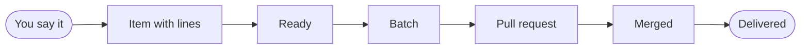

# shopsystem-bdd

A Claude Code plugin for building software from what you say you want.

You talk with Claude about what you want. The plugin keeps it as requirement lines: plain English, but a small,
strict kind that tools parse and check, so a line that could mean two things is refused before anyone builds it.
It turns each group of lines into a Gherkin scenario, and those scenarios are your acceptance tests. Ready work is
built in batches, and each batch ends in one reviewed pull request for you to merge.

This page is for everyone. It shows what the plugin does, how to install it, and where to read next.

## Thirty seconds of it

Here is a line from this repository's own spec (`spec/capabilities/backlog.md`, group g37):

```requirement
While the status of an item is `idea`, when the person runs `work shape` on the item, `work` shall set the status of the item to `shaped`.
```

And here is the scenario the plugin wrote from it, in `features/backlog.feature`:

```gherkin
  @g37 @r37
  Scenario: `work shape` shapes an idea
    Given an item i1
    And the status of the item i1 is `idea`
    When the person runs `work shape` on the item i1
    Then `work` sets the status of the item i1 to `shaped`
```

The line says "the status of an item" because `idea` is a noun. The glossary declares each attribute's values
adjectives or nouns (the `status` entry of `spec/index.md` lists `shaped`, `ready` and the others under `Values
(adjective):`, and `idea` and `needs-input` under `Values (noun):`): an adjective may also be said the short way, "an
item is `shaped`", and a noun only the full way. The scenario always names the attribute, so whoever binds its steps
never has to look it up.

What happened in between:

- `model parse` read the line to exactly one meaning, built from the words in the context's glossary.
- `model logic` checked it against every other line, looking for two lines that clash.
- `features generate` wrote the scenario from that meaning: the While clause became Givens, the when clause a
  When, the shall clause a Then. Nobody wrote the feature file by hand.
- A developer bound the steps once in pytest-bdd, and the scenario now runs in the suite.

## How work moves



You say what you want. Claude shapes it into an item of the backlog and writes its requirement lines. When the
lines pass the readiness bar (they parse, they clash with nothing, their scenarios can be written), the item is
ready. Claude builds ready items together in a batch, and the batch ends in one pull request, reviewed once. You
merge it, and its items are delivered.

## Install

In Claude Code's shell:

```console
$ claude plugin marketplace add dstengle/shopsystem-bdd
$ claude plugin install shopsystem-bdd@shopsystem-bdd
```

Then install the grammar tools once, from the installed plugin's directory:

```console
$ python3 ~/.claude/plugins/cache/shopsystem-bdd/shopsystem-bdd/4.1.0/scripts/tools install
$ python3 ~/.claude/plugins/cache/shopsystem-bdd/shopsystem-bdd/4.1.0/scripts/tools probe
```

`tools probe` shows what is installed. The rest of the docs write commands short, as `tools install` or
`work backlog`; [getting started](docs/getting-started.md) shows how to run them that way.

You need:

- Linux x86_64 for `tools install` (elsewhere, point `$SHOPSYSTEM_GF` at your own GF 3.12);
- Python 3, with pytest and pytest-bdd (pytest-xdist is optional, to run the suite in parallel);
- git, and `gh` logged in, for a batch's pull request and a request's issue;
- Claude Code.

## Where next

| if you want to | read |
|---|---|
| set up a repository and see a first scenario go green | [Getting started](docs/getting-started.md) |
| follow one feature from an idea to a merged batch | [The tour](docs/tour.md) |
| know what to say to Claude, and what you will be asked | [Talking with Claude](docs/talking-with-claude.md) |
| write and review requirement lines | [Writing requirements](docs/writing-requirements.md) |
| look up a command | [Commands](docs/reference/commands.md) |
| move a repository from 3.x to 4.0 | [Upgrading](docs/upgrading.md) |

Every page is listed in [the docs' home](docs/index.md). For the largest worked example there is, read this
repository's own spec, starting at [`spec/index.md`](spec/index.md): the plugin is built with itself.

## Skills

Claude picks these up from what you say. You never have to name one.

| skill | what it does |
|---|---|
| `shaping-items` | Turns what you want built here into an item with requirement lines, and readies it. |
| `building-a-batch` | Builds the ready items in a batch and takes it to one reviewed pull request. |
| `taking-in-a-request` | Answers a request another context asked of this one, from offer to accepted item. |
| `raising-a-request` | Asks an upstream context for behaviour you need, in that context's own words. |
| `analyzing-a-batch` | Measures a closed batch: what it cost, how long it took, and what to change. |

## Agents

| agent | what it does |
|---|---|
| `pr-reviewer` | Reviews a batch's pull request once, and replies with graded findings; it changes nothing. |
| `architecture-reviewer` | Reviews the shape of the code, only when you ask for it; it changes nothing. |
| `trial-runner` | Runs one trial of a plugin command on a target and records what it measured. |

## More

- [CHANGELOG.md](CHANGELOG.md): what changed in each release, newest first.
- [LICENSE](LICENSE): Apache License 2.0.
- [docs/index.md](docs/index.md): every page of the documentation, by reader.
- [spec/index.md](spec/index.md): this plugin's own bounded context, its glossary and capabilities.
