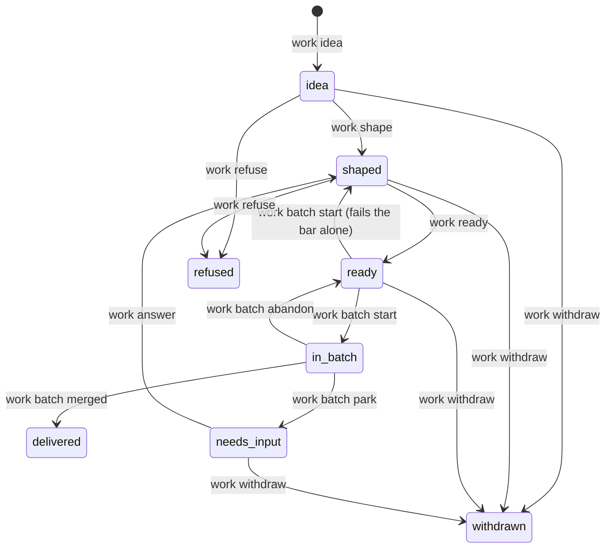
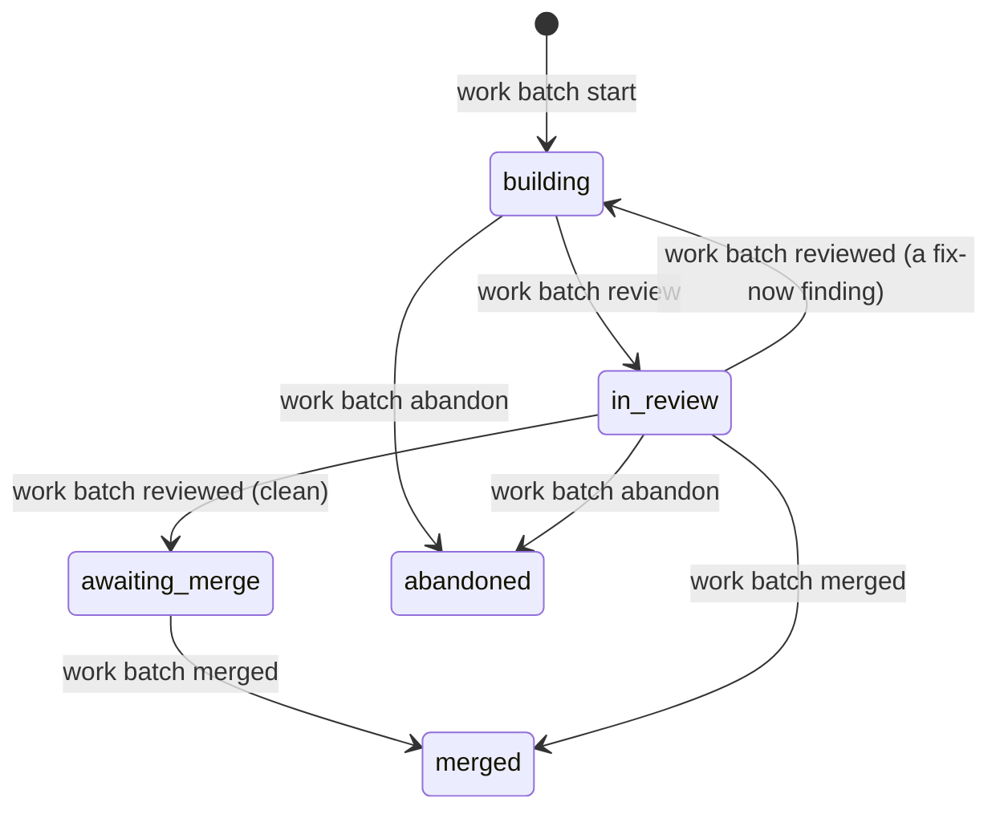

<!--
Examples on this page are files of this repository at plugin 4.0.0 (commit 7f60e57de, 2026-11-10), quoted as they
are, with cuts marked `...`. The outputs of `work ready`, `work request` and `model lexicon` on the example context
were pasted from one run that day, in a throwaway copy of docs/examples/notes-cli/ with the stand-in gh
(tests/scripts/stub_gh.py) as $SHOPSYSTEM_WORK_GH.
-->

# Concepts

This page is for every reader, and it's the one to come back to. It names the words of the workflow, one section
each, in an order where each builds on the last. Every section says the same five things:

- **what it is**, in one sentence;
- **where it lives**, as a path;
- **what writes it**, as `model forms` names it;
- **an example**, always a real file or a real run;
- **where to read more**.

If you want the machinery behind a word, [How it works](how-it-works.md) has it. If you want to see the words in
motion first, take [the tour](tour.md).

**On this page:** [bounded context](#bounded-context) · [glossary and packs](#glossary-and-packs) ·
[capability](#capability) · [requirement line](#requirement-line) · [group](#group) · [given block](#given-block) ·
[universal condition](#universal-condition) · [scenario and feature file](#scenario-and-feature-file) ·
[item](#item) · [backlog](#backlog) · [readiness bar](#readiness-bar) · [batch](#batch) ·
[pull request review and finding](#pull-request-review-and-finding) · [request](#request) · [record](#record) ·
[decision](#decision) · [quote](#quote) · [measurement and defect](#measurement-and-defect)

## The spec

### Bounded context

A bounded context is one repository's spec: the words it uses and the behaviour it promises.

- **Lives in:** `spec/index.md`, with everything under `spec/`.
- **Written by:** hand, for now (`model forms` says "plugin item b13 (no command yet)").

Its frontmatter names it, says which language its lines are written in, and which packs of words it imports. This
repository's own:

```yaml
---
id: bounded-context/missingmass.io/shopsystem/shopsystem-bdd
title: shopsystem-bdd
language: codified-2
imports: [cli, spec]
---
```

Below that sit a Purpose, Constraints, the Glossary, Relations and Upstreams (the contexts it asks for things).
Read more: [the capability file reference](reference/capability-file.md#specindexmd-the-bounded-context).

### Glossary and packs

The glossary is the list of words a context's lines may use; a pack is a ready-made set of words you import.

- **Lives in:** `spec/index.md`, `## Glossary`; a capability's own words under its `## Terms`. Packs are in the
  plugin's `grammar/packs/` (`cli`, `spec`, `time`).
- **Written by:** hand for the glossary; `work line --term` for a capability's term; `work line --relation` for a
  relation row.

Each entry says its part of speech, so the plugin knows how the word may be used:

```markdown
- **item** (noun): one file of the backlog, `.shop/backlog/b<n>.md`: work this bounded context may do, ... Kind of: file.
- **status** (attribute of item): Values: `idea`, `shaped`, `ready`, `in-batch`, `delivered`, `needs-input`, `refused`, `withdrawn`.
- **merge** (verb, action): the person merges a pull request into its base branch on GitHub. Forms: merges, merged. Frame: the person merges pull request.
```

`model lexicon` prints every word a context has, and where each came from. Here's the small example context of
[getting started](getting-started.md), which imports the `cli` pack:

```console
$ model --root docs/examples/notes-cli lexicon
actor (2)
  the person
  `notes`
kind (10)
  tool  [pack cli]
  command  [pack cli]
  ...
  note
  title
  tag
  file
event (9)
  run  [pack cli]
  print  [pack cli]
  ...
  add
  delete
```

Read more: [Writing requirements](writing-requirements.md), and the packs themselves in
[`grammar/packs/`](../grammar/packs/cli.md).

### Capability

A capability is one area of behaviour, kept as one file of requirement lines.

- **Lives in:** `spec/capabilities/<name>.md`.
- **Written by:** hand to start one (`model forms`: "plugin item b13 (no command yet)"); its lines arrive by
  `work batch start`.

The frontmatter of [`spec/capabilities/backlog.md`](../spec/capabilities/backlog.md):

```yaml
---
id: capability/missingmass.io/shopsystem/shopsystem-bdd/backlog
title: Backlog
narrator: a person or session keeping the backlog
group: service
language: codified-2
rests_on: [design-decision/missingmass.io/shopsystem/shopsystem-bdd/the-workflow-simplified]
retired: [g1, r1, g2, r2, ...]
unbuilt: []
---
```

Two lists matter. `retired:` holds ids that are gone and never used again. `unbuilt:` holds ids whose lines are in
the spec but whose code isn't written yet; their scenarios run as expected failures.
Read more: [A capability file, section by section](reference/capability-file.md#a-capability-file-section-by-section).

### Requirement line

A requirement line is one sentence that says what the software does. It is plain English, but a small, strict
kind: the plugin parses every line, and a line that could mean two things is refused before anyone builds it.

```reading
While the status of an item is `idea`, when the person runs `work shape` on the item, `work` shall set the status of the item to `shaped`.
shall [x2: agent the person (constant), x3: command `work shape` (parameter), x4: tool `work` (constant)]
  while [x1: item]
    status(x1) = `idea`
  when
    run(e1, subject: x2, object: x3, on: x1)
  response
    initiates(e2, subject: x4, status(x1) = `shaped`)
```

Read it in three parts. **While** is the state the item is in. **When** is what someone does. **Shall** is what
`work` must do in answer. The indented block under it is what `model parse --form` prints: the line's meaning, the
part the checks and the generator read.

- **Lives in:** a capability's `## Behaviour`, as `- [r<n>] <line>`; before that, in an item's `## Requirements`.
- **Written by:** `work line` into an item; `work batch start` moves it into `spec/`. You never edit a line in
  place: a changed line gets a new id, and `work line --retires <capability>#r<n>` retires the old one.

This line is `backlog#r37`. Try one yourself with `model parse "<line>"`.
Read more: [Writing requirements](writing-requirements.md) and the language reference,
[`grammar/language.md`](../grammar/language.md).

### Group

A group is one or more lines that together make one scenario, under a title a person can read.

- **Lives in:** a capability's `## Behaviour`, as a `### [g<n>] <title>` heading.
- **Written by:** `work line --group "<title>"` opens one in an item; `--in g<n>` adds a line to it.

```markdown
### [g37] `work shape` shapes an idea
- [r37] While the status of an item is `idea`, when the person runs `work shape` on the item, `work` shall set the status of the item to `shaped`.
```

Most groups hold one line. The title is what you'll see as the scenario's name.
Read more: [Behaviour: groups of lines](reference/capability-file.md#behaviour-groups-of-lines).

### Given block

A given block is a group's example data: the sample values its scenario starts from, kept out of the line itself.

- **Lives in:** under its group, in a fenced `given` block.
- **Written by:** `work line --given g<n> "<block>"`.

From [`spec/capabilities/batch-measurement.md`](../spec/capabilities/batch-measurement.md), group g24:

````markdown
### [g24] `measure show` prints the stage rows of a measurement whose stage row has no round trip without a round trip
- [r24] When the person runs `measure show` on a measurement that has a stage row that has no round trip, `measure` shall print every stage row of the measurement and not print a round trip.

```given
the measurement `m2` holds:
  {"stages": [{"work-item": "cart-1", "stage": "research", "agent": "researcher", "session": "s-1", "turns": 14}], "work_items": [], "totals": {"stages": 1, "sessions": 1, "turns": 14}}
```
````

The line says what's true of *any* such measurement; the block gives the scenario one to test.
Read more: [A given block](reference/capability-file.md#a-given-block-example-data-for-a-group).

### Universal condition

A universal condition is a line that is true everywhere, so no capability needs to say it again.

- **Lives in:** `spec/universal.md`, as `- [U<n>] <line>`.
- **Written by:** `work line --universal`.

```requirement
If a tool refuses a command, then the tool shall exit with an error naming a reason and change nothing.
```

That's U12. Because it holds for every tool, a line elsewhere says "`work` shall refuse the command and name the
status of the item" and stops there: U12 supplies the rest. `model logic` adds every universal condition to each
check it runs. Read more: [`spec/universal.md`: true everywhere](reference/capability-file.md#specuniversalmd-true-everywhere).

### Scenario and feature file

A scenario is a group turned into Gherkin; a feature file holds a capability's scenarios.

- **Lives in:** `features/<capability>.feature`, one scenario a group, tagged with its group and line ids.
- **Written by:** `features generate`. The first line of the file says "do not edit", and it means it.

Here's g37 from above, as [`features/backlog.feature`](../features/backlog.feature) has it:

```gherkin
@g37 @r37
Scenario: `work shape` shapes an idea
  Given an item i1
  And the status of the item i1 is `idea`
  When the person runs `work shape` on the item i1
  Then `work` sets the status of the item i1 to `shaped`
```

The scenario is the acceptance test. A developer binds its steps with pytest-bdd; when the test passes, the line
is built. Read more: [The generated feature](reference/capability-file.md#the-generated-feature-beside-its-lines)
and [Getting started](getting-started.md).

## The work

### Item

An item is one piece of work this context may do, from a raw idea to its delivery.

- **Lives in:** `.shop/backlog/b<n>.md`, named `b<n>` and its title.
- **Written by:** `work idea`; its lines by `work line`.

A delivered one, [`b55`](../.shop/backlog/b55.md), abridged:

```markdown
---
id: item/missingmass.io/shopsystem/shopsystem-bdd/b55
kind: item
status: delivered
provenance: own
value: high-value
urgency: high-urgency
size: small
depends_on: []
---

# A batch runs in one fresh agent, not in the main session

## Notes

Batches 3 to 6 were each orchestrated by one long main session ...

## Requirements

### batches

#### [g14] `work batch start` writes the batch brief for a fresh agent
- [r14] When the person runs `work batch start`, `work` shall write a batch brief and print the batch brief.
```

An item moves through eight states. Each arrow is labelled with the command that makes the move:



In words: an idea is **shaped** once it has a purpose and lines, **ready** once it passes the readiness bar, and
**in-batch** once a batch picks it. A merged batch makes it **delivered**. A batch that can't finish it without an
answer **parks** it as `needs-input`; `work answer` sends it back to `shaped`. (Mermaid can't draw hyphens in state
names, so the diagram writes `in_batch` and `needs_input`.)
Read more: [the commands for items](reference/commands.md#items).

### Backlog

The backlog is every item of a context, printed in rank order with what blocks each one.

- **Lives in:** `.shop/backlog/`, nothing more: it's the items themselves.
- **Written by:** the item commands; `work rate` sets the three ratings, `work depend` a dependency.

The score is (value + urgency) / size, counting low or small as 1, medium as 2 and high or large as 3. So a
high-value, medium-urgency, small item scores (3 + 2) / 1 = 5.00. Within each state, higher scores rank first.
An item that depends on one that isn't `delivered` says so in the last column:

```console
$ work backlog
...
## shaped (29)

| rank | item | title | provenance | value | urgency | size | score | waiting on |
|---|---|---|---|---|---|---|---|---|
| 1 | b65 | An item with no notes is groomed before it is shaped | own | high-value | medium-urgency | small | 5.00 | - |
...
| 15 | b44 | Commands for the file forms b41 left written by hand | own | medium-value | medium-urgency | medium | 2.00 | - |
...
## withdrawn (41)
...
| 9 | b151 | This repository's glossary in 4.0 (plan) | own | high-value | high-urgency | medium | 3.00 | blocked by b145 "One refusal path (plan)" (withdrawn) |
```

Read more: [`work backlog`](reference/commands.md#work-backlog) and [`work depend`](reference/commands.md#work-depend).

### Readiness bar

The readiness bar is the check an item must pass before it can be built.

- **Lives in:** nowhere; it runs when you call `work ready`, on a temporary copy of `spec/` with the item's lines
  laid in.
- **Checks:** every line parses; `model logic` finds no clash with the rest of the spec; `features generate` writes
  each group's scenario with no unworded step; every request line behind the item is settled.

Here it catches a new line that contradicts one already in the example context (`notes#r4` says `notes remove`
deletes the note):

```console
$ work ready b2
work: work ready: b2 "notes remove keeps the note" is not passing:
  L1 notes#r4 and #r5 clash: on "the person runs `notes remove` on a note", r4 obliges and r5 forbids `notes` to delete a note
```

Nothing is committed and the item stays `shaped`. Readying is the decision to build, so Claude doesn't ask you to
approve lines: the bar is the check. Read more:
[The readiness bar, on a copy of `spec/`](how-it-works.md#the-readiness-bar-on-a-copy-of-spec) and
[`work ready`](reference/commands.md#work-ready).

### Batch

A batch is a set of ready items built together on one branch and closed by one pull request (a little like a
sprint, but it ends when the work merges, not on a date).

- **Lives in:** `.shop/batches/<n>/plan.md`, the batch plan; its branch is `batch-<n>`.
- **Written by:** `work batch start`.

[`.shop/batches/32/plan.md`](../.shop/batches/32/plan.md):

```markdown
---
id: batch/missingmass.io/shopsystem/shopsystem-bdd/batch-32
kind: batch
status: merged
base: main
forked_from: a588eb7c558e0b5e8409f3a65a669ae39510748c
branch: batch-32
pull_request: https://github.com/dstengle/shopsystem-bdd/pull/46
---

# batch-32

## Tasks

| task | item | status | branch |
|---|---|---|---|
| t1 | b197 | done | batch-32-b197 |
```

Three words come with a batch:

- A **task** is one item's share of the batch, built on its own branch `batch-<n>-b<j>`.
- A **worktree** is the separate checkout a task is built in, `.shop/worktrees/batch-<n>-t<k>`, so tasks never
  step on each other.
- The **driver** is the one fresh agent that runs the whole batch. `work batch start` writes its brief to
  `.shop/worktrees/batch-<n>-driver/brief.md` (never committed); item b55 above is the line that asks for it.

A batch's states, with the fix loop on the left:



`work batch review` merges the tasks into `batch-<n>`, runs the tests, pushes and opens a draft pull request. If
the review finds something to fix now, the batch goes back to `building`: `work batch resume` gives each finding's
task its worktree back, the fix commits cite the finding, and `work batch review` runs again. A clean review leaves
it `awaiting-merge`, and the merge is yours.
Read more: [A batch: one branch, a worktree per task](how-it-works.md#a-batch-one-branch-a-worktree-per-task) and
[`work batch start`](reference/commands.md#work-batch-start).

### Pull request review and finding

A pull request review is one reading of a whole batch's change against its lines and the repository's rules; a
finding is one thing it found.

- **Lives in:** `.shop/batches/<n>/review-<k>.md`, also posted as a comment on the pull request.
- **Written by:** `work batch reviewed`, from the findings the `pr-reviewer` agent replied with.

Each finding has a **grade** (`Critical`, `Important`, `Minor`) and a **triage** (`fix now`, `observation`,
`drop`). From [`.shop/batches/32/review-1.md`](../.shop/batches/32/review-1.md):

```markdown
---
id: review/missingmass.io/shopsystem/shopsystem-bdd/batch-32/review-1
kind: review
batch: batch-32
pull_request: https://github.com/dstengle/shopsystem-bdd/pull/46
head: 376776586cb544f87a19bcc5486e7d17b4be8fbe
range: a588eb7c558e0b5e8409f3a65a669ae39510748c..376776586cb544f87a19bcc5486e7d17b4be8fbe
result: clean
---
...
### f2 Minor observation: an "at most" count in a condition is read as no condition
- item: b197
- where: scripts/spec_lf_quant.py:497
`count` returns without emitting anything when the count admits no K, ...
```

A `fix now` finding keeps the batch `building` until a commit on its item's branch says `Finding: f<m>` and a
later review calls it fixed. There's one review per batch, at the pull request, not one per task.
Read more: [One review, at the pull request](how-it-works.md#one-review-at-the-pull-request).

## Between contexts

### Request

A request is how work enters a context from outside: another context, the product, or the context itself asks
for something, in its own words, and the two sides settle lines.

- **Lives in:** `.shop/requests/q<n>.md` in each side's repository, and as one GitHub issue on the upstream's
  repository.
- **Written by:** `work request`; every later step by its own command, each posted as a comment on the issue.

A request just raised, from a run in a copy of the example context:

```console
$ work request --from bounded-context/example.org/notes/notes-cli --source observation/tag-filter --ask "Let notes list print only the notes under one tag" "notes list filtered by tag"
q1 https://github.com/ex/notes-cli/issues/1
```

```yaml
---
id: request/example.org/notes/notes-cli/q1
kind: request
asker: bounded-context/example.org/notes/notes-cli
upstream: bounded-context/example.org/notes/notes-cli
issue: https://github.com/ex/notes-cli/issues/1
source: [observation/tag-filter]
status: open
turn: upstream
---
```

The **turn** says whose move it is. The conversation, all on one issue:

```mermaid
sequenceDiagram
  participant A as Asker
  participant I as GitHub issue
  participant U as Upstream
  A->>I: work request (the ask, in its own words)
  U->>I: work offer (capabilities and glossary that may serve it)
  alt something here already serves it
    A->>I: work fits (delivered; issue closed)
  else new lines are needed
    A->>I: work propose (lines in the upstream's words)
    U->>I: work outcome, per line; work turn
    Note over U: the person decides
    U->>I: work accept (a shaped item)
    U->>I: work resolve, after the batch merges (issue closed)
  end
```

Lines are parsed in the **upstream's** grammar, because the upstream is the one that will build them. Only the
person accepts a request. Read more: [Requests: a GitHub issue with a fenced block](how-it-works.md#requests-a-github-issue-with-a-fenced-block)
and [the request commands](reference/commands.md#requests).

## What is kept

### Record

A record is a dated report kept for good: an analysis, a design, a plan, a measurement. It is never edited.

- **Lives in:** `.shop/records/<date>-<slug>.md`, with a row in `.shop/records/README.md`.
- **Written by:** `work record`. A design's or a plan's folder, `.shop/records/<date>-<topic>/`, is written by hand.

The row of the design this page was written from:

```markdown
| `2026-11-10-user-docs/design.md` | b170 and b247: the user documentation for plugin 4.0: its four readers, the voice, the pages under `docs/` ... | design |
```

Read more: [`work record`](reference/commands.md#work-record).

### Decision

A decision is one design choice, with why it was made and how it is held to.

- **Lives in:** `spec/decisions/<nnnn>-<slug>.md`, with an index in `spec/decisions/index.md`.
- **Written by:** `work decision`; the index by `model decisions`.

Its **tier** says how the decision is kept:

| tier | held by |
|---|---|
| `check` | the tests in `enforced_by`, which `model decisions --check` runs |
| `requirement` | the requirement lines in `enforced_by` |
| `judgement` | a reviewer's reading: the batch brief hands every `judgement` decision to the `pr-reviewer` |

[`spec/decisions/0076-python-files-stay-at-300-lines.md`](../spec/decisions/0076-python-files-stay-at-300-lines.md):

```yaml
---
id: design-decision/missingmass.io/shopsystem/shopsystem-bdd/python-files-stay-at-300-lines
summary: "Every tracked Python file stays at 300 lines or fewer, and the suite fails on one over it."
date: 2026-11-05
status: accepted
tier: check
enforced_by: [tests/scripts/test_decision_checks.py::test_every_tracked_python_file_is_300_lines_or_fewer]
source: [record/missingmass.io/shopsystem/shopsystem-bdd/2026-11-04-workflow-simplification-design]
by: "workflow simplification plan 6"
---
```

Read more: [A decision file](reference/capability-file.md#a-decision-file).

### Quote

A quote is your words, kept exactly as you wrote them, with the messages around them, so an item can cite what you
actually said.

- **Lives in:** `.shop/quotes/<n>.md`, named `quote-<n>`.
- **Written by:** `work quote`. A hook remembers your session, so Claude only passes the words.

The quote this documentation began from, [`.shop/quotes/20.md`](../.shop/quotes/20.md):

```markdown
---
id: quote/missingmass.io/shopsystem/shopsystem-bdd/quote-20
kind: quote
session: 72e23fa5-6dee-49f3-a1d1-7e79096a0501
message: 574cd8b3-06ad-40de-badf-fbe44d2faa93
date: 2026-11-10
---

# quote-20

> Once 4.0 is done, take a new backlog item to make some nice user documentation for the plugin and then get to work on the backlog item. I trust you to make some delightful docs.

## Messages
...
```

`work show quote-20` prints it back. Read more: [Why your words are kept](talking-with-claude.md#why-your-words-are-kept).

### Measurement and defect

A measurement is what a merged batch cost, in time and tokens; a defect is a fault found after a batch merged,
pinned to the item that delivered it.

- **Live in:** `.shop/records/measurements/<date>-<batch>.md`; `.shop/batches/<n>/defect-<k>.md`.
- **Written by:** `measure batch`; `measure defect`.

From [the measurement of batch-32](../.shop/records/measurements/2026-11-10-batch-32.md):

```text
totals
total             | value
------------------+----------------------
wall time         | 18 minutes 41 seconds
session time      | 20 minutes 6 seconds
waiting for merge | 31 seconds
output tokens     | 90778
...
cost              | 8.45
```

And [a defect of batch-15](../.shop/batches/15/defect-1.md), against item b84:

```markdown
---
id: defect/missingmass.io/shopsystem/shopsystem-bdd/batch-15/d1
kind: defect
batch: batch-15
item: b84
date: 2026-11-07
---

# batch-15 d1

features generate writes no scenario for a negated response with a recipient ('`feed` shall not return the video to the caller'), ...
```

`measure show` prints a measurement, and `measure compare` sets two side by side.
Read more: [the measure commands](reference/commands.md#measure-what-a-batch-cost).

## Next

- [Writing requirements](writing-requirements.md): the controlled language, for writers.
- [How it works](how-it-works.md): the machinery under these words.
- [Commands](reference/commands.md): every command and its options.
