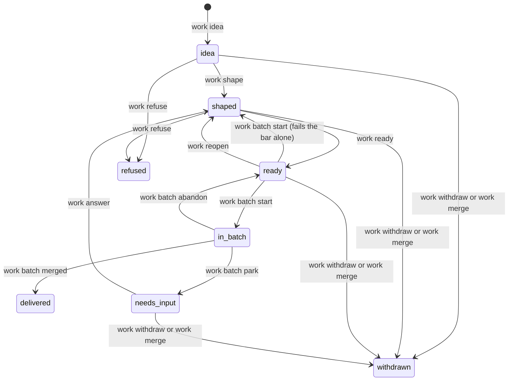
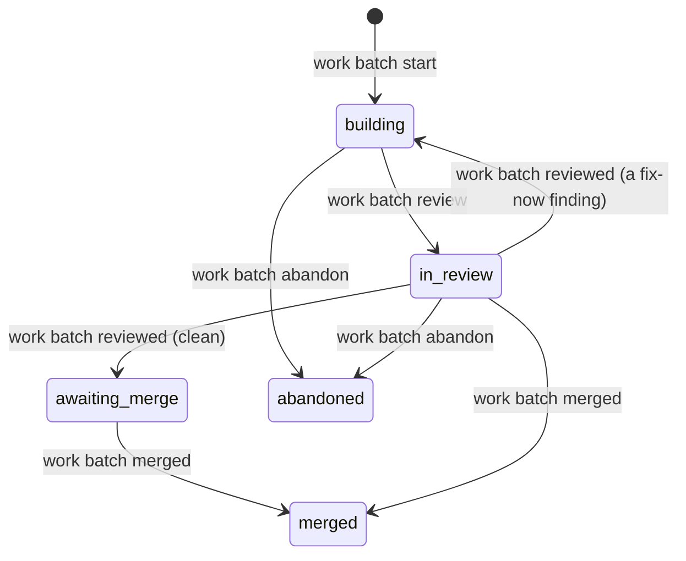

<!--
Examples on this page are files of this repository at plugin 0.33.0 (commit 7f60e57de, 2026-11-10), quoted as they
are, with cuts marked `...`. The outputs of `shop work ready`, `shop work request` and `shop spec lexicon` on the
example context were pasted from one run that day, in a throwaway copy of docs/examples/notes-cli/ with the stand-in gh
(tests/scripts/stub_gh.py) as $SHOPSYSTEM_WORK_GH.
-->

# Concepts

This page is for every reader, and it's the one to come back to. It names the words of the workflow, one section
each, in an order where each builds on the last. Every section says the same five things:

- **what it is**, in one sentence;
- **where it lives**, as a path;
- **what writes it**, as `shop spec forms` names it;
- **an example**, always a real file or a real run;
- **where to read more**.

If you want the machinery behind a word, [How it works](how-it-works.md) has it. If you want to see the words in
motion first, take [the tour of the internals](internals-tour.md).

**On this page:** [product, job and trace](#product-job-and-trace) · [bounded context](#bounded-context) ·
[domain model](#domain-model) · [service and operation](#service-and-operation) ·
[vocabulary and packs](#vocabulary-and-packs) · [adapter contract](#adapter-contract) · [capability](#capability) ·
[requirement line](#requirement-line) · [construct catalogue and rule catalogue](#construct-catalogue-and-rule-catalogue) ·
[group](#group) · [given block](#given-block) · [universal condition](#universal-condition) ·
[scenario and feature file](#scenario-and-feature-file) · [item](#item) · [backlog](#backlog) ·
[readiness bar](#readiness-bar) · [batch](#batch) · [pull request review and finding](#pull-request-review-and-finding) ·
[request](#request) · [record](#record) · [decision](#decision) · [quote](#quote) ·
[measurement and defect](#measurement-and-defect)

## The product

The product comes first: everything else on this page is kept to do its jobs, [the spec](#the-spec) of each bounded
context and [the work](#the-work) that builds it.

### Product, job and trace

A product is what a shop's bounded contexts are built for: who it serves (its actors), the jobs those actors want
done, and which bounded context does each job. A requirement group says which jobs it serves, and a job's trace is
every requirement that does the job.

- **Lives in:** `.shop/product/product.toml`, the product file of the shop; a group's `serves:` line in its capability
  file.
- **Written by:** `shop spec product`, `shop spec actor`, `shop spec job`, `shop spec subdomain`, `shop spec context`,
  `shop spec assign` and `shop spec plays` the product file, one commit each, and `shop spec unassign` and
  `shop spec drop` take a declaration back; `shop work line <b> --serves <cap>#g<n> <job>` a group's job, on an item,
  which a batch applies as the group's `serves:` line. The trace is never written: `shop spec trace <job>` derives it.

A **job** has an id, its actors and a job statement of one form, `When <situation>, <actor> wants <motivation>, so
they can <outcome>.`, and may need other jobs first. A **subdomain** is a part of the product's domain (`core`,
`supporting` or `generic`) that serves jobs; a **bounded context** of the product's domain map addresses subdomains,
is named by its id in the one context id form, `bounded-context/<domain>/<path>`, and holds the jobs assigned to it.
A product actor **plays** an actor of a bounded context's model ("the writer" is "the person" in the notes example).
The notes example keeps its product (its product file, and each group's job in its capability), so its trace runs as
it is:

<!-- docs: context docs/examples/notes-cli -->
```console
$ shop spec --root docs/examples/notes-cli trace keep-notes
the trace of the job keep-notes:
  notes#r1 (served by notes#g1): When the person adds a note with a title and a tag, the notes service shall keep the note under the tag.
  notes#r2 (served by notes#g2): If the person adds a note without a title, then the notes service shall refuse the request and name the title.
```

A job's groups are dedicated to it on an item; until a batch applies the item, `shop spec trace <job> --item b<n>` reads
the trace with the item's pairs applied, as `shop spec check --item b<n>` checks it. The trace follows the requests its lines make to
the lines they reach, the adapter specs that realise its port lines and the jobs it needs, and says the job's
coordination when it requests a driven port's operations. `shop spec check` warns of a job no group serves, a
capability that serves no job and a product actor that triggers no line of its job's trace.
Read more: [the product commands](reference/commands.md#shop-spec-product),
[the `serves:` line](reference/capability-file.md#behaviour-groups-of-lines) and
[Talking with Claude](talking-with-claude.md#your-product-and-its-jobs), which walks the conversation.

## The spec

A context's specification has four parts, and each part has one job:

| part | lives in | its job |
|---|---|---|
| domain model | `spec/model/` | the structure: what there is, and what can be asked of it |
| vocabulary | `spec/vocabulary/` | the words: each names one element of the model |
| requirements | `spec/capabilities/`, `spec/universal.md` | the rules: what a service does when asked, one checked line each |
| decisions | `spec/decisions/` | the choices: why it is built so, and how each choice is held to |

The adapter contracts (`spec/adapters/`) sit beside the four: they say how one interface asks for the operations,
never what an operation does. The grammar the lines are parsed in is the plugin's, the same in every context, and no
part of one (the decision "The specification has four parts", `spec/decisions/0107-the-specification-has-four-parts.md`).

### Bounded context

A bounded context is one repository's spec: its domain model, the words it uses, the behaviour it promises and the
decisions behind it.

- **Lives in:** `spec/index.md`, with everything under `spec/`.
- **Written by:** hand, for now (plugin item b318 gives `spec/index.md` its command).

Its frontmatter names it, says which language its lines are written in, and which packs of words it imports. This
repository's own:

```yaml
---
id: bounded-context/missingmass.io/shopsystem/shopsystem-bdd
title: shopsystem-bdd
language: codified-2
imports: [request, spec]
---
```

Below that sit a Purpose, Constraints, the Composition (its areas and their capabilities) and Upstreams (the
contexts it asks for things).
Read more: [the capability file reference](reference/capability-file.md#specindexmd-the-bounded-context).

### Domain model

The domain model is the shape of a context, with no rules in it: the objects, their attributes and lifecycles, the
relations between them, the services with the operations an actor may request, the events and the actors.

- **Lives in:** `spec/model/<area>.md`, one file per area of the context, in a ` ```model ` block.
- **Written by:** `shop work line --model` and `shop work line --relation`, on an item, applied to `spec/model/` by a
  batch.

From this repository's [`spec/model/tracking.md`](../spec/model/tracking.md):

```model
service backlog
  operation shape(item, note)  outcomes: done | refused: item not an idea, no note
  operation show(item)  outcomes: returned → the item
```

Every rule about these (what `shape` does, when it refuses) is a requirement line; `shop spec check` holds each line to
what the model declares, and the model to its lines (an operation with no line, a refusal reason no line states).
Read more: [The domain model](reference/domain-model.md).

### Service and operation

A service is what answers requests in one area; an operation is one thing an actor may ask of it, with its
parameters and the kinds of outcome it has.

- **Lives in:** the domain model, as `service <name>` and its `operation <name>(<parameters>)` lines.
- **Written by:** `shop work line --model`, on an item.

`operation shape(item, note)  outcomes: done | refused: item not an idea, no note` says that `shape` takes an item
and a note, and either completes or refuses the request for one of two reasons. Every operation answers with the
same response, whatever the interface: its outcome (`done`, `returned`, `refused`, `passed` or `failed`), its
content, the errors that name the business references a refusal is about (`parameter:note`, `item:b12`), and
notices. A requirement line says which outcome comes when; `shop spec check` fails a refusal reason no line states, and
an operation no line requests.
Read more: [The response](reference/adapters.md#the-response).

### Vocabulary and packs

The vocabulary is the list of words a context's lines may use, each naming one element of the model; a pack is a
ready-made set of words you import.

- **Lives in:** `spec/vocabulary/<area>.md` and `shared.md`. Packs are in the plugin's `grammar/packs/` (`base`,
  `request`, `spec`, `time`, and `cli`, deprecated since 0.38.0 for `request`).
- **Written by:** `shop work line --term`, on an item, applied to `spec/vocabulary/` by a batch.

Each entry says its part of speech and, after the arrow, the element it names:

```markdown
- **item** (noun) → object item. One file of the backlog: work this bounded context may do.
- **shaped** (adjective) → value item.status shaped.
- **shape** (verb, action) → operation backlog.shape. Forms: shapes, shaped. Frame: <actor> shapes <item>.
```

A verb that names an operation is how a line says a request: "the person shapes the item" asks the backlog service
for `shape`. Every context imports the `request` pack, the words of a request and its response: *request*,
*service*, *refuse*, *name*, *return*, *keep*, *complete*. A context `shop migrate init` founds imports the `base`
pack too, `imports: [base, request]` in `spec/index.md`: the kinds most contexts name and none owns, *text*, *file*,
*version*, *repository* and *bounded context*. An older context adopts it with `shop work line <item> --import base`.
A word of your own spelled as one of them collides with the pack's: here a notes context whose model has an
`object text`,

```console
$ shop spec lexicon --check
v_t16  text  spec/vocabulary/notes-cli.md: the pack base defines text too; mark the entry Redefines: base
10 terms, 1 problems
```

and with `Redefines: base.` on the entry it passes, `shop spec lexicon` listing it as `text  [redefines base]`.
`shop spec lexicon` prints every word a context has, and
where each came from. Here's the small example context of [getting started](getting-started.md):

```console
$ shop spec --root docs/examples/notes-cli lexicon
actor (2)
  the notes service
  the person
kind (9)
  request  [pack request]
  ...
  note
  tag
...
event (13)
  refuse  [pack request]
  ...
  add
  list
  remove
```

Read more: [Writing requirements](writing-requirements.md), [the vocabulary](reference/domain-model.md#specvocabularymd-and-sharedmd),
and the packs themselves in [`grammar/packs/`](../grammar/packs/request.md).

### Adapter contract

An adapter contract maps the domain's operations to one interface: for the CLI, each operation's command and each
parameter's option, and how each outcome shows (exit 0, exit 1 with the reasons on stderr, the response envelope
under `--json`).

- **Lives in:** `spec/adapters/<port>.toml`; this repository's is [`spec/adapters/cli.toml`](../spec/adapters/cli.toml).
- **Written by:** hand, for the mapping (a plugin item gives it its commands); `shop spec annotate` for each operation's
  `requirements`.

No requirement line names a command, an option or an exit code; `shop spec check` holds the contract and the programs'
argparse to each other. Each operation's table also lists, generated, the requirement lines that **govern** it (a
line governs an operation when its trigger requests it), its refusals among them, so whoever works on the command
reads its business rules where they use it:

```toml
[operations."notes.add"]
command = "notes add"
requirements = [
  "notes#r1: When the person adds a note with a title and a tag, the notes service shall keep the note under the tag.",
  "notes#r2: If the person adds a note without a title, then the notes service shall refuse the request and name the title.",
]
```

`shop spec annotate` writes those lists; `shop spec check` fails an operation that misses a line that governs it
(`v_a5`) or holds one that no longer does (`v_a6`), so they never fall behind the spec. Read more:
[Adapter contracts](reference/adapters.md).

### Capability

A capability is one area of behaviour, kept as one file of requirement lines.

- **Lives in:** `spec/capabilities/<name>.md`.
- **Written by:** `shop work line --capability` on an item to start one, and `shop work batch start`, which writes the
  file and its lines.

The frontmatter of [`spec/capabilities/items.md`](../spec/capabilities/items.md):

```yaml
---
id: capability/missingmass.io/shopsystem/shopsystem-bdd/items
title: Items
narrator: the person
group: service
area: tracking
specifies: object item, service backlog, the readiness policy
language: codified-2
retired: []
unbuilt: []
---
```

`area:` is the area of the model its lines are read in, and `specifies:` what it is about. Two lists matter.
`retired:` holds ids that are gone and never used again. `unbuilt:` holds ids whose lines are in
the spec but whose code isn't written yet; their scenarios run as expected failures.
Read more: [A capability file, section by section](reference/capability-file.md#a-capability-file-section-by-section).

### Requirement line

A requirement line is one sentence that says what the software does. It is plain English, but a small, strict
kind: the plugin parses every line, and a line that could mean two things is refused before anyone builds it.

```reading
While the status of an item is `idea`, when the person shapes the item, the backlog service shall set the status of the item to `shaped`.
shall [x2: agent the person (constant), x3: service the backlog service (constant)]
  while [x1: item]
    status(x1) = `idea`
  when
    request(e1, backlog.shape, subject: x2, object: x1)
  response
    initiates(e2, subject: x3, status(x1) = `shaped`)
```

Read it in three parts. **While** is the state the item is in. **When** is the request someone makes. **Shall** is
what the service must do in answer. The indented block under it is what `shop spec parse --form` prints: the line's
meaning, the part the checks and the generator read.

- **Lives in:** a capability's `## Behaviour`, as `- [r<n>] <line>`; before that, in an item's `## Requirements`.
- **Written by:** `shop work line` into an item; `shop work batch start` moves it into `spec/`. You never edit a line in
  place: a changed line gets a new id, and `shop work line --retires <capability>#r<n>` retires the old one.

This line is `items#r14`. Try one yourself with `shop spec parse "<line>"`.
Read more: [Writing requirements](writing-requirements.md) and the language reference,
[`grammar/language.md`](../grammar/language.md).

### Construct catalogue and rule catalogue

The construct catalogue lists every construct of the language a line may use; the rule catalogue lists every rule
`shop spec check` holds a context to. Both are part of the plugin's own specification: its requirements say only the
language and checking services' general behaviour (a line parsed to one meaning or refused naming why; a violation of
an error rule fails the check naming the rule), and each catalogue entry, with its example, says one construct or
rule.

- **Live in:** the plugin's [`grammar/constructs.md`](../grammar/constructs.md) and
  [`grammar/rules.md`](../grammar/rules.md).
- **Written by:** `shop spec constructs --write` and `shop spec rules --write`, from the grammar's definition; `shop
  work batch start` writes them again when a batch's lines cite one of their codes.

Each entry gives its code, a label, a short purpose (what the construct or rule is for), `Since:`, the item that
brought it (or, for an entry older than the backlog, the release that first held it, `0.38.0`), and `Changed:`, the
items that changed it since, then its example: a construct's example is
parsed to one tree that uses it and read back word for word, a rule's fact sets are one it fails on and one it passes
on. The example is the entry's test. A line that uses a construct the construct catalogue has no entry of is refused
naming the construct, so the language a context writes in is exactly the catalogue's; `shop spec check` fails a line
that names a rule the rule catalogue has no entry of (`v_c1`), and an entry with no purpose (`v_c2`), naming neither
an item nor a release (`v_c3`), or naming an item not delivered (`v_c4`). A line names a construct or a
rule by its code, as in "a requirement that uses `order-by`".
Read more: [The catalogues](reference/design-model.md#the-catalogues-are-specification).

### Group

A group is one or more lines that together make one scenario, under a title a person can read.

- **Lives in:** a capability's `## Behaviour`, as a `### [g<n>] <title>` heading.
- **Written by:** `shop work line --group "<title>"` opens one in an item; `--in g<n>` adds a line to it.

```markdown
### [g14] An idea shaped becomes shaped
- [r14] While the status of an item is `idea`, when the person shapes the item, the backlog service shall set the status of the item to `shaped`.
```

Most groups hold one line. The title is what you'll see as the scenario's name.
Read more: [Behaviour: groups of lines](reference/capability-file.md#behaviour-groups-of-lines).

### Given block

A given block is a group's example data: the sample values its scenario starts from, kept out of the line itself.

- **Lives in:** under its group, in a fenced `given` block.
- **Written by:** `shop work line --given g<n> "<block>"`.

From [`spec/capabilities/measurement.md`](../spec/capabilities/measurement.md), group g6:

````markdown
### [g6] A measurement viewed gives no round trip of a stage row that has none
Restates: batch-measurement#r56@0.29.
- [r6] When the person views a measurement that has a stage row that has no round trip, the measurement service shall return every stage row of the measurement and not return a round trip.

```given
the measurement `m2` holds:
  {"stages": [{"work-item": "cart-1", "stage": "research", "agent": "researcher", "session": "s-1", "turns": 14}], "work_items": [], "totals": {"stages": 1, "sessions": 1, "turns": 14}}
```
````

The line says what's true of *any* such measurement; the block gives the scenario one to test.
Read more: [A given block](reference/capability-file.md#a-given-block-example-data-for-a-group).

### Universal condition

A universal condition is a line that is true everywhere, so no capability needs to say it again.

- **Lives in:** `spec/universal.md`, as `- [U<n>] <line>`.
- **Written by:** `shop work line --universal`.

```requirement
If a service refuses a request, then the service shall name a reason and change nothing.
```

That's U17. Because it holds for every service, a line elsewhere says "the backlog service shall refuse the request
and name the item" and stops there: U17 supplies the rest. `shop spec logic` adds every universal condition to each
check it runs. Read more: [`spec/universal.md`: true everywhere](reference/capability-file.md#specuniversalmd-true-everywhere).

### Scenario and feature file

A scenario is a group turned into Gherkin; a feature file holds a capability's scenarios.

- **Lives in:** `features/<capability>.feature`, one scenario a group, tagged with its group and line ids.
- **Written by:** `shop features generate`. The first line of the file says "do not edit", and it means it.

Here's g14 from above, as [`features/items.feature`](../features/items.feature) has it:

```gherkin
@g14 @r14
Scenario: An idea shaped becomes shaped
  Given an item i1
  And the status of the item i1 is `idea`
  When the person shapes the item i1
  Then the backlog service sets the status of the item i1 to `shaped`
```

The scenario is the acceptance test. A developer binds its steps with pytest-bdd; when the test passes, the line
is built. Read more: [The generated feature](reference/capability-file.md#the-generated-feature-beside-its-lines)
and [Getting started](getting-started.md).

## The work

### Item

An item is one piece of work this context may do, from a raw idea to its delivery.

- **Lives in:** `.shop/backlog/b<n>.md`, named `b<n>` and its title.
- **Written by:** `shop work idea`; its lines by `shop work line`.

A delivered one, [`b55`](../.shop/backlog/b55.md), abridged:

```markdown
---
id: item/missingmass.io/shopsystem/shopsystem-bdd/b55
kind: item
status: delivered
provenance: own
value: high-value
urgency: high-urgency
size: small
depends_on: []
---

# A batch runs in one fresh agent, not in the main session

## Notes

Batches 3 to 6 were each orchestrated by one long main session ...

## Requirements

### batches

#### [g14] `work batch start` writes the batch brief for a fresh agent
- [r14] When the person opens a batch, the batches service shall keep a batch brief and return the batch brief.
```

An item moves through eight states. Each arrow is labelled with the command that makes the move:



In words: an idea is **shaped** once it has a purpose and lines, **ready** once it passes the readiness bar, and
**in-batch** once a batch picks it. A merged batch makes it **delivered**. A batch that can't finish it without an
answer **parks** it as `needs-input`; `shop work answer` sends it back to `shaped`. (Mermaid can't draw hyphens in state
names, so the diagram writes `in_batch` and `needs_input`.)
Read more: [the commands for items](reference/commands.md#items).

### Backlog

The backlog is every item of a context, printed in rank order with what blocks each one.

- **Lives in:** `.shop/backlog/`, nothing more: it's the items themselves.
- **Written by:** the item commands; `shop work rate` sets the three ratings, `shop work depend` a dependency.

The score is (value + urgency) / size, counting low or small as 1, medium as 2 and high or large as 3. So a
high-value, medium-urgency, small item scores (3 + 2) / 1 = 5.00. Within each state, higher scores rank first.
An item that depends on one that isn't `delivered` says so in the last column:

```console
$ shop work backlog
...
## shaped (29)

| rank | item | title | provenance | value | urgency | size | score | waiting on |
|---|---|---|---|---|---|---|---|---|
| 1 | b65 | An item with no notes is groomed before it is shaped | own | high-value | medium-urgency | small | 5.00 | - |
...
| 15 | b44 | Commands for the file forms b41 left written by hand | own | medium-value | medium-urgency | medium | 2.00 | - |
...
## withdrawn (41)
...
| 9 | b151 | This repository's glossary in 4.0 (plan) | own | high-value | high-urgency | medium | 3.00 | blocked by b145 "One refusal path (plan)" (withdrawn) |
```

Read more: [`shop work backlog`](reference/commands.md#shop-work-backlog) and [`shop work
depend`](reference/commands.md#shop-work-depend).

### Readiness bar

The readiness bar is the check an item must pass before it can be built.

- **Lives in:** nowhere; it runs when you call `shop work ready`, on a temporary copy of `spec/` with the item's lines
  applied to it.
- **Checks:** every line parses; `shop spec logic` finds no clash with the rest of the spec; `shop features generate`
  writes each group's scenario with no unworded step; every request line behind the item is settled.

Here it catches a new line that contradicts one already in the example context (`notes#r4` says `notes remove`
deletes the note):

```console
$ shop work ready b2
work ready: b2 "notes remove keeps the note" is not passing:
  L1 notes#r4 and #r5 clash: on "the person runs `notes remove` on a note", r4 obliges and r5 forbids `notes` to delete a note
```

Nothing is committed and the item stays `shaped`. Readying is the decision to build, so Claude doesn't ask you to
approve lines: the bar is the check. Read more:
[The readiness bar, on a copy of `spec/`](how-it-works.md#the-readiness-bar-on-a-copy-of-spec) and
[`shop work ready`](reference/commands.md#shop-work-ready).

### Batch

A batch is a set of ready items built together on one branch and closed by one pull request (a little like a
sprint, but it ends when the work merges, not on a date).

- **Lives in:** `.shop/batches/<n>/plan.md`, the batch plan; its branch is `batch-<n>`.
- **Written by:** `shop work batch start`.

[`.shop/batches/32/plan.md`](../.shop/batches/32/plan.md):

```markdown
---
id: batch/missingmass.io/shopsystem/shopsystem-bdd/batch-32
kind: batch
status: merged
base: main
forked_from: a588eb7c558e0b5e8409f3a65a669ae39510748c
branch: batch-32
pull_request: https://github.com/dstengle/shopsystem-bdd/pull/46
---

# batch-32

## Tasks

| task | item | status | branch |
|---|---|---|---|
| t1 | b197 | done | batch-32-b197 |
```

Three words come with a batch:

- A **task** is one item's share of the batch, built on its own branch `batch-<n>-b<j>`.
- A **worktree** is the separate checkout a task is built in, `.shop/worktrees/batch-<n>-t<k>`, so tasks never
  step on each other.
- The **driver** is the one fresh agent that runs the whole batch. `shop work batch start` writes its brief to
  `.shop/worktrees/batch-<n>-driver/brief.md` (never committed); item b55 above is the line that asks for it.

A batch's states, with the fix loop on the left:



`shop work batch review` merges the tasks into `batch-<n>`, runs the tests, pushes and opens a draft pull request. If
the review finds something to fix now, the batch goes back to `building`: `shop work batch resume` gives each finding's
task its worktree back, the fix commits cite the finding, and `shop work batch review` runs again. A clean review leaves
it `awaiting-merge`, and the merge is yours.
Read more: [A batch: one branch, a worktree per task](how-it-works.md#a-batch-one-branch-a-worktree-per-task) and
[`shop work batch start`](reference/commands.md#shop-work-batch-start).

### Pull request review and finding

A pull request review is one reading of a whole batch's change against its lines and the repository's rules; a
finding is one thing it found.

- **Lives in:** `.shop/batches/<n>/review-<k>.md`, also posted as a comment on the pull request.
- **Written by:** `shop work batch reviewed`, from the findings the `pr-reviewer` agent replied with.

Each finding has a **grade** (`Critical`, `Important`, `Minor`) and a **triage** (`fix now`, `observation`,
`drop`). From [`.shop/batches/32/review-1.md`](../.shop/batches/32/review-1.md):

```markdown
---
id: review/missingmass.io/shopsystem/shopsystem-bdd/batch-32/review-1
kind: review
batch: batch-32
pull_request: https://github.com/dstengle/shopsystem-bdd/pull/46
head: 376776586cb544f87a19bcc5486e7d17b4be8fbe
range: a588eb7c558e0b5e8409f3a65a669ae39510748c..376776586cb544f87a19bcc5486e7d17b4be8fbe
result: clean
---
...
### f2 Minor observation: an "at most" count in a condition is read as no condition
- item: b197
- where: scripts/spec_lf_quant.py:497
`count` returns without emitting anything when the count admits no K, ...
```

A `fix now` finding keeps the batch `building` until a commit on its item's branch says `Finding: f<m>` and a
later review calls it fixed. There's one review per batch, at the pull request, not one per task.
Read more: [One review, at the pull request](how-it-works.md#one-review-at-the-pull-request).

## Between contexts

### Request

A request is how work enters a context from outside: another context, the product, or the context itself asks
for something, in its own words, and the two sides settle lines.

- **Lives in:** `.shop/requests/q<n>.md` in each side's repository, and as one GitHub issue on the upstream's
  repository.
- **Written by:** `shop work request`; every later step by its own command, each posted as a comment on the issue.

A request just raised, from a run in a copy of the example context:

```console
$ shop work request --from bounded-context/example.org/notes/notes-cli --source observation/tag-filter --ask "Let notes list print only the notes under one tag" "notes list filtered by tag"
q1 https://github.com/ex/notes-cli/issues/1
```

```yaml
---
id: request/example.org/notes/notes-cli/q1
kind: request
asker: bounded-context/example.org/notes/notes-cli
upstream: bounded-context/example.org/notes/notes-cli
issue: https://github.com/ex/notes-cli/issues/1
source: [observation/tag-filter]
status: open
turn: upstream
---
```

The **turn** says whose move it is. The conversation, all on one issue:

```mermaid
sequenceDiagram
  participant A as Asker
  participant I as GitHub issue
  participant U as Upstream
  A->>I: work request (the ask, in its own words)
  U->>I: work offer (capabilities and words that may serve it)
  alt something here already serves it
    A->>I: work fits (delivered; issue closed)
  else new lines are needed
    A->>I: work propose (lines in the upstream's words)
    U->>I: work outcome, per line; work turn
    Note over U: the person decides
    U->>I: work accept (a shaped item)
    U->>I: work resolve, after the batch merges (issue closed)
  end
```

Lines are parsed in the **upstream's** grammar, because the upstream is the one that will build them. Only the
person accepts a request. Read more: [Requests: a GitHub issue with a fenced block](how-it-works.md#requests-a-github-issue-with-a-fenced-block)
and [the request commands](reference/commands.md#requests).

## What is kept

### Record

A record is a dated report kept for good: an analysis, a design, a plan, a measurement. It is never edited, and
nothing of the live system stands on it.

- **Lives in:** `.shop/records/<date>-<slug>.md`, with a row in `.shop/records/README.md`.
- **Written by:** `shop work record`. A design's or a plan's folder, `.shop/records/<date>-<topic>/`, is written by
  hand.

The row of the design this page was written from:

```markdown
| `2026-11-10-user-docs/design.md` | b170 and b247: the user documentation for plugin 4.0: its four readers, the voice, the pages under `docs/` ... | design |
```

The records policy: a record is kept and indexed, never cited. An item's provenance (its `source:`) cites the
person's quoted words, a request or a decision, never a record; `shop spec check` fails a new item that cites one
(`v_r1`) and notes an older one (`w_r1`). When a choice must rest on what a record concluded, the conclusion is
restated as a decision, and the item cites the decision.
Read more: [`shop work record`](reference/commands.md#shop-work-record), and the decision "Records are kept, never
cited" (`spec/decisions/0106-records-are-kept-never-cited.md`).

### Decision

A decision is one design choice, with why it was made and how it is held to.

- **Lives in:** `spec/decisions/<nnnn>-<slug>.md`, with an index in `spec/decisions/index.md`.
- **Written by:** `shop work decision`; the index by `shop spec decisions`.

Its **tier** says how the decision is kept:

| tier | held by |
|---|---|
| `check` | the tests in `enforced_by`, which `shop spec decisions --check` runs |
| `requirement` | the requirement lines in `enforced_by` |
| `judgement` | a reviewer's reading: the batch brief hands every `judgement` decision to the `pr-reviewer` |

[`spec/decisions/0076-python-files-stay-at-300-lines.md`](../spec/decisions/0076-python-files-stay-at-300-lines.md):

```yaml
---
id: design-decision/missingmass.io/shopsystem/shopsystem-bdd/python-files-stay-at-300-lines
summary: "Every tracked Python file stays at 300 lines or fewer, and the suite fails on one over it."
date: 2026-11-05
status: accepted
tier: check
enforced_by: [tests/scripts/test_decision_checks.py::test_every_tracked_python_file_is_300_lines_or_fewer]
source: [record/missingmass.io/shopsystem/shopsystem-bdd/2026-11-04-workflow-simplification-design]
by: "workflow simplification plan 6"
---
```

Read more: [A decision file](reference/capability-file.md#a-decision-file).

### Quote

A quote is your words, kept exactly as you wrote them, with the messages around them, so an item can cite what you
actually said.

- **Lives in:** `.shop/quotes/<n>.md`, named `quote-<n>`.
- **Written by:** `shop work quote`. A hook remembers your session, so Claude only passes the words.

The quote this documentation began from, [`.shop/quotes/20.md`](../.shop/quotes/20.md):

```markdown
---
id: quote/missingmass.io/shopsystem/shopsystem-bdd/quote-20
kind: quote
session: 72e23fa5-6dee-49f3-a1d1-7e79096a0501
message: 574cd8b3-06ad-40de-badf-fbe44d2faa93
date: 2026-11-10
---

# quote-20

> Once 4.0 is done, take a new backlog item to make some nice user documentation for the plugin and then get to work on the backlog item. I trust you to make some delightful docs.

## Messages
...
```

`shop work show quote-20` prints it back. Read more: [Why your words are
kept](talking-with-claude.md#why-your-words-are-kept).

### Measurement and defect

A measurement is what a merged batch cost, in time and tokens; a defect is a fault found after a batch merged,
pinned to the item that delivered it.

- **Live in:** `.shop/records/measurements/<date>-<batch>.md`; `.shop/batches/<n>/defect-<k>.md`.
- **Written by:** `shop measure batch`; `shop measure defect`.

From [the measurement of batch-32](../.shop/records/measurements/2026-11-10-batch-32.md):

```text
totals
total             | value
------------------+----------------------
wall time         | 18 minutes 41 seconds
session time      | 20 minutes 6 seconds
waiting for merge | 31 seconds
output tokens     | 90778
...
cost              | 8.45
```

And [a defect of batch-15](../.shop/batches/15/defect-1.md), against item b84:

```markdown
---
id: defect/missingmass.io/shopsystem/shopsystem-bdd/batch-15/d1
kind: defect
batch: batch-15
item: b84
date: 2026-11-07
---

# batch-15 d1

features generate writes no scenario for a negated response with a recipient ('`feed` shall not return the video to the caller'), ...
```

`shop measure show` prints a measurement, and `shop measure compare` sets two side by side.
Read more: [the measure commands](reference/commands.md#shop-measure-what-a-batch-cost).

## Next

- [Writing requirements](writing-requirements.md): the controlled language, for writers.
- [How it works](how-it-works.md): the machinery under these words.
- [Commands](reference/commands.md): every command and its options.
