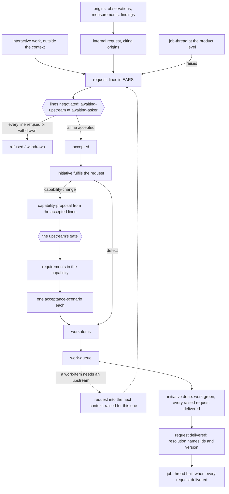
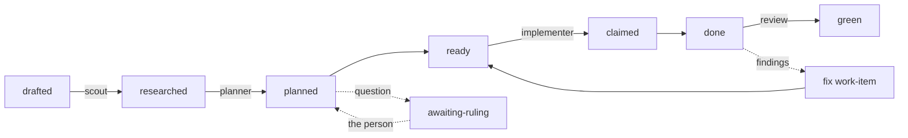

# Design state and the initiatives that change it

Version 4, 2026-10-24. Supersedes version 3 (2026-10-15). The worked
example is `ecommerce-example.md`; the formal grammar is `grammar.md`;
the September method it rests on is `spec-method.md`. What changed from
version 3, and why, is the last section of `how-we-got-here.md`.

## 1. The model in one paragraph

A product is described by **standing artifacts**: the design as it is,
rewritten in place, read to learn the system. Work enters a
bounded-context only as a **request**. Each request is fulfilled by one
**initiative** of that context, realised by a tree of **parts** that
leads back to it. A part never leaves its context; the request is the
only thing that crosses a seam. So the work is a chain of per-context
trees: a job-thread at the product level raises requests into contexts,
and a context's work-items may raise requests into the next. **Records**
are dated and never edited: **origins** (observation, measurement,
review-finding) are what was noticed and may be cited by a request or an
initiative; **history** (decision-argument, initiative-archive) is read
only to trace why. Three levels: product → bounded-contexts →
capabilities. Everything else is a typed edge. Scripts hold state and
invariants; language models do the judgment steps; work is pulled, not
dispatched; every exchange with a person is a **question** on a node and
its answer.

## 2. Standing artifacts

### Product level

| artifact | holds | form |
|---|---|---|
| **product-vision** | who it's for, what it's becoming, what it won't be; orders the jobs | prose, one page |
| **job** | narrator, outcome, situation | *when [situation], [narrator] wants [outcome]* |
| **context-map** | the bounded-contexts and the context-seams between them | composition table + one seam artifact each |
| **bounded-context** | one language, one spec, one contract with a version others pin, one owner; or *external*: a contract and an owner who isn't us | `spec/` (none for external) |
| **context-seam** | pattern, surface, pin, demand direction, forbidden, seam design-decisions, seam rules (EARS) | seam artifact |

**Narrators are product-level actors.** A narrator is a role from a job,
never a bounded-context, and it is shared across a seam: a request's
lines keep the narrator of the job they come from. Terms are not shared:
each bounded-context owns its glossary, which is part of its contract.

### Bounded-context level

| artifact | holds | form |
|---|---|---|
| **context-index** | purpose; constraints carried (cited, not re-argued); composition; testing; glossary | `spec/index.md` |
| **capability** | one narrator; group (model, service, operations, guarantees); Purpose; Behaviour; Implementation-may-change; Not yet (each with a trigger); `rests_on`; `serves` | `spec/capabilities/<name>.md` |
| **capability-requirement** | one EARS statement in a capability's Behaviour, its response observable by the narrator. Carries a stable id, `[r<n>]`, unique within its capability and never reused (retired ids kept in the capability's ledger); referenced as `<capability>#r<n>`. Everything that points at a requirement — a scenario, a request's resolution, a proposal's change list — points by id, never by text | `- [r3] When …` |
| **acceptance-scenario** | the test of one capability-requirement, which it names by id; its title is free to change. Evidence, never demand | Gherkin, in the capability's feature file |
| **design-decision** | one file, ADR form. Frontmatter: `id`, `summary` (one sentence, required), `date`, `status`, `supersedes`, `revisit_when` (only where a signal is read), `source`. `## Decision`: standing; a paragraph or a grammar, a layout, a convention. `## Context`, `## Alternatives`, `## Consequences`: record. A surface clients observe is not a decision's body: the choice is the decision; the surface lives in the capability or the seam | `decisions/<n>-<slug>.md`; `spec/decisions.md` is a **generated** index |

**Feature files** are containers, not artifacts: one per capability, named
for it, holding that capability's acceptance-scenarios in the form the
test runner reads. The `Feature:` line restates the capability's title and
nothing else in the file carries meaning the capability does not. Step
definitions beneath are code — the real binding between a scenario and
the system — and sit outside the model.

### Edges between standing artifacts

| edge | from → to | meaning | written by |
|---|---|---|---|
| `orders` | product-vision → job | priority among jobs | hand |
| `serves` | capability → job, `using: [capabilities]` | serves that job through those dependencies | script, by each bounded-context on its own capabilities, when a request that reaches a job-thread of that job is delivered |
| `depends_on` | capability → capability, across a seam | **derived**: the union of `serves[*].using` | script |
| `has` | capability → capability-requirement → acceptance-scenario | composition | hand; formulation |
| `rests_on` | capability → design-decision | assumption | hand |
| `supersedes` | design-decision → design-decision | history | hand, in the decision file |
| `pins` | bounded-context → bounded-context, at a version | on the seam | hand |

The path of a job: from each capability that serves it in the entry
bounded-context, follow `using` into the upstream capability and read its
`serves` entry for the same job; repeat.

The upstream's standing artifacts name no client. No line is justified
by "context X needs it": demand lives in the request, and the tie between
the two is the request's `resolution`.

## 3. Requests, initiatives and parts

### The request

The one way work enters a bounded-context, and the only node that crosses
a seam, in either direction. Its **asker** is a downstream context, the
product level, or the context itself (an *internal* request). Its
**upstream** is the context asked.

| field | content |
|---|---|
| `id`, `title` | global id |
| `asker`, `upstream` | a bounded-context or the product level; the upstream's context |
| `part_of` | a job-thread, when the product level raised it |
| `raised_for` | the request the asker's initiative fulfils, when a work-item raised it |
| `source` | origins cited (observations, review-findings, measurements); required on an internal request |
| `status` | `open → awaiting-asker ⇄ awaiting-upstream → accepted → delivered`; or `refused`, `withdrawn` |
| `priority` | rank in the upstream's list, set by the upstream's owner |
| lines | the asker's proposed lines, in strict EARS |
| outcomes | the upstream's answer to each line |
| `resolution` | for each accepted line, the requirement id that holds it and the version it is in |

A request carries only the asker's context and the asker's request id.
What crosses with it is the upstream's contract (its published spec at a
pinned version) and nothing else of either side.

**Lines, negotiated.** The body is proposed lines against the upstream's
capabilities, written in the job's narrator and the upstream's published
terms. The upstream answers each line: accepted as written; rewritten
(the rewrite shown); refused (with the reason); or a question with its
readings. The asker in its turn answers questions, revises or withdraws
lines, and confirms that a rewritten line still meets its need. The
status alternates between `awaiting-asker` and `awaiting-upstream` until
every line is accepted, refused or withdrawn. Then the request is
`accepted` (where a line is accepted) and an initiative starts, or
`refused`. The asker may withdraw the whole request before it is
accepted. It is `delivered` when its initiative is done and its
`resolution` names each accepted line's requirement id and version. The
accepted lines become the upstream's capability-proposal, and the
upstream's gate judges that proposal, its own.

**Who writes what.** The asker writes the lines and its answers; the
upstream writes each line's outcome, its questions and the resolution.
Each side writes its part only through a tool, explicitly, never by
editing what the request is kept in. The tool's shape (a command, a
service, a file held by a script) is each bounded-context's own and not
part of the model.

**Internal requests.** A request whose asker is the context itself, citing
one or more origins. Same form, same protocol, same fulfilment. External
and internal requests make one ranked list a context. An observation is
open while no request or initiative cites it. A budget for internal work
is measured first (cost share by origin, over two releases), then set.

### The initiative

A bounded-context's unit of work, and the root of that context's tree.

| field | content |
|---|---|
| `id`, `title`, `summary` | global id; one sentence |
| `kind` | `capability-change` · `defect` |
| `context` | the bounded-context that owns it |
| `fulfils` | exactly one request, of this context, `accepted` |
| `status` | `proposed → started → done \| abandoned` |
| `source` | origins: those its request cites |

An initiative is never `part_of` anything. Its `kind` fixes its first
part. It is not a work-breakdown: its scope is its request's accepted
lines, and the breakdown is its work-items with `blocked_by`,
`depends_on` and their claims. It is archived and measured as one unit.

| kind | first part | then |
|---|---|---|
| `capability-change` | capability-proposal | work-items |
| `defect` | work-item | — |

`job` and `job-path` are no longer initiative kinds: they are job-threads
at the product level.

### Done-ness, through requests only

- A job-thread is `built` when every request it raised is `delivered`.
- A request is `delivered` when its initiative is `done`.
- An initiative is `done` when its own work is green and every request
  its work-items raised is `delivered`.

A context reads its own files and the status of the requests it raised,
nothing else of another context. The other context's work-items are
observability, never a dependency.

### Parts

Every part has exactly one `part_of` — another part or its root — and
never a `priority` or a `source`. `part_of` never crosses a seam: a part
is in the same context as its root. The roots are the initiative (in a
bounded-context) and the job-thread (at the product level).

| part | owner | stages | leaves standing |
|---|---|---|---|
| **job-proposal** | product | drafted → approved (the person) → merged | the job, ordered by the product-vision |
| **map-proposal**, **vision-proposal** | product | as above | a bounded-context or seam on the map; vision text |
| **capability-proposal** | a bounded-context | drafted → approved (the person, on the listed ids) → merged → formulated (every added or changed requirement has a scenario, or the capability is guarantees) | capability-requirements and design-decisions; then their acceptance-scenarios |
| **map-escalation** | whoever hit it | open → ruled | a map change, or a ruling recorded |
| **work-item** | a capability | drafted → researched → planned → ready → claimed → done → green; `awaiting-ruling` from planned | acceptance-scenarios green; code |

A capability-proposal argues one capability: `adds`, `changes`, `removes`
by requirement id; design-decisions; Implementation. A map-escalation
says why: `no-seam` · `pattern-change` · `refused-still-needed` ·
`seam-decision-revisited`.

### The job-thread

The product level's root. It has a job, enters one bounded-context,
crosses the seams its path needs, and has `priority` and `source`. A new
job's job-proposal is part of its first thread. It raises requests into
contexts (each request `part_of` it), never a capability-proposal or a
work-item. Stages: proposed → mapped (every crossing on a seam) →
accepted (the person) → built (read from its requests). It leaves the
entry scenario standing as the job's acceptance test.

### The work-item

| field | set at | content |
|---|---|---|
| id | drafted | `<capability>/<n>`; its acceptance-scenarios tagged with that id in the test runner's marker spelling |
| `part_of` | drafted | the capability-proposal (or, for a `defect`, the initiative) |
| kind | drafted | *capability* (acceptance: scenarios), *guarantee* (a check against a bound), *enabling* (a check; `for:` the work-item it enables) |
| acceptance, observable, unknown, `blocked_by`, risk | drafted | by the drafter, from the approved capability-requirements |
| why red today, file set, reuse, tests the decisions may break | researched | by the scout; probes marked run/read |
| decisions inlined, broken tests resolved, file set final, `depends_on` | planned | by the planner; a question → `awaiting-ruling` |
| `raises` | any stage | a request into an upstream, when the work needs one |
| report, suite record, commits | done | by the implementer |
| findings | green | per-item review on named risks (contract, concurrency, data); otherwise the initiative's branch review |

Order: `blocked_by` for what must precede; priority (unknown first) for
what should. The file set is the claim: a work-item is ready when no
claimed work-item's set overlaps it; a worker needing a file outside its
set claims it if free, else stops.

### The trace

From any work-item: `part_of` → capability-proposal → initiative →
`fulfils` → request → `part_of` a job-thread; or `raised_for` the
asker's request, and on from there; or, for an internal request, its
origins. Two rules make it complete: every initiative fulfils exactly one
request; every request is part of a thread or cites an origin (or is
raised for a request that is). Because a request carries only the asker's
context and request id, the trace reaches the thread without reaching
the asker's work-items.

### Three structures

| structure | holds | operated by |
|---|---|---|
| **intake** | per bounded-context: its requests, external and internal, in one ranked list; at the product level: job-threads | the context's owner ranks; an accepted request starts an initiative |
| **work-breakdown** | per initiative: its parts, with `part_of` | planning |
| **work-queue** | across a context's breakdowns: work-items by status; ready ones pulled by a fresh worker | workers; a script supervises |

The person's queue is the questions on nodes: proposals' gates,
`awaiting-ruling`, and a request's lines when the person is its asker.

## 3a. Records

Dated, append-only, never edited. Not design and not work. **Origins**
may be cited as a request's or an initiative's `source`; **history** is
read to trace why and is never a source. Every record is `about` a
standing artifact.

| record | kind | holds | read when |
|---|---|---|---|
| **observation** | origin | something noticed: a hardening finding with its repro, a measurement that looks off, a user's remark, an idea; `about`, `by`, `date` | before changing the artifact it is about; by the product role when reading the flow |
| **measurement** | origin | the facts of a run: cost, time, counts | when a `revisit_when` or a guarantee is judged |
| **review-finding** | origin | a review's verdicts on a work-item | the fix work-item; the observation log for what is not fixed now |
| **decision-argument** | history | the Context, Alternatives, Consequences of a design-decision file | when the decision is questioned or its `revisit_when` fires; never to learn what was decided |
| **initiative-archive** | history | an initiative and its parts as they closed | tracing why; never for what the system does |

An origin never changes the design. Origins have no rank; an origin
becomes work only when a request cites it. A recurring observation is the
signal for a job, a cluster about one seam the signal its pattern is
wrong.

## 4. Grammar

1. *(Retired in v4.)* `needs` is gone; demand is a request's lines.
2. `serves`, `depends_on`, `has`, `rests_on`, `supersedes`, `pins` appear only between standing artifacts.
3. An acceptance-scenario is on `has` and on a work-item's acceptance, never in a request's resolution. A scenario going red is evidence in a request's text.
4. `depends_on` is derived from `serves … using`; an edge no `using` names cannot exist.
5. `using` points across a seam the way the pin points.
6. A job-thread's crossing references a seam on the context-map; a crossing with no seam raises a map-escalation and the thread stays proposed.
7. A request between two bounded-contexts is across a seam between them; it is answered in the upstream's own spec, and the upstream names no client.
8. A work-item names a capability, directly or through `for:`.
9. Every part has exactly one `part_of`; following it reaches a root. A request has `priority` and `source`; an initiative has `source`; a part has neither.
10. Only an origin is a `source`; history never is. A record is `about` a standing artifact and never changes the design.
11. A capability has one narrator; every capability-requirement's response is observable by it.
12. Design-decisions are never edited; a later one supersedes. Specs are rewritten in place; git holds history; a commit touching a spec names its motivation.
13. A watch condition exists only where its signal is something someone reads; otherwise it is a sentence of rationale.
14. No new level, artifact kind or rule without a trigger that fired.
15. Every capability-requirement has a stable id, unique within its capability and never reused. Scenarios, resolutions and proposals reference requirements by id, never by text.
16. *(New in v4.)* Every initiative fulfils exactly one request, of its own context; a request is fulfilled by at most one initiative.
17. *(New in v4.)* Every request is part of a job-thread or cites an origin, or is raised for a request that is.
18. *(New in v4.)* `part_of` never crosses a seam. A request is part of a job-thread at most and has no parts. The only id that one context's work names in another's is a request's.
19. *(New in v4.)* An initiative is done only when its work is closed and every request it raised is delivered; a job-thread is built only when every request part of it is delivered.

## 5. Flow





## 6. Where new work comes from

Every row ends in a request to a bounded-context; what differs is who
asks and what it cites.

| situation | asker; cites | the context's initiative | work-items' acceptance |
|---|---|---|---|
| a new job | product level, a job-thread (job-proposal part of it) | `capability-change` in the entry context | scenarios |
| a new entry to a standing job | product level, a job-thread | as above | scenarios |
| NFR with a bound | internal; a measurement | `capability-change`: a requirement in a guarantees capability | a check against the bound |
| new backend, operator-visible | internal; an operator's observation | `capability-change`: requirements in the operations capability | scenarios |
| behind a port | internal; a `revisit_when`, a measurement | `capability-change` superseding the decision; Implementation rewritten | the port's conformance suite |
| reimplementation | internal; a decision revisited | `capability-change` superseding several decisions | expand, migrate, contract work-items; existing scenarios green throughout |
| `defect`, requirement exists | internal; a review-finding, an observation | `defect`: one work-item | its scenario, red then green |
| `defect`, requirement missing | as above | becomes a `capability-change` | a new scenario |
| an upstream is needed | the downstream context; raised for its own request | `capability-change` in the upstream | scenarios |
| cross-cutting (telemetry everywhere) | product level, a job-thread with the operator as narrator; a map-proposal for an observability context | one request per service context | a check per service |
| refactor from review | — | not a request: an enabling work-item `for:` the work-item it unblocks, or an observation if nothing needs it yet | a check |

**Interactive work** is work whose output is a request: identifying it,
brainstorming it, writing its lines. It happens outside the context and
ends when the request exists.

## 7. Questions the model answers

| question | read |
|---|---|
| what is this system meant to do | product-vision, jobs, context-map |
| what does it do now | every Behaviour statement on `main`; Not yet |
| why does this capability exist | its `serves` |
| what breaks if an upstream capability changes | every `serves … using` that names it |
| what does the system do for a job | the path |
| why does this requirement exist | its id → the capability-proposal that added or last changed it → initiative → `fulfils` → request → job-thread or origins |
| what is open for an initiative | its parts not closed; the requests it raised not delivered |
| what is this bounded-context being asked for | its requests, by status and whose turn it is |
| what should we start next | the context's accepted requests with no initiative, ranked |
| who must change when a seam changes | the seam's pattern and the `using` edges across it |
| is anything unneeded | `depends_on` − ∪`using` is empty by construction; a capability with no `serves` is a question |
| what is waiting on a person | the questions on nodes with no answer written |

## 8. Terms new in v4

- **request**: the one way work enters a bounded-context (§3).
- **question**: what a node asks of a role the scripts cannot stand in for, written under the node's `## Questions` with its readings. The node waits until an answer is written.
- **interactive work**: work whose output is a request (§6).
- **the round's kind**: what an `initiative-round` does (integrate, gate, apply, formulate); version 3 called it the round's "job", which clashed with the job.

## 9. Where things live

```
product/     product-vision.md  jobs/  context-map/ (bounded-contexts, context-seams)
spec/        index.md  capabilities/<name>.md  decisions.md (generated)
decisions/   <n>-<slug>.md          (Decision section standing; the rest record)
features/    <name>.feature
work/        <initiative-id>/initiative.md  <initiative-id>/<part-id>.md
             (a bounded-context holds only its own initiatives and parts)
records/     observations.md  measurements/  review-findings/  archive/
```

Requests are kept by the upstream's tool, wherever that context chooses;
each side reads and writes them only through it.

In the plugin's repositories (2026-10-19, design-decision/final-layout): decisions under `spec/decisions/`,
work and records under `.shop/`.

Files first. The corpus when a trace can no longer be assembled from them.
