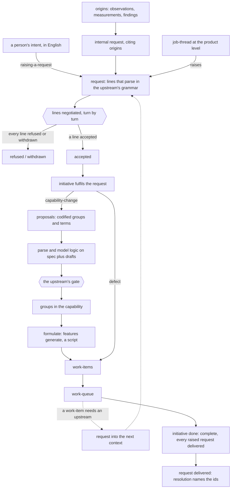
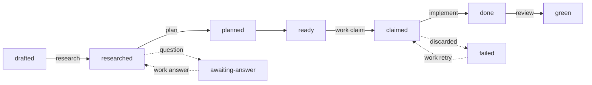

# Design state and the initiatives that change it

Version 5, 2026-11-03. Supersedes version 4 (2026-10-24). Version 5 is
version 4 fitted to the domain model (`.shop/records/2026-11-02-domain-model/`)
and to the grammar tools; it is not a rewrite. Where version 4 and the
plugin's files disagreed, the grammar tools decided. Every change from
version 4 is a row of §10, with its reason. The worked example is
`ecommerce-example.md`; the formal grammar is `grammar.md`; what changed,
and why, is told in the last sections of `how-we-got-here.md`.

## 0. Two languages

Version 5 holds two languages, and says so first:

- **the graph**: kinds, edges and rules over the facts read from the
  files' frontmatter, checked by `model check` (clingo, `scripts/model.lp`;
  `grammar.md` §1–§5);
- **the requirement language**: every requirement is a sentence that
  parses to exactly one tree in a GF grammar whose words are the
  glossary (the lexicon), and the requirements of a context are checked
  together by one clingo solve over their facts (`model logic`,
  `grammar/check.lp`; `grammar.md` §6–§7).

The two are joined by facts: `parsed(Q)`, `unparsed(Q, Why)`,
`ambiguous(Q)`, `member_of(Q, G)`, `in(G, C)`, `generates(G, S)` and
`restates(G, Old)`. The kind names are **requirement** and **scenario**:
version 4's `capability-requirement` and `acceptance-scenario` are these
two, renamed because the glossary forbids "capability requirement".

## 1. The model in one paragraph

A product is described by **standing artifacts**: the design as it is,
rewritten in place, read to learn the system. Work enters a
bounded-context only as a **request**, whose lines parse in that
context's requirement grammar. Each request is fulfilled by one
**initiative** of that context, realised by a tree of **parts** that
leads back to it. A part never leaves its context; the request is the
only thing that crosses a seam. **Records** are dated and never edited:
**origins** (observation, measurement, review-finding) may be cited by a
request or an initiative; **history** (decision-argument,
initiative-archive, design, analysis) is read only to trace why. Three
levels: product → bounded-contexts → capabilities. A capability's
behaviour is **requirements** in **requirement groups**; each group
generates one **scenario**; the **universal conditions** hold on every
trace. Scripts hold state and invariants; language models do the
judgment steps; work is pulled, not dispatched; every exchange with a
person is a **question** on a node and its answer.

## 2. Standing artifacts

### Product level

| artifact | holds | form |
|---|---|---|
| **product-vision** | who it's for, what it's becoming, what it won't be; orders the jobs | prose, one page |
| **job** | narrator, outcome, situation | *when [situation], [narrator] wants [outcome]* |
| **context-map** | the bounded-contexts and the context-seams between them | composition table + one seam artifact each |
| **bounded-context** | one language (its glossary and grammar), one spec, one contract with a version others pin, one owner; or *external*: a contract and an owner who isn't us | `spec/` (none for external) |
| **context-seam** | pattern, surface, pin, demand direction, forbidden, seam design-decisions, seam rules (codified requirements) | seam artifact |

**Narrators are product-level actors.** A narrator is a role from a job,
never a bounded-context, and it is shared across a seam: a request's
lines keep the narrator of the job they come from. Terms are not shared:
each bounded-context owns its glossary, which is its lexicon and part of
its contract.

### Bounded-context level

| artifact | holds | form |
|---|---|---|
| **context-index** | purpose; constraints carried (cited, not re-argued); composition; testing; the glossary (typed terms) | `spec/index.md`, `language: codified-1` |
| **capability** | one narrator; group (model, service, operations, guarantees); Purpose; Terms; Behaviour (requirement groups); Implementation-may-change; Not yet; Dropped; `rests_on`; `serves`; `retired` | `spec/capabilities/<name>.md`, `language: codified-1` |
| **requirement** | one statement that parses to exactly one tree in the requirement grammar, its response observable by the narrator. A stable id `[r<n>]`, unique within its capability and never reused; referenced as `<capability>#r<n>`. Everything that points at a requirement points by id, never by text. A changed requirement is retired and replaced under a new id, never edited | `- [r3] When …` |
| **requirement group** | the one statement that makes one scenario: its pre-state (Where, While), its trigger (When, If) and its responses joined by `and`. A stable id `[g<n>]` with the number of its requirement, a title (free English, the scenario's title), an optional `Restates:` line and an optional `given` block of example data only | `### [g1] <title>` |
| **universal condition** | a statement true in every state of every trace, in the requirement grammar; never restated in a requirement | `- [U1] …` in `spec/universal.md` |
| **term** | one glossary entry of one sentence, with a **category** (actor, kind, attribute, value, event, resource, condition), which is the grammar slot it fills; a relation is a row of `## Relations` | `- **term** (category): …` |
| **scenario** | **generated**: one for each requirement group that is not logic-only, its title the group's, tagged `@g<n>` and each member's `@r<n>`. Evidence, never demand | Gherkin, in the capability's feature file |
| **design-decision** | one file, ADR form. Frontmatter: `id`, `summary`, `date`, `status`, `supersedes`, `revisit_when`, `source`. `## Decision` standing; the rest record | `spec/decisions/<n>-<slug>.md`; `index.md` there is generated |

**Feature files** are generated containers: one per service capability,
named for it, written by `features generate` from the capability's
groups and never edited by hand. A guarantees capability has none: its
requirements parse and are logic-checked, and measurement or trials
check them. **Steps** are the linearisations of step functions of the
Steps grammar; step definitions beneath are code — the binding between a
step and the system — and sit outside the model.

### Edges between standing artifacts

| edge | from → to | meaning | written by |
|---|---|---|---|
| `orders` | product-vision → job | priority among jobs | hand |
| `serves` | capability → job, `using: [capabilities]` | serves that job through those dependencies | script, on delivery |
| `depends_on` | capability → capability, across a seam | **derived**: the union of `serves[*].using` | script |
| `member_of` | requirement → requirement group | exactly one group | hand |
| `in` | requirement group → capability | exactly one capability; `has_req(C, Q)` is derived | hand |
| `generates` | requirement group → scenario | exactly one scenario, unless logic-only | `features generate` |
| `restates` | requirement group → a 0.29 id | the conversion's trace; a source only, not a node | the conversion |
| `rests_on` | capability → design-decision | assumption | hand |
| `supersedes` | design-decision → design-decision | history | hand, in the decision file |
| `pins` | bounded-context → bounded-context, at a version | on the seam | hand |

The path of a job: from each capability that serves it in the entry
bounded-context, follow `using` into the upstream capability and read its
`serves` entry for the same job; repeat.

The upstream's standing artifacts name no client. No line is justified
by "context X needs it": demand lives in the request, and the tie between
the two is the request's `resolution`.

### The requirement language

A requirement is one sentence in one of the six EARS forms, the clauses
in a fixed order. The actor is a lexicon actor, and the response is
`shall` and verb phrases joined by `and`, or `shall not` and verb
phrases joined by `or` (neither); responses whose subjects differ are
joined by `, and`:

| form | shape | logic | Gherkin |
|---|---|---|---|
| ubiquitous | `Actor shall V.` | always | a property: Givens from the witness, Then |
| event-driven | `When T, Actor shall V.` | T at a step → V at the next | When T, Then V |
| state-driven | `While C, Actor shall V.` | always: C → V | Given C, Then V |
| optional feature | `Where F, Actor shall V.` | F a fact of the context → V | Given F |
| unwanted behaviour | `If T, then Actor shall V.` | as event-driven, T an unwanted input | Given or When the input, Then V |
| complex | `[Where F,] [While C,] When/If T, Actor shall V.` | the conjunction | in clause order |

What happens under one pre-state and trigger is one statement: "When a
session ends a `plan` stage for a work-item with the result, `work run`
shall set the status of the work-item to `awaiting-answer` and ask a
question on the work-item." Each verb phrase is a conjunct of the logic
and a Then of the scenario, under one id. A list response ("shall print
X and Y") is one verb phrase with a coordinated object. A value is
accepted only in its own attribute's slot: "an initiative that is
`drafted`" does not parse, because `drafted` is a value of a work-item's
status. A preposition between two kinds means the one relation the
`## Relations` table gives for that pair. A condition is defined by a
sentence of the language ("An initiative is open when the initiative is
not `done` and the initiative is not `abandoned`."), or is primitive.
The grammar, its guards and its growth rule are `grammar.md` §6.

**The logic.** Each grammar fun has one translation into ground facts
about its requirement (roles, pre-state, trigger, responses, sets), one
generic instance a noun phrase. `When T, R` is read as always (T → next
R) and `While C, R` as always (C → R), unrolled once over two states.
`model logic` is one clingo solve of `grammar/check.lp` over the pairs of
requirements and U's that share vocabulary: L1 a clash witness naming
both ids, L2 duplicates, L3 and L4 graph rules on the transitions, L5 an
untriggered event obligation. `features generate` reads each scenario
off its requirements' facts, with no solver: the pre-state gives the
Givens, the trigger the When, the responses the Thens. A `given` block
gives only example data (file contents, tables).

**Restates.** `Restates: r66@0.29, formulation#r5@0.29` lists the 0.29
ids a group replaces (frozen in `spec/restated.json`); a bare id is of the
group's own capability. Each 0.29 id is restated by a group, or listed
under the capability's `## Dropped` with its reason or `moved to <cap>`.

**Universal conditions** U1–U10 (`spec/universal.md`): at most `workers`
worker slots; a stage starts only when what it needs is free; a refusal
exits with its reason and changes nothing; every transition is committed
and pushed; a session never writes a status; a stage without a result is
discarded; a worker changes only files in its worktree; `--json` prints
one object; a delivery changes only its own initiative directories; a
stage is given its brief and no other input.

**Resources** are terms of category resource, `exclusive` or
`counted by <code>`. A stage's need for one is a requirement (`When
`work run` starts an integrate round, the round shall hold the spec
lock.`), and U2 does the rest; exclusivity is never written as "one at
a time, except".

## 3. Requests, initiatives and parts

### The request

The one way work enters a bounded-context, and the only node that crosses
a seam, in either direction. Its **asker** is a downstream context, the
product level, or the context itself (an *internal* request). Its
**upstream** is the context asked.

| field | content |
|---|---|
| `id`, `title` | global id |
| `asker`, `upstream` | a bounded-context or the product level; the upstream's context |
| `part_of` | a job-thread, when the product level raised it |
| `raised_for` | the request the asker's initiative fulfils, when a work-item raised it |
| `source` | origins cited (observations, review-findings, measurements); required on an internal request |
| `status` | `open → awaiting-asker ⇄ awaiting-upstream → accepted → delivered`; or `refused`, `withdrawn` |
| `priority` | rank in the upstream's list, set by the upstream's owner |
| lines | the asker's proposed lines, each a sentence that parses in the upstream's requirement grammar |
| outcomes | the upstream's answer to each line (its line outcome) |
| `resolution` | for each accepted line, the requirement id that holds it (ids are never reused, so no version) |

**Lines, negotiated.** The body is proposed lines against the upstream's
capabilities, written in the job's narrator and the upstream's lexicon. A
line that does not parse is refused before any session reads it, naming
the line, the token and its position, with the longest prefix that
parsed and the nearest lexicon words. The upstream answers each line:
accepted as written; rewritten (the rewrite shown); refused (with the
reason); or a question with its readings. The asker answers questions,
revises or withdraws lines, and confirms that a rewritten line still
meets its need. The turn passes between the sides until every line is
settled (accepted, refused or withdrawn). Then the request is `accepted`
(where a line is accepted) and an initiative starts, or `refused`. It is
`delivered` when its initiative is done and its `resolution` names each
accepted line's requirement id.

**Who writes what.** The asker writes the lines and its answers; the
upstream writes each line's outcome, its questions and the resolution.
Each side writes its part only through a tool (`work request`,
`work outcome`, `work reply`, `work turn`, `work resolve`).

**Internal requests.** A request whose asker is the context itself, citing
one or more origins. Same form, same protocol, same fulfilment.

### The initiative

A bounded-context's unit of work, and the root of that context's tree.

| field | content |
|---|---|
| `id`, `title`, `summary` | global id; one sentence |
| `kind` | `capability-change` · `defect` |
| `context` | the bounded-context that owns it |
| `fulfils` | exactly one request, of this context, `accepted` |
| `status` | `proposed` → `started` (`work start`) → `done` (complete) \| `abandoned` (`work abandon`) |
| `source` | origins: those its request cites |

An initiative is never `part_of` anything. It is **open** while its
status is neither `done` nor `abandoned`, and **complete** when a
work-item of it is `green`, every work-item is `green` or `withdrawn`,
every proposal is closed, and its kept branch review lists nothing to fix
now. It is archived and measured as one unit.

### Done-ness, through requests only

- A job-thread is `built` when every request it raised is `delivered`.
- A request is `delivered` when its initiative is `done`.
- An initiative is `done` when it is complete and every request its
  work-items raised is `delivered`.

### Parts

Every part has exactly one `part_of` — another part or its root — and
never a `priority` or a `source`. `part_of` never crosses a seam.

| part | owner | lifecycle | leaves standing |
|---|---|---|---|
| **job-proposal**, **map-proposal**, **vision-proposal** | product | drafted → approved (the person) → merged | the job; a bounded-context or seam; vision text |
| **capability-proposal** (a proposal) | a bounded-context | `drafted` ⇄ `awaiting-answer` → `approved` (the person) → `formulated` (its groups' scenarios generated and committed); `withdrawn` from any open status | requirements, groups and design-decisions; then their scenarios |
| **glossary-proposal** (a proposal) | a bounded-context | `drafted` ⇄ `awaiting-answer` → `approved`; `withdrawn` | terms of the glossary |
| **map-escalation** | whoever hit it | open → ruled | a map change, or a ruling recorded |
| **work-item** | a capability | `drafted → researched → planned → ready → claimed → done → green`; `awaiting-answer` from a stage that asks, back by `work answer`; `failed` when a stage is discarded, back by `work retry`; `withdrawn` | scenarios green; code |

A **proposal** proposes changes in `adds`, `changes` and `removes`. A
capability-proposal argues exactly one capability: it adds and removes
requirements by id and changes only groups (title, membership) — a
changed requirement is `removes` the old and `adds` a new one. A
glossary-proposal argues the glossary and lists terms (`term/<term>`).
A part is **closed** when it is a `formulated` capability-proposal, an
`approved` glossary-proposal, a `green` work-item, or `withdrawn`.

### The job-thread

The product level's root (a root, not a part). It has a job, enters one
bounded-context, crosses the seams its path needs, and has `priority` and
`source`. It raises requests into contexts, never a proposal or a
work-item. Stages: proposed → mapped → accepted (the person) → built
(read from its requests).

### The work-item

| field | set at | content |
|---|---|---|
| id | drafted | `w<n>`; its scenarios are those tagged with the requirements it accepts |
| `part_of` | drafted | the capability-proposal (or, for a `defect`, the initiative) |
| `under` | drafted | the capability it changes |
| `accepts` | drafted | requirements or groups (a group means its members); or a `check` |
| file set, `blocked_by` | drafted, researched | by the drafter and the researcher |
| plan, file set final | planned | by the planner; a question → `awaiting-answer` |
| `raises` | any stage | a request into an upstream, when the work needs one |
| report, commits | done | by the implementer |
| findings | green | its review, or the initiative's branch review |

The file set is the claim: a work-item is ready when no claimed
work-item's claim overlaps it.

### The trace

From any work-item: `part_of` → capability-proposal → initiative →
`fulfils` → request → `part_of` a job-thread; or `raised_for` the
asker's request; or, for an internal request, its origins. From any
requirement: `member_of` → group → `restates` → the 0.29 text.

### Three structures

| structure | holds | operated by |
|---|---|---|
| **intake** | per bounded-context: its requests in one ranked list; at the product level: job-threads | the context's owner ranks; an accepted request starts an initiative |
| **work-breakdown** | per initiative: its parts, with `part_of` | planning |
| **work-queue** | across a context's breakdowns: work-items by status | `work run` supervises |

The person's queue is the questions on nodes with no answer written.

## 3a. Records

Dated, append-only, never edited. **Origins** may be cited as a request's
or an initiative's `source`; **history** is read to trace why and is
never a source. Every record is `about` a standing artifact.

| record | kind | holds |
|---|---|---|
| **observation** | origin | something noticed, with `about`, `by`, `date` |
| **measurement** | origin | the facts of a run: cost, time, counts |
| **review-finding** | origin | a review's graded findings on a work-item or a branch |
| **decision-argument** | history | the Context, Alternatives, Consequences of a design-decision |
| **initiative-archive** | history | an initiative and its parts as they closed |
| **design** | history | a written design or plan, read to trace why the spec took its shape |
| **analysis** | history | an analysis of a batch or a measurement, read beside it |

## 4. Grammar (the graph)

1. *(Retired in v4.)* `needs` is gone; demand is a request's lines.
2. `serves`, `depends_on`, `rests_on`, `supersedes`, `pins` and the requirement edges appear only between standing artifacts.
3. A resolution names a requirement (never a scenario), and the spec has it.
4. `depends_on` is derived from `serves … using`.
5. `using` points across a seam the way the pin points.
6. A job-thread's crossing references a seam on the context-map.
7. A request's asker and upstream sit across a seam between them; the upstream names no client.
8. A work-item names a capability.
9. Every part has exactly one `part_of`; following it reaches a root.
10. Only an origin is a `source`. A record is `about` a standing artifact and never changes the design.
11. A capability has one narrator; every requirement's response is observable by it.
12. Design-decisions are never edited; a later one supersedes.
13. A watch condition exists only where its signal is something someone reads.
14. No new level, artifact kind or rule without a trigger that fired.
15. Every requirement and group has a stable id, unique within its capability and never reused (neither live nor retired); every universal condition an id `U<n>`; every `Restates:` id existed in 0.29.
16. Every initiative fulfils exactly one request, of its own context; a request is fulfilled by at most one initiative.
17. Every request is part of a job-thread or cites an origin, or is raised for a request that is.
18. `part_of` never crosses a seam.
19. An initiative is done only when it is complete and every request it raised is delivered.
20. *(New in v5.)* Every requirement parses to exactly one tree (v_p1, v_p2); every `given` line parses in the Steps grammar (v_p3) and is example data (v15m); a group has one statement (v15k, v15l), and no two groups of a capability share features, condition and trigger (v15n).
21. *(New in v5.)* Every requirement is in exactly one group; every group that is not logic-only generates exactly one scenario; a scenario is generated by exactly one group.
22. *(New in v5.)* Every term has a category; a value names one attribute of one kind; no two terms linearise the same. A term entry is one sentence (v_t7); a relation is a row, never an entry (v_t8, v_t10); no `Means` field (v_t9).

The codes are `grammar.md` §4; a code has one meaning (§10.2).

## 5. Flow





## 6. Where new work comes from

Every row ends in a request to a bounded-context; what differs is who
asks and what it cites.

| situation | asker; cites | the context's initiative | work-items' acceptance |
|---|---|---|---|
| a new job | product level, a job-thread | `capability-change` in the entry context | scenarios |
| NFR with a bound | internal; a measurement | `capability-change`: a requirement in a guarantees capability | a check against the bound |
| new backend, operator-visible | internal; an operator's observation | `capability-change` in the operations capability | scenarios |
| behind a port | internal; a `revisit_when`, a measurement | `capability-change` superseding the decision | the port's conformance suite |
| `defect`, requirement exists | internal; a review-finding, an observation | `defect`: one work-item | its scenario, red then green |
| `defect`, requirement missing | as above | becomes a `capability-change` | a new scenario |
| an upstream is needed | the downstream context; raised for its own request | `capability-change` in the upstream | scenarios |
| a missing word | any | a glossary-proposal, before the line that needs it | the line parses |
| refactor from review | — | not a request: an enabling work-item, or an observation | a check |

## 7. Questions the model answers

| question | read |
|---|---|
| what is this system meant to do | product-vision, jobs, context-map |
| what does it do now | every requirement on `main`; Not yet |
| why does this requirement exist | its id → the capability-proposal that added it → initiative → `fulfils` → request → job-thread or origins; for a converted one, `restates` → the 0.29 text |
| is the spec consistent | `model check` (the graph, the parse) and `model logic` (contradictions, transitions, reachability) |
| what is open for an initiative | its parts not closed; the requests it raised not delivered |
| what is this bounded-context being asked for | its requests, by status and whose turn it is |
| what is waiting on a person | the questions on nodes with no answer written |

## 8. Terms new in v5

- **requirement group**: the requirements that make one scenario (§2).
- **universal condition**: a statement true on every trace, `U<n>` (§2).
- **term category**: the grammar slot a term fills (actor, kind, attribute, value, event, resource, condition).
- **relation row**: a row `| from kind | word | to kind |` of `## Relations`, the one meaning of its word between those kinds.
- **definition**: a condition's sentence that parses in the `Def` grammar; its logic is a rule. A condition without one is primitive.
- **lexicon**: the glossary read as the grammar's words.
- **resource**: what a session holds while it runs, exclusive or counted.
- **step**, **feature**: the generated Gherkin line and file.
- **logic-only group**: a group of resource statements with no scenario.

## 9. Where things live

```
spec/        index.md (language: codified-1, the glossary)  universal.md  restated.json
             capabilities/<name>.md  decisions/<n>-<slug>.md  decisions/index.md (generated)
features/    <name>.feature (generated by features generate)
grammar/     Req.gf  ReqEng.gf  Steps.gf  StepsEng.gf  corpus/  (the plugin's core grammars)
.shop/work/  <initiative>/initiative.md  <initiative>/<part>.md  requests/q<n>.md
.shop/records/  observations, measurements, review-findings, decision-arguments, archive, designs, analyses
```

The generated `Lex` and `Typed` grammar modules and the compiled grammar
of each context are cached outside the repository
(`$XDG_CACHE_HOME/shopsystem-bdd/grammar/<digest>/`), keyed by the
glossary, and never tracked.

## 10. Changes from version 4

### 10.1 Each change, with its reason

| # | change | reason |
|---|---|---|
| C1 | `capability-requirement` → **requirement**, `acceptance-scenario` → **scenario** | decision 2; the glossary forbids "capability requirement" |
| C2 | A requirement is "one statement that parses to one tree in the requirement grammar", not "one EARS statement" | the parse is now the check; it replaces the regex |
| C3 | New kind **requirement group** `<cap>#g<n>`, with a title and `restates` | DOM §2.1: one group is one scenario; statements share a pre-state and a trigger |
| C4 | A scenario is **generated**: one per group, title = group title, tags `@g<n>` plus the members' `@r<n>`; "title free to change" goes | a scenario is a linearisation of its group, so it cannot say more than the group |
| C5 | `has_req(C,Q)` → `member_of(Q,G)` + `in(G,C)` (`has_req` is derived) | requirements sit inside groups |
| C6 | `has_sc(Q,S)` → `generates(G,S)`, 1..1, written by the generator | a scenario tests a group (DOM §4) |
| C7 | New standing kind **universal condition** `U<n>`, in `spec/universal.md` | decision 5 |
| C8 | **term** is promoted to a kind and has a **category**: actor, kind, attribute, value, relation, event, resource, condition | DOM §0; the category is the grammar slot |
| C9 | New kinds **step** and **feature** (generated). Step code stays outside the model | DOM §2.1 |
| C10 | **proposal** becomes a supertype with the sorts capability-proposal and glossary-proposal | DOM §2.2; the live code already has glossary-proposals |
| C11 | capability-proposal lifecycle: `drafted, awaiting-answer, approved, formulated, withdrawn`; `merged` goes | DOM §3; no line uses `merged` |
| C12 | `formulated` means "its groups' scenarios are generated and committed" | formulate is a script (decision 10) |
| C13 | work-item: `awaiting-ruling` → `awaiting-answer`, plus `failed` (U6), `work retry` and `withdrawn` | matches the live code and DOM §3 |
| C14 | The design-decision lifecycle is added: `proposed, accepted, rejected, superseded` | DOM §3; v4 had none |
| C15 | The initiative lifecycle names its events: `work start`, `work abandon`, *complete* | decision 3 |
| C16 | `argues`: exactly one capability for a capability-proposal; a glossary-proposal argues the glossary | live rule v_k6 and DOM §4; v4 said 1..n |
| C17 | `accepts(W,X)`: X is a requirement or a group (a group means its members) | the live code and DOM say requirement; groups are the scenario unit (decision 6) |
| C18 | `changes` applies only to groups (title, membership) and terms. A changed requirement is `removes` old + `adds` new | "retire, never edit" (decision 4) |
| C19 | `resolution(Q,R)` has no version | the live code dropped it; ids are never reused, so the version adds nothing |
| C20 | A request line is "a line that parses in the upstream's grammar", not "strict EARS" | G2 |
| C21 | Record kinds `design` and `analysis` are added (history) | the live `model check` rejects `kind: design` on these very records |
| C22 | `cross-context-request` goes, with v1, v7/v7b (LP's), v_b2, v_k1, v_k2 and the `needs/from_cap/across` inputs | retired in v4, still in the live code |
| C23 | job-thread is a root, not a part | v4 says root; the live code still treats it as a v3 part |
| C24 | Rule codes get one meaning each (§7.2) | grammar.md and `model.lp` reuse six codes for different rules |
| C25 | v_e1/v_e2 (the regex check) → **v_p1** (does not parse), **v_p2** (more than one tree) | C2 |
| C26 | New id rules **v15g** (group id form and uniqueness), **v15h** (`U<n>` form and uniqueness), **v15i** (an id is never reused: it is neither live nor in `retired:`), **v15j** (a `Restates:` id existed in 0.29 per `spec/restated.json`) | fresh ids, decision 4 |
| C27 | New term rules **v_t4** (a term has a category), **v_t5** (a value names exactly one attribute of one kind), **v_t6** (no two terms linearise the same). v_t1 now checks prose sections only | categories make the lexicon well-typed; a parsed line can only use lexicon words |
| C28 | v_s1–v_s3 and v15f work on groups: a scenario names no group; a group has no scenario (and is not logic-only); a requirement is in no group or in two | C4, C6 |
| C29 | The temporal checks L1–L4 (§12) live in `model logic`, outside `model.lp` | decision 9 |
| C30 | G §6 sentence forms stay as a non-normative reading form; `LINE = EARS` and "formulated as" go | no parser was ever written for them; the requirement grammar is the GF grammar |
| C31 | v4's layout section is fitted to the live layout: `spec/decisions/`, `.shop/work`, `.shop/records`, plus `spec/universal.md`, `spec/restated.json`, `grammar/` (the plugin's core grammars) and the grammar cache (§11.3) | live files |
| C32 | `under(W,C)` stays work-item → capability. DOM's reading (work-item → proposal) is `part_of` | v4 and the live code agree |
| C33 | A response is verb phrases joined by `and` (`shall not`: by `or`); a group is one statement, its number its requirement's (v15l, v15n) | revision 2, point C: statements that repeated a trigger are one sentence with `and` |
| C34 | A `given` block holds example data only, known by its shape (v15m); the Givens come from the statement | revision 2, point B: a While clause gives its Given |
| C35 | Relations are rows of `## Relations` with `Kind of:` expansion; a preposition means the row for its kind pair (v_t8, v_t10) | revision 2, point D: no entry for each meaning of "on" or "for" |
| C36 | A condition is a `Def` sentence or primitive; a term entry is one sentence (v_t7); the `Means` field goes (v_t9) | revision 2, points E and F |
| C37 | `model logic` translates each fun into `&tel` formulas, solves on telingo's incremental horizon over each group's cone, and names conflicts by unsat cores; L3 is a core holding a transition guard; L4 is asked of the solver. `features generate` reads scenarios off minimal traces | revision 2, points A and B: one translation |
| C38 | `model logic` translates each fun into facts, and checks the whole context in one brave clingo solve of the fixed `grammar/check.lp` over pairs that share vocabulary, one generic instance a noun phrase: L1 a clash witness naming both ids, L2 duplicates, L3/L4 graph rules on the transitions, L5 an untriggered event obligation. `features generate` reads each requirement's facts, with no solver. telingo, cones, pools and traces go; C37 is replaced | revision 3 (`.shop/records/2026-11-03-gf-conversion/design-r3.md`): the per-group solve took minutes; a pair check is milliseconds |

### 10.2 Rule codes with one meaning each

| code | v5 meaning | what happens to the other meaning |
|---|---|---|
| v3 | a resolution names a requirement (never a scenario), and the spec has it | LP's and G's clauses merge into one rule |
| v7 | asker and upstream sit across a seam (G's) | LP's (a cross-context-request names no capability) goes with C22 |
| v18a–c, v18d | part_of/blocked_by/for across contexts (G's); v18d: a foreign work id (LP's) | |
| v_d2 | a job-thread built with an undelivered request (G's) | LP's (an abandoned initiative with an open part) becomes **v_d5** |
| w_many_requests | open requests per upstream (G's) | LP's per-seam count goes |
| w_stale_intake | an accepted request with no initiative after 90 days (G's) | LP's (an initiative `proposed` for over 90 days) becomes **w_stale_proposed** |

Every other version 4 rule keeps its code and meaning. v16a's date cutoff goes: the conversion compacts old
initiatives anyway. In both tables, "decision n" and section numbers (§12, §11.3) are those of the GF
conversion's design (`.shop/records/2026-11-03-gf-conversion/design.md`), "DOM" is the domain model
(`.shop/records/2026-11-02-domain-model/domain-model.md`), "G" is version 4's `grammar.md` and "LP" is the plugin's
`scripts/model.lp` as it was at 0.29.
