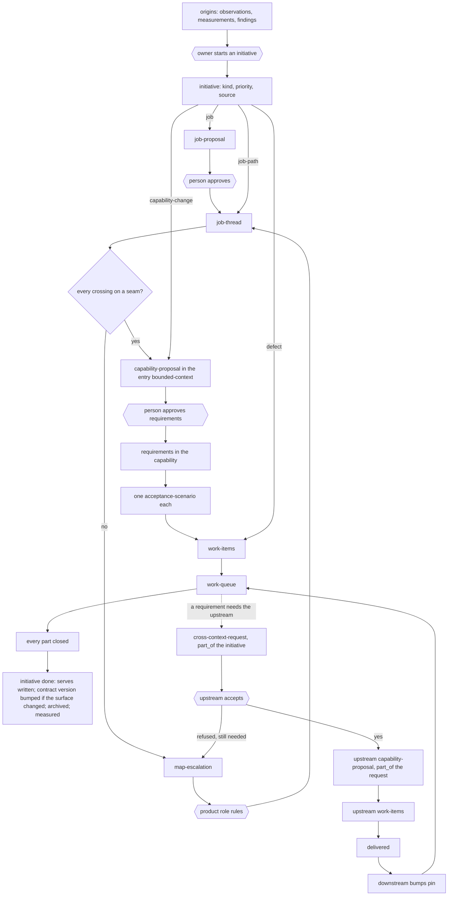
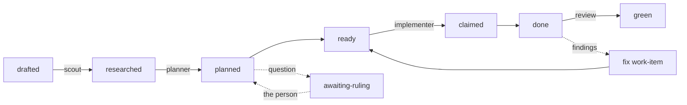

# Design state and the initiatives that change it

Version 3, 2026-10-15. Supersedes version 2 (2026-10-14). The worked
example is `ecommerce-example.md`; the formal grammar is `grammar.md`;
the September method it rests on is `spec-method.md`.

## 1. The model in one paragraph

A product is described by **standing artifacts**: the design as it is,
rewritten in place, read to learn the system. The design is changed only
through **initiatives**: each enters through intake, is ranked, and is
realised by a tree of **parts** that leads back to it. **Records** are
dated and never edited: **origins** (observation, measurement,
review-finding) are what was noticed and may be cited as an initiative's
`source`; **history** (decision-argument, initiative-archive) is read only
to trace why. Three levels, one tree: product → bounded-contexts →
capabilities. Everything else is a typed edge. Scripts hold state and
invariants; language models do the judgment steps; work is pulled, not
dispatched.

## 2. Standing artifacts

### Product level

| artifact | holds | form |
|---|---|---|
| **product-vision** | who it's for, what it's becoming, what it won't be; orders the jobs | prose, one page |
| **job** | narrator, outcome, situation | *when [situation], [narrator] wants [outcome]* |
| **context-map** | the bounded-contexts and the context-seams between them | composition table + one seam artifact each |
| **bounded-context** | one language, one spec, one contract with a version others pin, one owner; or *external*: a contract and an owner who isn't us | `spec/` (none for external) |
| **context-seam** | pattern, surface, pin, demand direction, forbidden, seam design-decisions, seam rules (EARS) | seam artifact |

### Bounded-context level

| artifact | holds | form |
|---|---|---|
| **context-index** | purpose; constraints carried (cited, not re-argued); composition; testing; glossary | `spec/index.md` |
| **capability** | one narrator; group (model, service, operations, guarantees); Purpose; Behaviour; Implementation-may-change; Not yet (each with a trigger); `rests_on`; `serves` | `spec/capabilities/<name>.md` |
| **capability-requirement** | one EARS statement in a capability's Behaviour, its response observable by the narrator. Carries a stable id, `[r<n>]`, unique within its capability and never reused (retired ids kept in the capability's ledger); referenced as `<capability>#r<n>`. Everything that points at a requirement — a scenario, a request's resolution, a proposal's change list — points by id, never by text | `- [r3] When …` |
| **acceptance-scenario** | the test of one capability-requirement, which it names by id; its title is free to change. Evidence, never demand | Gherkin, in the capability's feature file |
| **design-decision** | one file, ADR form. Frontmatter: `id`, `summary` (one sentence, required), `date`, `status`, `supersedes`, `revisit_when` (only where a signal is read), `source`. `## Decision`: standing; a paragraph or a grammar, a layout, a convention. `## Context`, `## Alternatives`, `## Consequences`: record. A surface clients observe is not a decision's body: the choice is the decision; the surface lives in the capability or the seam | `decisions/<n>-<slug>.md`; `spec/decisions.md` is a **generated** index |

**Feature files** are containers, not artifacts: one per capability, named
for it, holding that capability's acceptance-scenarios in the form the
test runner reads. The `Feature:` line restates the capability's title and
nothing else in the file carries meaning the capability does not. Step
definitions beneath are code — the real binding between a scenario and
the system — and sit outside the model.

### Edges between standing artifacts

| edge | from → to | meaning | written by |
|---|---|---|---|
| `orders` | product-vision → job | priority among jobs | hand |
| `serves` | capability → job, `using: [capabilities]` | serves that job through those dependencies | script, when a job-thread closes, on every capability its path reached |
| `depends_on` | capability → capability, across a seam | **derived**: the union of `serves[*].using` | script |
| `has` | capability → capability-requirement → acceptance-scenario | composition | hand; formulation |
| `rests_on` | capability → design-decision | assumption | hand |
| `supersedes` | design-decision → design-decision | history | hand, in the decision file |
| `pins` | bounded-context → bounded-context, at a version | on the seam | hand |

The path of a job: from each capability that serves it in the entry
bounded-context, follow `using` into the upstream capability and read its
`serves` entry for the same job; repeat.

## 3. Initiatives and parts

### The initiative

The root of all work and the only thing in intake.

| field | content |
|---|---|
| `id`, `title`, `summary` | global id; one sentence |
| `kind` | `job` · `job-path` · `capability-change` · `defect` |
| `owner-level` | product, or a bounded-context |
| `status` | `proposed → started → done \| abandoned` |
| `priority` | rank, set by the owner-level's owner |
| `source` | origins cited |

An initiative is never `part_of` anything. Its `kind` fixes its first
part; its tree is its **work-breakdown**; it is `done` when every part is
closed; it is archived and measured as one unit.

| kind | first part | then |
|---|---|---|
| `job` | job-proposal (a new job and its first job-thread, one gate) | job-thread → capability-proposals, cross-context-requests → … |
| `job-path` | job-thread, for a job that already stands | as above |
| `capability-change` | capability-proposal | work-items |
| `defect` | work-item | — |

### Parts

Every part has exactly one `part_of` — another part or the initiative —
and never a `priority` or a `source`. A part may be owned by a different
bounded-context than its initiative; it is still part of it.

| part | owner | carries `needs` | stages | leaves standing |
|---|---|---|---|---|
| **job-proposal** | product | — (argues the job) | drafted → approved (the person) → merged | the job, ordered by the product-vision |
| **map-proposal**, **vision-proposal** | product | — | as above | a bounded-context or seam on the map; vision text |
| **job-thread** | product | each crossing: a seam and what is needed from it | proposed → mapped → accepted → built (read from its parts) | `serves … using` on every capability reached; the entry scenario kept as the job's acceptance test |
| **capability-proposal** | a bounded-context | — (argues one capability: `adds`, `changes`, `removes` by requirement id; design-decisions; Implementation) | drafted → approved (the person, on the listed ids) → merged → formulated (every added or changed requirement has a scenario, or the capability is guarantees) | capability-requirements and design-decisions; then their acceptance-scenarios |
| **cross-context-request** | the downstream bounded-context, from one of its capabilities | what that capability needs across a seam | open → accepted \| refused → delivered | the upstream's own requirement; `resolution` naming it; a seam decision when one changed. Its fulfilment — the upstream's capability-proposal and work-items — is `part_of` the request |
| **map-escalation** | whoever hit it | why: `no-seam` · `pattern-change` · `refused-still-needed` · `seam-decision-revisited` | open → ruled | a map change, or a ruling recorded |
| **work-item** | a capability | — | drafted → researched → planned → ready → claimed → done → green; `awaiting-ruling` from planned | acceptance-scenarios green; code |

Job-threads own no work-items: work-items exist only under
capability-proposals. The upstream's spec names no client; the trace
runs through parts, never through standing artifacts.

### The work-item

| field | set at | content |
|---|---|---|
| id | drafted | `<capability>/<n>`; its acceptance-scenarios tagged with that id in the test runner's marker spelling |
| `part_of` | drafted | the capability-proposal (or, for a `defect`, the initiative) |
| kind | drafted | *capability* (acceptance: scenarios), *guarantee* (a check against a bound), *enabling* (a check; `for:` the work-item it enables) |
| acceptance, observable, unknown, `blocked_by`, risk | drafted | by the slicer, from the approved capability-requirements |
| why red today, file set, reuse, tests the decisions may break | researched | by the scout; probes marked run/read |
| decisions inlined, broken tests resolved, file set final, `depends_on` | planned | by the planner; a question → `awaiting-ruling` |
| report, suite record, commits | done | by the implementer |
| findings | green | per-item review on named risks (contract, concurrency, data); otherwise the initiative's branch review |

Order: `blocked_by` for what must precede; priority (unknown first) for
what should. The file set is the claim: a work-item is ready when no
claimed work-item's set overlaps it; a worker needing a file outside its
set claims it if free, else stops.

### Three structures

| structure | holds | operated by |
|---|---|---|
| **intake backlog** | per owner-level: uncited origins; initiatives `proposed`, ranked | triage: an owner starts an initiative from origins, citing them as `source` |
| **work-breakdown** | per initiative: its parts, with `part_of` | planning |
| **work-queue** | across all breakdowns: work-items by status; ready ones pulled by a fresh worker | workers; a script supervises |

An upstream's inbound cross-context-requests are parts awaiting
acceptance, not intake; the upstream sequences them by their initiatives'
priorities. The product role's `awaiting-ruling` and open map-escalations
are likewise work-tracking. The person's queue is `needs approval`
(proposals) and `awaiting-ruling`.

## 3a. Records

Dated, append-only, never edited. Not design and not work. **Origins**
may be cited as an initiative's `source`; **history** is read to trace
why and is never a source. Every record is `about` a standing artifact.

| record | kind | holds | read when |
|---|---|---|---|
| **observation** | origin | something noticed: a hardening finding with its repro, a measurement that looks off, a user's remark, an idea; `about`, `by`, `date` | before changing the artifact it is about; by the product role when reading the flow |
| **measurement** | origin | the facts of a run: cost, time, counts | when a `revisit_when` or a guarantee is judged |
| **review-finding** | origin | a review's verdicts on a work-item | the fix work-item; the observation log for what is not fixed now |
| **decision-argument** | history | the Context, Alternatives, Consequences of a design-decision file | when the decision is questioned or its `revisit_when` fires; never to learn what was decided |
| **initiative-archive** | history | an initiative and its parts as they closed | tracing why; never for what the system does |

An origin never changes the design. Origins have no rank and appear in
nobody's queue; a recurring observation is the signal for a job, a
cluster about one seam the signal its pattern is wrong.

## 4. Grammar

1. `needs` appears only on a part (a job-thread's crossing, a cross-context-request). Standing artifacts never need.
2. `serves`, `depends_on`, `has`, `rests_on`, `supersedes`, `pins` appear only between standing artifacts.
3. An acceptance-scenario is on `has` and on a work-item's acceptance, never on `needs`. A scenario going red is evidence in a request's Need.
4. `depends_on` is derived from `serves … using`; an edge no `using` names cannot exist.
5. `using` points across a seam the way the pin points.
6. A job-thread's crossing references a seam on the context-map; a crossing with no seam raises a map-escalation and the thread stays proposed.
7. A cross-context-request comes from a capability, is answered in the upstream's own spec, and the upstream names no client.
8. A work-item names a capability, directly or through `for:`.
9. Every part has exactly one `part_of`; following it reaches an initiative. An initiative has `priority` and `source`; a part has neither.
10. Only an origin is a `source`; history never is. A record is `about` a standing artifact and never changes the design.
11. A capability has one narrator; every capability-requirement's response is observable by it.
12. Design-decisions are never edited; a later one supersedes. Specs are rewritten in place; git holds history; a commit touching a spec names its motivation.
13. A watch condition exists only where its signal is something someone reads; otherwise it is a sentence of rationale.
14. No new level, artifact kind or rule without a trigger that fired.
15. Every capability-requirement has a stable id, unique within its capability and never reused. Scenarios, resolutions and proposals reference requirements by id, never by text.

## 5. Flow





## 6. Where new work comes from

An initiative is started by an owner from origins. What those origins
are, by kind:

| initiative kind | typical origins | first part | work-items' acceptance |
|---|---|---|---|
| `job` | a conversation, a customer's remark, a vision paragraph | job-proposal | scenarios |
| `job-path` | an observation that a job needs another entry | job-thread | scenarios |
| `capability-change`: NFR with a bound | a measurement | capability-proposal: a requirement in a guarantees capability | a check against the bound |
| `capability-change`: new backend, operator-visible | an operator's observation | capability-proposal: requirements in the operations capability | scenarios |
| `capability-change`: behind a port | a `revisit_when`, a measurement | capability-proposal superseding the decision; Implementation rewritten | the port's conformance suite |
| `capability-change`: reimplementation | a decision revisited | capability-proposal superseding several decisions | expand, migrate, contract work-items; existing scenarios green throughout |
| `defect`, requirement exists | a review-finding, an observation | work-item | its scenario, red then green |
| `defect`, requirement missing | as above | becomes a `capability-change` | a new scenario |
| cross-cutting (telemetry everywhere) | an operator's observation | `job` with the operator as narrator; map-proposal for an observability context; one cross-context-request per service seam | a check per service |
| refactor from review | a review-finding | not an initiative: an enabling work-item `for:` the work-item it unblocks, or an observation if nothing needs it yet | a check |

Every row still has a narrator who wants something. In most rows no
capability-requirement changes; a design-decision or an Implementation
section does, and the capability-proposal is the part for that.

## 7. Questions the model answers

| question | read |
|---|---|
| what is this system meant to do | product-vision, jobs, context-map |
| what does it do now | every Behaviour statement on `main`; Not yet |
| why does this capability exist | its `serves` |
| what breaks if an upstream capability changes | every `serves … using` that names it |
| what does the system do for a job | the path |
| why does this requirement exist | its id → the capability-proposal that added or last changed it → `part_of` … → initiative → `source` |
| what is open for an initiative | its parts not closed |
| what is this bounded-context being asked for | its parts awaiting acceptance |
| what should we start next | the intake backlog, ranked |
| who must change when a seam changes | the seam's pattern and the `using` edges across it |
| is anything unneeded | `depends_on` − ∪`using` is empty by construction; a capability with no `serves` is a question |

## 8. Where things live

```
product/     product-vision.md  jobs/  context-map/ (bounded-contexts, context-seams)
spec/        index.md  capabilities/<name>.md  decisions.md (generated)
decisions/   <n>-<slug>.md          (Decision section standing; the rest record)
features/    <name>.feature
work/        <initiative-id>/initiative.md  <initiative-id>/<part-id>.md
             (a bounded-context holds, under the same initiative id, the parts it owns)
records/     observations.md  measurements/  review-findings/  archive/
```

In the plugin's repositories (2026-10-19, design-decision/final-layout): decisions under `spec/decisions/`,
work and records under `.shop/`.

Files first. The corpus when a trace can no longer be assembled from them.
