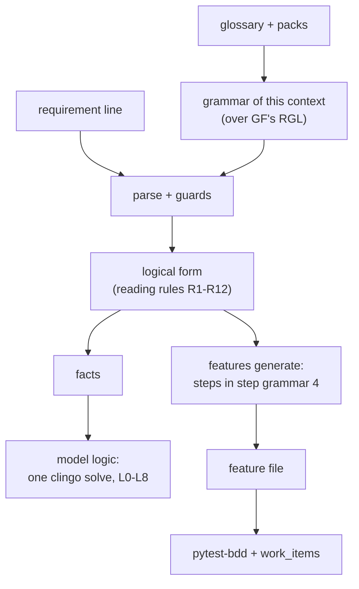
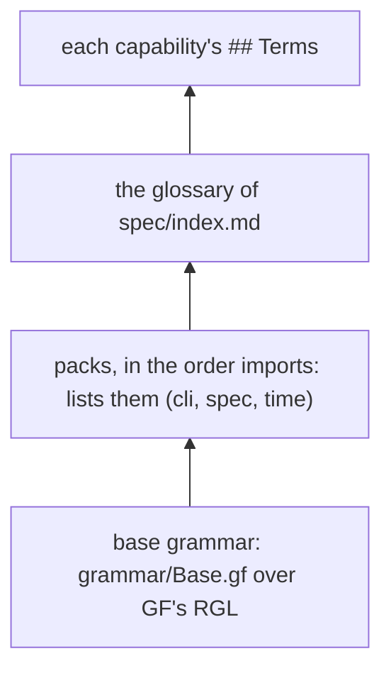
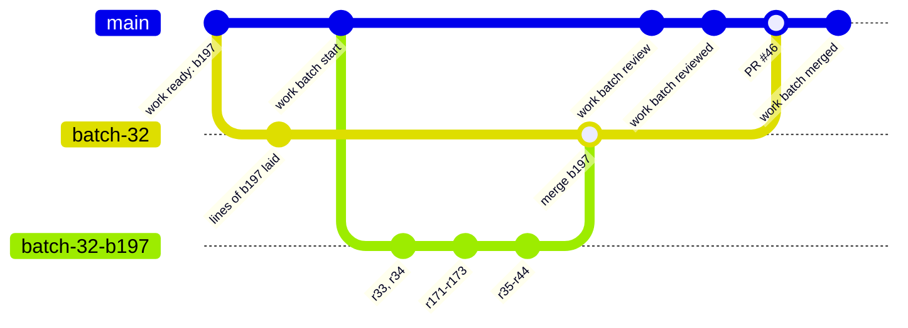

# How it works

<!-- Outputs on this page are from plugin 0.33.0 at commit 7f60e57de, 2026-11-10: the read-only commands run in this
repository, the ones that write (work idea, line, ready, batch start, pytest) in a throwaway clone with no remote. -->

This page is for the curious developer: what happens between a sentence in a capability file and a green test, and
what the workflow does with git and GitHub along the way. You don't need any of it to use the plugin. It helps when
a refusal surprises you, or when you want to know why a batch is shaped the way it is.

Each part ends with a link to the design record that tells the full story:
[the controlled language 4](../.shop/records/2026-11-09-cnl-4/design.md) for the language and its checks, and
[the workflow simplified](../.shop/records/2026-11-04-workflow-simplification/design.md) for items, batches and
reviews.

## One line, all the way through

Here is a line from this repository's own spec, `spec/capabilities/backlog.md`, group g37:

```reading
While the status of an item is `idea`, when the person runs `work shape` on the item, `work` shall set the status of the item to `shaped`.
shall [x2: agent the person (constant), x3: command `work shape` (parameter), x4: tool `work` (constant)]
  while [x1: item]
    status(x1) = `idea`
  when
    run(e1, subject: x2, object: x3, on: x1)
  response
    initiates(e2, subject: x4, status(x1) = `shaped`)
```

And here is the scenario `features generate` wrote from it, in `features/backlog.feature`:

```gherkin
  @g37 @r37
  Scenario: `work shape` shapes an idea
    Given an item i1
    And the status of the item i1 is `idea`
    When the person runs `work shape` on the item i1
    Then `work` sets the status of the item i1 to `shaped`
```

Nobody wrote that scenario by hand, and nobody can edit it: it is regenerated whenever the line changes. The rest
of this section is what happened in between.



### 1. A grammar built for your context

There is no fixed grammar of English inside the plugin. Each bounded context gets its own, generated from its words.
It is built in layers, lowest first:



The **base grammar** (`grammar/Base.gf`, under 40 lines) knows only the shape of a line: While and Where
conditions, a When or If trigger, and `shall` responses. It knows no nouns and no verbs. The English surface
(agreement, "does not", relative clauses, "a" and "an") comes from the
[Grammatical Framework](https://www.grammaticalframework.org/)'s resource grammar library, the RGL, which
`tools install` pins.

The **packs** and the **glossary** supply the words, and each word's entry decides what the grammar will accept.
This is the CLI pack's `run`, from [`grammar/packs/cli.md`](../grammar/packs/cli.md):

```text
- **run** (verb, action): an agent starts a command. Frame: agent runs command. Frame: agent runs command with option. Frame: agent runs command on thing.
```

From entries like that, `scripts/spec_rgl.py` writes a GF module typed by kind. A verb gets one function per frame,
so "the person runs `work shape` on the item" fits, and a noun of the wrong kind in a slot does not parse at all.
An action verb can only be a trigger or a response; a state verb can only be a condition. A word a higher layer
takes over from a pack needs `Redefines: <pack>` on its entry, or `model check` refuses it.

The compiled grammar is cached under `~/.cache/shopsystem-bdd/pgf/`, keyed by the hash of every source. So the
first parse after a glossary change is slow while GF compiles, and every one after that is fast. Parses are cached
too, beside it.

### 2. The parse and its guards

`model parse` asks GF for every tree of the line. Then two rules decide:

- **One meaning, or refused.** Several trees are fine if they all mean the same thing; the first is kept. Trees
  that mean different things are refused, naming the words that read two ways.
- **A refusal says where and why.** When GF stops, the plugin reports how far it got, the nearest words in the
  lexicon, and, when it can tell, the verb whose frame the line breaks.

Here is a line the grammar parses but a reading rule refuses, because "the item" points at nothing:

```refused
When the person runs `work show`, `work` shall print the status of the item.
```

```console
$ model parse "When the person runs \`work show\`, \`work\` shall print the status of the item."
refused: "the item" has no antecedent: no earlier noun phrase, functional relation or declared indexical gives an item
  tree: When NoPre (k_agent_Event (k_agent_One (k_agent_Simple a_the_person_1)) ...
```

[Writing requirements](writing-requirements.md) walks through the refusals you will meet and how to reword them.

### 3. The logical form and the reading rules

A tree is grammar; it is not yet meaning. `scripts/spec_lf.py` turns each tree into a **logical form**: referents
(`x1: item`), atoms (`status(x1) = 'idea'`, `run(e1, ...)`) and boxes (`while`, `when`, `response`). That is what
`model parse --form` prints, and it is the only thing the later steps read.

Twelve **reading rules**, R1 to R12, fix what the small words mean. A few you will notice:

| rule | what it says |
|---|---|
| R1 | "a K" is any K in a condition or trigger, and a new K in a response. |
| R2 | "the K" binds to something the line gave; otherwise the line is refused (the example above). |
| R4 | "does not V a K" in a condition is refused: say "Vs no K", or "a K that X does not V". |
| R10 | A literal that names no declared constant is a parameter. That is why `` `work shape` `` shows `(parameter)`. |
| R12 | A line that obliges with no trigger, and neither "always" nor "never", is refused. |

Every rule is written out, with the real lines it was tested on, in
[`grammar/language.md`](../grammar/language.md).

### 4. Facts, and one solve

`scripts/spec_lf_facts.py` translates each form into ground facts for [clingo](https://potassco.org/clingo/), an
answer-set solver. These are the facts of r37, printed from that module:

```text
form("backlog#r37",while_when).
cnl4("backlog#r37").
role("backlog#r37",x1,k_item).
cond("backlog#r37",x1,t_status_8,v_idea,pos).
trig("backlog#r37",ran,"`work shape`",a_the_person,x1).
set("backlog#r37",1,x1,t_status_8,v_shaped).
resp("backlog#r37",1,pos,set(t_status_8,v_shaped),a_work,x1).
```

`model logic` puts the facts of every line in the context, and of `spec/universal.md`, together with one fixed
program, [`grammar/check.lp`](../grammar/check.lp), and runs **one** solve, with a 20-second limit. Pairs of lines
that could fire on the same trigger in the same state are unified there, so a clash between capabilities is found
as readily as one inside a file. The findings:

| code | finding | kind |
|---|---|---|
| L0 | the solve did not finish, or has no model | error |
| L1 | two lines fire on one trigger in one state and demand opposite things | error |
| L2 | two lines that say the same thing | warning |
| L3 | a set that no transition allows | error |
| L4 | a value no transition path reaches | warning |
| L5 | an obligation nothing triggers | warning |
| L6 | a clash that hangs on a condition defined only in prose | warning |
| L7 | a "shall not" forbids what a "may" permits | warning |
| L8 | every Then of a line is already entailed by other lines | warning |

L8 comes from a second program, `grammar/entail.lp`. It is also what `model explain` uses to show what a line means
once the universal conditions and the packs' definitions are taken into account:

```console
$ model explain backlog#r38
backlog#r38  While the status of an item is not `idea`, if the person runs `work shape` on the item, then `work` shall refuse the command and name the status of the item.
which also means:
  `work` shall exit with an error (by the definition of refuse in the pack cli)
  `work` shall change nothing (by U12)
  `work` shall exit with an error (by U12)
```

### 5. Steps, in a grammar of their own

`features generate` reads the same logical form a second time, for Gherkin. Givens come from the While part and
from what the trigger says of its referents, the When from the trigger, and the Thens from the response. Referents
become named instances in order of first mention: `x1: item` becomes "the item i1". A Given brings in each instance
before a Given or the When names it ("an item i1"), so the steps can be bound from the feature file alone.

Every step is written in **step grammar 4** (`grammar/Steps4.gf`, extended per context like the base grammar). So a
step is never free text: `features vocab` can read each one back into a template and a term, which is how a step is
matched to its handler. A Then that a universal condition already entails is left out, with an `# entailed: U12`
comment in its place, so the check after every scenario is not tested twice.

The output is byte-stable. `features generate --check` fails when a feature file is not what the spec generates,
so a hand edit or a stale file shows up in the suite.

### 6. pytest-bdd and `work_items`

The feature files are ordinary Gherkin. You bind them with [pytest-bdd](https://pytest-bdd.readthedocs.io/) step
definitions, as in [getting started](getting-started.md).

The plugin adds one small pytest plugin, `scripts/work_items.py`, loaded with `-p work_items`. It reads each
capability's `unbuilt:` list and marks those scenarios as strict expected failures. A line that is in the spec but
not built yet runs red without failing the suite; once it passes, strict means you must take its id out of
`unbuilt:`, or the XPASS fails the run. Here is the new scenario of a batch, before its task has built it:

```console
$ python3 -m pytest -q tests/scenarios/test_backlog.py -m "r43" -rx
...
XFAIL tests/scenarios/test_backlog.py::test_work_show_prints_the_status_of_an_item - unbuilt: backlog#r43
1 xfailed in 3.68s
```

## The workflow's machinery

### The readiness bar, on a copy of `spec/`

An item becomes `ready` only by passing a mechanical check, so the questions come before the build, not during it.
`work ready` copies `spec/` to a temporary directory, lays the item's lines into the copy, and runs the pipeline
above over it: every line parses, the lexicon gains no problem, `model logic` finds no L0 and no L1 naming the
item's lines, and `features generate` writes a scenario for each group. Your real `spec/` is never written.

Here is an item whose line contradicts a delivered one:

```console
$ work line b250 --into backlog --group "\`work show\` keeps quiet about an item's title" "When the person runs \`work show\` on an item, \`work\` shall not print the title of the item."
b250 "work show prints the status of an item": backlog#r43
$ work ready b250
work: work ready: b250 "work show prints the status of an item" is not passing:
  L1 backlog#r15 and #r43 clash: on "the person runs `work show` on an item", r15 obliges and r43 forbids `work` to print
```

The bar is why Claude does not ask you to approve lines one by one. A line that clears it is well-formed and
consistent with everything else; whether it is the line you want is a question for the conversation that shaped
it. See [concepts](concepts.md) for the item's states.

### A batch: one branch, a worktree per task

`work batch start` picks the ready, unblocked items in rank order and lays them on a new branch `batch-<n>`, in its
own worktree under `.shop/worktrees/`. One commit puts every item's lines into `spec/`, adds their ids to each
capability's `unbuilt:`, and regenerates the features. The base branch gets the batch's `plan.md` and the items
moved to `in-batch`. The checkout you work in is never switched.

```console
$ work batch start
batch-34 building: t1 b251 "work show prints the status of an item, too"
batch brief: .../repo/.shop/worktrees/batch-34-driver/brief.md
```

Each item is a task on its own branch `batch-<n>-b<j>`, in its own worktree, so tasks run in parallel without
touching one another. A task's commits end with `Item: b<j>`, and the commit that makes a scenario pass takes its
id out of `unbuilt:`. `work batch done` checks all of that and runs the suite before it marks the task done.
`work batch review` merges the task branches into the batch branch with `--no-ff`, settling the one conflict git
cannot (two items' `unbuilt:` lines in one capability).

This is batch-32 of this repository, which built item b197 and was merged as pull request #46:



The full story is goal 5 of [the workflow simplified](../.shop/records/2026-11-04-workflow-simplification/design.md).

### The driver and its subagents

A batch is run by one fresh agent, the **driver**. `work batch start` writes its brief to
`.shop/worktrees/batch-<n>-driver/brief.md` (never committed), and the session that started the batch dispatches
the driver with that brief as its whole prompt. The brief names each task's worktree, branch, item, requirement ids
and acceptance tests, and the rules every subagent is given, among them:

```text
- One scenario at a time, red first: see it fail on its Then line before writing its handler or code.
- Never edit a `.feature` file; an existing test is changed only in its setup.
- Take each id out of its capability's `unbuilt:` in the same commit that makes its scenario pass.
```

The driver gives each running task a subagent, all at once, and calls `work batch done` or `work batch park` as
each returns. A question it cannot settle is parked on its item as `needs-input`, never put to you, and the rest
of the batch carries on. It stops at `awaiting-merge`: merging is yours. The steps it follows are the
[building-a-batch skill](../skills/building-a-batch/SKILL.md).

### One review, at the pull request

There is no review per task. `work batch review` pushes the batch branch and opens a draft pull request.
`work batch brief` writes what the reviewer reads: the batch's own commits and no others, the items' requirement
lines, the `tier: judgement` decisions, `CLAUDE.md`'s rules, the size of the change, and the runs of the
`[review] checks` of `.shop/delivery.toml`. A fresh [`pr-reviewer`](../agents/pr-reviewer.md) agent reads it and
writes graded findings.

`work batch reviewed` records them as `.shop/batches/<n>/review-<k>.md` and posts that on the pull request. A clean
review marks the pull request ready and the batch `awaiting-merge`. A review with a finding to fix sends the batch
back to `building`: the fix is a commit on the item's branch with a `Finding: f<m>` trailer, and the re-review reads
only the commits since the last one. Goal 6 of
[the workflow simplified](../.shop/records/2026-11-04-workflow-simplification/design.md) says why one review at the
end catches more, for less, than a review after every task.

### Requests: a GitHub issue with a fenced block

When one bounded context needs something of another, the request travels as an issue on the upstream's GitHub
repository (its `github:` under `## Upstreams` in `spec/index.md`). Each step (ask, offer, fits, turn, accept,
resolve) is a comment that `work` posts. Only one fenced block of fields in it is read; the text under it is for the
people browsing GitHub. This is the body of an ask, as `work request` renders it:

```text
~~~shop-request
step: ask
request: request/ex/notes/notes-cli/q3
asker: bounded-context/ex/notes/notes-cli
upstream: bounded-context/missingmass.io/shopsystem/shopsystem-bdd
title: Show the status of an item
status: open
turn: upstream
ask: Let `work show` print an item's status beside its title.
~~~

A request between bounded contexts, kept by shopsystem-bdd's `work`: each step is a comment `work` posts, and only its block of fields is read.
```

Each side keeps a record, `.shop/requests/q<n>.md`, and commits it before posting, so a failed post never leaves
GitHub ahead of the repository. `work sync` takes in the comments a record does not hold yet, and
`work watch --forward` wakes on GitHub's events while you work. A block that does not parse is shown, never acted
on. Lines the asker proposes are parsed in the **upstream's** grammar, so they are checked in the words of the
context that will build them.

## Next

- [Concepts](concepts.md): the words of the workflow, one by one.
- [Writing requirements](writing-requirements.md): the controlled language for writers.
- [Commands](reference/commands.md): every command and its options.
