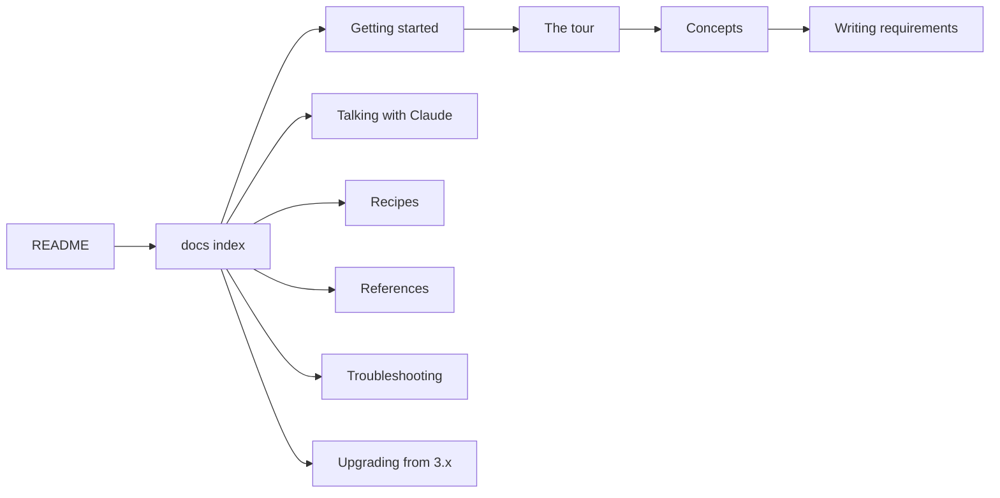

# The shopsystem-bdd docs

This is the home of the plugin's documentation. Start here when you want to know which page to read next.

With the plugin, you tell Claude what you want, and it is kept as one plain-English line that a tool can parse:

```requirement
While the status of an item is `idea`, when the person runs `work shape` on the item, `work` shall set the status of the item to `shaped`.
```

That line becomes a scenario in a feature file, and the scenario is the acceptance test the work must pass:

```gherkin
@g37 @r37
Scenario: `work shape` shapes an idea
  Given an item i1
  And the status of the item i1 is `idea`
  When the person runs `work shape` on the item i1
  Then `work` sets the status of the item i1 to `shaped`
```

Both are real: they are `r37` of this repository's own [`spec/capabilities/backlog.md`](../spec/capabilities/backlog.md)
and its scenario in [`features/backlog.feature`](../features/backlog.feature).

## Where to start

**If you talk with Claude** and let it do the typing:
[the tour](tour.md), [talking with Claude](talking-with-claude.md), [concepts](concepts.md), then
[troubleshooting and FAQ](troubleshooting.md).

**If you write or review requirement lines**, in the backlog or on a pull request:
[concepts](concepts.md), [writing requirements](writing-requirements.md),
[troubleshooting](troubleshooting.md), then the language's reference, [`grammar/language.md`](../grammar/language.md).

**If you build against the generated features**, writing the step handlers and fixing red tests:
[getting started](getting-started.md), [the tour](tour.md), [the capability file](reference/capability-file.md),
[commands](reference/commands.md), then [how it works](how-it-works.md).

**If you maintain a repository on 3.x** and are moving it to 4.0:
[upgrading](upgrading.md), [writing requirements](writing-requirements.md),
[troubleshooting](troubleshooting.md), then [`CHANGELOG.md`](../CHANGELOG.md).

## The map



Read left to right: the front door, then the walk from setting up to writing lines. The branches are the pages you
reach for when you need them.

## Every page

**Learning**, step by step, with real commands and output:

- [Getting started](getting-started.md): from an empty repository to a first green scenario.
- [The tour](tour.md): one small feature followed from an idea to a merged batch.

**Doing**, answers to "how do I ...":

- [Talking with Claude](talking-with-claude.md): what to say, what Claude does, and what is asked of you.
- [Recipes](recipes.md): short steps for the tasks that come up, from a new glossary word to a defect.
- [Upgrading](upgrading.md): moving a repository from 3.x to 4.0 with `migrate upgrade`.
- [Troubleshooting and FAQ](troubleshooting.md): a refusal you met, what it means, and what to do.

**Knowing**, the ideas behind the workflow:

- [Concepts](concepts.md): the words of the workflow, from capability and item to batch and request.
- [Writing requirements](writing-requirements.md): the controlled language for writers, with "this, not that" pairs.
- [How it works](how-it-works.md): from a line to a test, and the machinery of a batch.

**Looking up**, exact and complete:

- [Commands](reference/commands.md): every subcommand of `work`, `model`, `features`, `tools`, `measure` and `migrate`.
- [The capability file](reference/capability-file.md): the files of a spec, section by section.
- [The design model](reference/design-model.md): the kinds a context keeps and the rules `model check` holds.
- [`grammar/language.md`](../grammar/language.md): the language's reference, every rule with its readings.
- [`grammar/constructs.md`](../grammar/constructs.md): each construct of the grammar, generated.
- [`grammar/packs/`](../grammar/packs/): the word packs a context imports (`cli`, `spec`, `time`).

**History**, kept as it was:

- [`CHANGELOG.md`](../CHANGELOG.md): every release, newest first.
- [`docs/history/`](history/README.md): documents of earlier releases, such as design model v5.

Next: [getting started](getting-started.md), or [the tour](tour.md) if the plugin is already set up.
