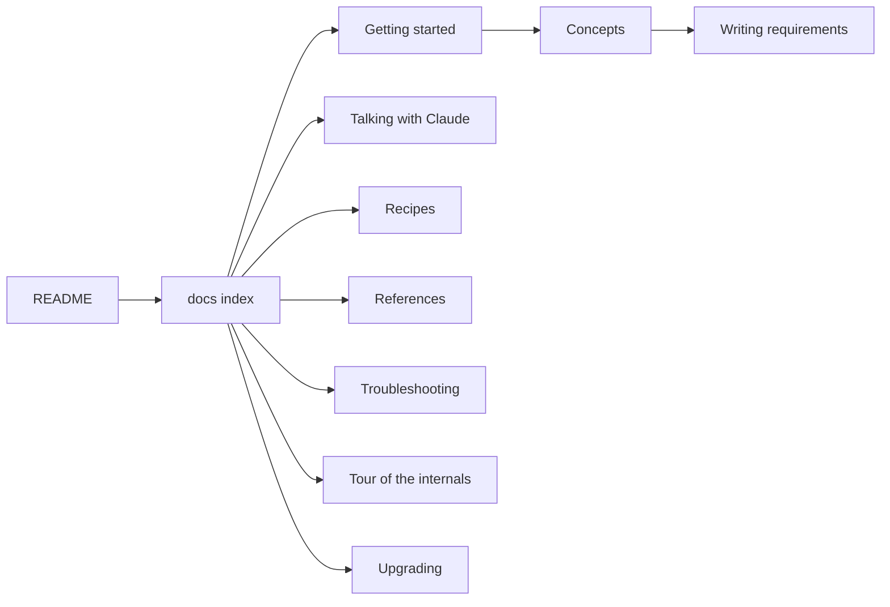

# The shopsystem-bdd docs

This is the home of the plugin's documentation. Start here when you want to know which page to read next.

With the plugin, you tell Claude what you want, and it is kept as one plain-English line that a tool can parse:

```requirement
While the status of an item is `idea`, when the person shapes the item, the backlog service shall set the status of the item to `shaped`.
```

That line becomes a scenario in a feature file, and the scenario is the acceptance test the work must pass:

```gherkin
@g14 @r14
Scenario: An idea shaped becomes shaped
  Given an item i1
  And the status of the item i1 is `idea`
  When the person shapes the item i1
  Then the backlog service sets the status of the item i1 to `shaped`
```

Both are real: they are `r14` of this repository's own [`spec/capabilities/items.md`](../spec/capabilities/items.md)
and its scenario in [`features/items.feature`](../features/items.feature).

## Where to start

**If you talk with Claude** and let it do the typing:
[talking with Claude](talking-with-claude.md), [concepts](concepts.md), then
[troubleshooting and FAQ](troubleshooting.md).

**If you write or review requirement lines**, in the backlog or on a pull request:
[concepts](concepts.md), [writing requirements](writing-requirements.md),
[troubleshooting](troubleshooting.md), then the language's reference, [`grammar/language.md`](../grammar/language.md).

**If you build against the generated features**, writing the step handlers and fixing red tests:
[getting started](getting-started.md), [the tour of the internals](internals-tour.md),
[the capability file](reference/capability-file.md), [commands](reference/commands.md), then
[how it works](how-it-works.md).

**If you maintain a repository on an older release** and are moving it to this one:
[upgrading](upgrading.md), [writing requirements](writing-requirements.md),
[troubleshooting](troubleshooting.md), then [`CHANGELOG.md`](../CHANGELOG.md).

## The map



Read left to right: the front door, then the walk from setting up to writing lines. The branches are the pages you
reach for when you need them.

## Every page

**Learning**, step by step, with real commands and output:

- [Getting started](getting-started.md): from an empty repository to a first green scenario.
- [A tour of the internals](internals-tour.md): what the session runs underneath, one small feature followed from an
  idea to a merged batch.

**Doing**, answers to "how do I ...":

- [Talking with Claude](talking-with-claude.md): what to say, what Claude does, and what is asked of you.
- [Recipes](recipes.md): short steps for the tasks that come up, from a new vocabulary word to a defect.
- [Upgrading](upgrading.md): moving a repository from an older release with `shop migrate upgrade`, and the version
  numbering.
- [Troubleshooting and FAQ](troubleshooting.md): a refusal you met, what it means, and what to do.

**Knowing**, the ideas behind the workflow:

- [Concepts](concepts.md): the specification's four parts (domain model, vocabulary, requirements, decisions),
  services and operations, adapter contracts, the catalogues, and the words of the workflow from item to request,
  with the records policy.
- [Writing requirements](writing-requirements.md): the controlled language for writers, with "this, not that" pairs.
- [How it works](how-it-works.md): from a line to a test, and the machinery of a batch.

**Looking up**, exact and complete:

- [Commands](reference/commands.md): `shop` and every subcommand of `shop work`, `shop spec`, `shop features`, `shop
  tools`, `shop measure` and `shop migrate`.
- [The domain model](reference/domain-model.md): the model and vocabulary files, their syntax and their checks.
- [Adapter contracts](reference/adapters.md): the response envelope and the CLI's contract, `spec/adapters/cli.toml`,
  with the requirement lines that govern each operation.
- [The capability file](reference/capability-file.md): the files of a spec, section by section.
- [The design model](reference/design-model.md): the kinds a context keeps, the rules `shop spec check` holds, and the
  catalogues as specification.
- [The module map](reference/modules.md): each module of the plugin's `scripts/` and each test helper with the one
  concern it holds.
- [`grammar/language.md`](../grammar/language.md): the language's reference, every rule with its readings.
- [`grammar/constructs.md`](../grammar/constructs.md): the construct catalogue, each construct a line may use, generated.
- [`grammar/rules.md`](../grammar/rules.md): the rule catalogue, each rule `shop spec check` holds, generated.
- [`grammar/packs/`](../grammar/packs/): the word packs a context imports (`base`, `request`, `spec`, `time`; `cli` retired in 0.38.0).

**History**, kept as it was:

- [`CHANGELOG.md`](../CHANGELOG.md): every release, newest first.
- [`docs/history/`](history/README.md): documents of earlier releases, such as design model v5.

Next: [getting started](getting-started.md), or [talking with Claude](talking-with-claude.md) if the plugin is already
set up.
