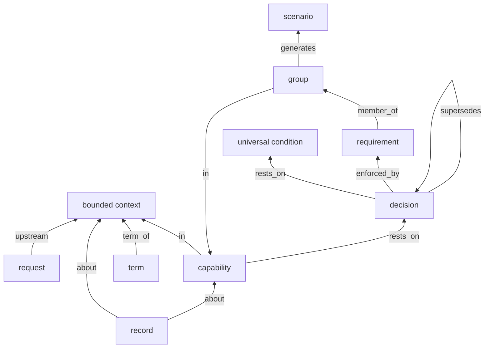

# What `shop spec check` holds

This page is for the developer who has just met a code like `v_s1` or `w_example` from `shop spec check` and wants to
know what it guards and what to do about it. It shows the things a bounded context keeps, how they point at each
other, and every rule `shop spec check` holds them to.

`shop spec rules` is the authority. The tables below are its output, word for word, grouped by what each rule guards;
where this page and the command differ, the command wins. The full catalogue, with a fact set each rule fires on and
one it passes, is [`grammar/rules.md`](../../grammar/rules.md), which `shop spec rules --write` generates.

## A first look

Say you add a scenario to `features/items.feature` by hand, with no `@g<n>` tag, and run the check:

```console
$ shop spec check --limit 1
v_s1  a scenario names no group  (1)
    features/items.feature:An empty backlog listed returns nothing
warning w_example  a requirement holds example data: a code or quoted string that names no declared constant  (41)
    capability/missingmass.io/shopsystem/shopsystem-bdd/analysis-tools#r37, .venv/bin/python
    ... and 40 more
warning w_uncited_obs  an observation no initiative cites  (16)
    observation/missingmass.io/shopsystem/shopsystem-bdd/2026-10-15-closed-before-formulated
    ... and 15 more
1 violations, 57 warnings, 0 unresolved references, 0 file problems
```

Each block is one rule: its code, its label, how many things break it, then those things by id. `v_s1` says every
scenario must come from a group of requirement lines. The fix is to write the line (with Claude, as an item) and let
`shop features generate` write its scenario. A hand-written scenario has no line behind it, so nothing would keep it
true.

A few things to know about the output:

- **`v_` codes are violations.** Any one of them makes `shop spec check` exit 1.
- **`w_` codes are warnings.** They are printed, but the exit code stays 0. This repository lives with 57 of them.
- **Unresolved references** are ids that name nothing, such as a `rests_on:` naming a decision that does not exist.
  Each one also exits 1.
- **File problems** are files `shop spec` cannot read: a missing id, a status outside its lifecycle, a block it cannot
  parse. Each one exits 1 too.
- `--limit` sets how many rows each rule shows; `--json` gives the same report as one object.

## What a context keeps

`spec` reads your files into a graph, and the rules are statements about that graph. `shop spec facts` prints it, one
fact a line. Here is one group of `spec/capabilities/items.md`, as it prints it (cut to the lines that matter):

```console
$ shop spec facts
...
node("capability/missingmass.io/shopsystem/shopsystem-bdd/items#g12", "requirement-group").
in("capability/missingmass.io/shopsystem/shopsystem-bdd/items#g12", "capability/missingmass.io/shopsystem/shopsystem-bdd/items").
node("capability/missingmass.io/shopsystem/shopsystem-bdd/items#r12", "requirement").
member_of("capability/missingmass.io/shopsystem/shopsystem-bdd/items#r12", "capability/missingmass.io/shopsystem/shopsystem-bdd/items#g12").
parsed("capability/missingmass.io/shopsystem/shopsystem-bdd/items#r12").
generates("capability/missingmass.io/shopsystem/shopsystem-bdd/items#g12", "features/items.feature:An item shown gives its title").
...
```

Read it as: group g12 is in the items capability, requirement r12 is a member of it, r12 parses, and g12 generates
one scenario. The kinds of node `shop spec facts` gives, and where each lives:

| kind | where it lives |
|---|---|
| `bounded-context` | `spec/index.md`, one per repository |
| `capability` | `spec/capabilities/<name>.md` |
| `requirement-group` | a `### [g<n>]` heading in a capability's `## Behaviour` |
| `requirement` | a `- [r<n>]` line under a group |
| `scenario` | a `Scenario:` in `features/<capability>.feature` |
| `term` | an entry of `spec/vocabulary/<area>.md` (in a context with no domain model, a bullet of `spec/index.md`'s `## Glossary` or a capability's `## Terms`) |
| `universal-condition` | a `- [U<n>]` line of `spec/universal.md` |
| `design-decision` | `spec/decisions/<nnnn>-<slug>.md` |
| `request` | `.shop/requests/q<n>.md` |
| a record: `analysis`, `design`, `measurement`, `review-finding`, `decision-argument`, `observation`, `initiative-archive` | `.shop/records/` (its frontmatter's `kind:` names which) |

The first eight are **standing**: they are what the context is. A record is not standing; it is written about
something standing, and its `about:` must name one.

Items, batches and quotes (`.shop/backlog/`, `.shop/batches/`, `.shop/quotes/`) are not in the graph. `shop work` checks
those files itself each time it reads one, and refuses a malformed one, naming the file and the field.

The edges, as `shop spec facts` gives them:



In words: a capability is in the bounded context, and so is each term. A group is in a capability; each requirement
is a member of one group, and each group generates one scenario. A capability rests on decisions. A decision may
supersede another, be enforced by requirements, and rest on universal conditions. A record is about the context, a
capability or a decision. A request names the context it is asked of as its upstream. (`shop spec facts` names the
decision edges `enforced_req` and `decision_rests_on`.)

## The rules

Each table gives the code and label as `shop spec rules` prints them, then what to do when the rule fires. Run
`shop spec rules` to see the list for your release.

### Ids

Ids are never reused, so a scenario's `@r<n>` tag always means one line. Let `shop work line` hand out ids; never number
a line by hand.

| code | `shop spec rules` says | when it fires |
|---|---|---|
| `v15a` | a requirement has no id | Give the line its `[r<n>]`. A line added through `shop work line` gets one. |
| `v15b` | two requirements share an id | Give one of them the next free id with `shop work line`. |
| `v15c` | a retired id is used again | The id is in the capability's `retired:`. Take a new one. |
| `v15d` | a requirement id outside its capability | Move the line into a group of the capability its id names. |
| `v15g` | a group has no id, or shares one | Give the group its own `[g<n>]`. |
| `v15h` | a universal condition has no id, or shares one | Give the `[U<n>]` a number no other condition has. |
| `v15i` | an id is used again: retired, or added though live | A retired `g<n>` is back; take a new group id. |
| `v15j` | a group restates an id 0.29 did not have | Fix its `Restates:`; the 0.29 ids are in `spec/restated.json`. |

To change a delivered line, retire it: `shop work line <item> --retires backlog#r38 "<new line>"` gives the new line a
new id and puts the old one under `retired:`.

### Groups and scenarios

A group is one requirement line and the one scenario generated from it.

| code | `shop spec rules` says | when it fires |
|---|---|---|
| `v15k` | the statements of a group differ in trigger or condition | Split the group: one trigger and condition a group. |
| `v15l` | a group has more than one statement | Join them into one line, `shall A and B`, or split the group. |
| `v15m` | a given line is not example data | Write it as `the <words> <name> holds` with one code span, or `holds:` with a table or docstring under it. |
| `v15n` | two groups of a capability share features, condition and trigger | Join the two lines into one: `shall A and B`. |
| `v_s1` | a scenario names no group | Delete the hand-written scenario; write a line and run `shop features generate`. |
| `v_s2` | a scenario is generated from more than one group | Run `shop features generate` to write the feature again. |
| `v_s3` | a group has no scenario | Run `shop features generate`. If the group still has none, its line holds a construct the step words cannot say yet; reword it. |
| `v_s4` | a requirement of a codified capability is in no group, or in two | Put each `- [r<n>]` under exactly one `### [g<n>]`. |

### The parse

Every line of the spec is parsed in the context's grammar. A line that does not parse cannot become a scenario.

| code | `shop spec rules` says | when it fires |
|---|---|---|
| `v_p0` | a spec file is not codified (no `language: codified-2`, or a capability in `codified-1`): run `shop migrate upgrade` | Run `shop migrate upgrade`, then reword what it reports. See [upgrading](../upgrading.md). |
| `v_p1` | a requirement does not parse | Run `shop spec parse "<line>"`: it shows where the parse stopped and the words that may follow. Reword the line under a new id. |
| `v_p2` | a requirement parses to more than one tree | The line can be read two ways. Reword it until `shop spec parse` prints one tree. |
| `v_p3` | a line of a group's given block does not parse in the step grammar | Reword the given line in the vocabulary's words. |

[Writing requirements](../writing-requirements.md) has the common refusals and their fixes.

### The vocabulary

The vocabulary is the lexicon every line is parsed with, so its entries are checked before any line is.
`shop spec lexicon --check` checks the vocabulary alone, before any line: it prints v_t4-v_t15, among them v_t7-v_t10,
which `shop spec rules` does not list (they are in [`grammar/rules.md`](../../grammar/rules.md)).

| code | `shop spec rules` says | when it fires |
|---|---|---|
| `v_t1` | a word the glossary avoids | A line or scenario uses a word listed after a term's `Not:`. Use the term. |
| `v_t2` | a term has two entries, other than the senses of one verb or of one attribute word | Merge the two entries into one; an attribute word said of two kinds keeps an entry for each. |
| `v_t3` | an avoided word is a term | Drop the word from the other entry's `Not:`, or rename one term. |
| `v_t4` | a term of a typed glossary does not name its part of speech | Write it in the bullet: `- **<term>** (<part of speech>): ...`. |
| `v_t5` | a value names no attribute, or more than one | List the value under exactly one attribute's `Values:`. |
| `v_t6` | two terms are written the same | Rename one of them. |
| `v_t11` | a verb's entry gives no frame: the kinds of its subject and object, or that it takes no object | Add a `Frame:` field to the verb's entry. |
| `v_t12` | a condition names another kind with `the`: a relation between two kinds is a verb | Make the relation a verb with a frame, or a row of `## Relations`. |
| `v_t13` | a verb's Frame: does not read as its subject, the verb and the kinds it takes | Rewrite the `Frame:` as subject, verb, then the kinds it takes. |
| `v_t14` | a verb's entry says neither state nor action | Write its part of speech as `(verb, state)` or `(verb, action)`. |
| `v_t15` | two entries of one verb take, in every slot, the same kind or one kind under the other | Make the senses' frames differ, or keep one entry. |
| `v_t16` | a term an imported pack defines too has no `Redefines:` naming the pack | Add `Redefines: <pack>` to the entry, or drop the entry and use the pack's. |
| `v_t17` | `spec/index.md` imports a pack that neither the plugin nor the bounded context has | Fix the name under `imports:`; the plugin's packs are in [`grammar/packs/`](../../grammar/packs/). |
| `v_t18` | a vocabulary entry names no element of the domain model | Write `→ <element>` after the part of speech. |
| `v_t19` | a vocabulary entry names an element the domain model does not declare | Declare the element in `spec/model/<area>.md`, or name one that is declared. |
| `v_t20` | two entries of one vocabulary layer name one element, and neither is a form of the other | Keep one entry and list the other spelling under `Forms:`. |
| `v_t21` | a context with a domain model imports the retired pack cli: run `shop migrate upgrade` | Import `request` in place of `cli`; see [upgrading](../upgrading.md#0380-the-domain-contract). |

### The domain model

The model is checked on its own, and every line against it ([the domain model](domain-model.md)).

| code | `shop spec rules` says | when it fires |
|---|---|---|
| `v_m1` | a requirement uses a word that names no element through the vocabulary its capability's area reads | Use a word of the area's layers, or add the element and its entry. A line still in 0.37's words (a command, an option) is refused here or at its parse. |
| `v_m2` | a request names a parameter its operation does not declare, or a value outside the parameter's values | Declare the parameter in the operation, or use one of its values. |
| `v_m3` | a requester the operation's actors do not include | Name an actor the operation's `by` lists, or add it there. |
| `v_m4` | an operation declares a refusal reason that no line states | Write the line that refuses the request and names what the reason names, or drop the reason. |
| `w_m5` | a lifecycle transition no line causes | A hint: write the line that sets the status, or drop the transition. |
| `v_m6` | a line sets a status by a transition its lifecycle does not allow | Add the transition to the lifecycle, or fix the line's precondition. |
| `v_m7` | an operation no line requests | Write a line whose trigger requests it, or drop the operation. |
| `v_m9` | a lifecycle transition an operation of another area performs | Have the line request an operation of the area that declares the object, or move the operation there. |
| `v_m8` | the domain model breaks its own rules: a relation to an undeclared object, a transition over an undeclared value, two operations of one name in a service, an event raised by no operation | Fix the model block the message names. |

### Adapter contracts

| code | `shop spec rules` says | when it fires |
|---|---|---|
| `v_a1` | an operation of the domain model has no table in the CLI contract and is not unexposed | Add its table to `spec/adapters/cli.toml`, or list it under `[unexposed]`. |
| `v_a2` | the CLI contract names an operation the model does not declare, or a parameter its operation does not declare | Fix the table's name, or declare the operation or parameter. |
| `v_a3` | the CLI contract names a command or an option the program's argparse lacks | Fix the contract, or add the command or option to the program. |
| `v_a4` | a command or an option of the program's argparse is named by no table of the CLI contract and is not cli-only | Name it in an operation's table, or list it under `[cli-only]`. |
| `v_a5` | an operation of an adapter contract does not hold a requirement that governs it: run spec annotate | A line whose trigger requests the operation is missing from its `requirements`. Run `shop spec annotate`. |
| `v_a6` | an operation of an adapter contract holds a requirement that does not govern it: run spec annotate | A listed line was retired, or its trigger no longer requests the operation. Run `shop spec annotate`. |

See [adapter contracts](adapters.md).

### Decisions

| code | `shop spec rules` says | when it fires |
|---|---|---|
| `v12a` | a decision has no summary | Add `summary:`. `shop work decision` refuses to write one without it. |
| `v12b` | a supersedes cycle | Two decisions supersede each other, directly or around a loop. Break the loop. |
| `v13` | a revisit signal no one reads | Point `revisit_signal:` at a measurement record, or `requests`. |
| `v_d6` | a check decision names no test | Add the pytest node id that checks it to `enforced_by:`. |
| `v_d7` | a requirement decision names no requirement | Add the `<capability>#r<n>` that enforces it to `enforced_by:`. |
| `v_d8` | an accepted decision supersedes one still accepted | Set the old decision's status to `superseded`. |
| `v_d9` | a decision names a verification route outside the four | `verified_by:` takes `scenario`, `check`, `judgement` or `monitor`. |
| `w_untiered` | a decision in force gives no tier | Add `tier:` (`check`, `requirement` or `judgement`). |
| `w_unrouted` | a universal condition no decision routes | Write a decision that rests on the `U<n>` with a `verified_by:` route. |

`shop spec decisions --check` runs the tests each check decision names.

### Records and requests

| code | `shop spec rules` says | when it fires |
|---|---|---|
| `v10a` | a source that is not an origin | A `source:` must name an observation, a measurement or a review finding. |
| `v10b` | a record is about nothing | Add `about:`. `shop work record` writes it (default: the bounded context). |
| `v10c` | a record is about something that is not standing | Point `about:` at the context, a capability or a decision. |
| `v3` | a request's resolution names something that is not a requirement of the spec | Name requirement ids (`<capability>#r<n>`) in the resolution, never scenarios. |
| `v17` | a request that is part of no job-thread, cites no origin and is raised for no request | Give the request the origin it came from. Requests written by `shop work request` have one. |
| `v18d` | an id of a kind kept in .shop/work/ with another context's path, other than the request a request is raised for | Remove the reference to another context's frozen work. |
| `v_d4` | a delivered request has an accepted line its resolution does not name | Name, in the resolution, the requirement each accepted line became. |
| `w_many_requests` | more than five open requests to one upstream | A hint to settle some before raising more. |
| `w_uncited_obs` | an observation no initiative cites | A note, nothing to fix. It is how 0.30 observations without a plan show up. |
| `v_r1` | an item cites a record in its `source:`: an item's provenance cites quotes, requests and decisions, never a record | Cite the quote, request or decision the record led to; restate a record's conclusion as a decision if the item stands on it. |
| `w_r1` | an item older than the records policy cites a record in its `source:` (history, kept as it is) | A note, nothing to fix. |

### Example data in a line

| code | `shop spec rules` says | when it fires |
|---|---|---|
| `w_example` | a requirement holds example data: a code or quoted string that names no declared constant | Move the sample value into the group's given block (`shop work line --given`), or make it a term if it is a real constant. |

A line says what is true for every value; the given block holds the value a scenario runs with.

### The product check

In a shop that keeps the product layer (`.shop/product/product.toml`, written by `shop spec job`, `subdomain`,
`context`, `assign` and `plays`), `shop spec check` reads it against this bounded context and each job's trace (what
`shop spec trace` derives).

| code | `shop spec rules` says | when it fires |
|---|---|---|
| `v_job_elsewhere` | a job a requirement group serves here is assigned to another bounded context | A group's `serves:` names a job the product assigns elsewhere. Serve it there, or assign it here. |
| `v_need_cycle` | a job's needs close a cycle | The product file was edited by hand; `shop spec job` refuses such needs. |
| `w_unheld_job` | a job of the product that no bounded context holds | Assign it with `shop spec assign`. |
| `w_unserved_job` | a job nothing serves | A job assigned here that no group's `serves:` names. |
| `w_untriggered_actor` | a product actor of a job held here whose actor here triggers no line of the job's trace | The actor that plays it here starts no line of the trace. |
| `w_unaddressed_sub` | a subdomain that no bounded context addresses | Declare the bounded context that addresses it with `shop spec context`. |
| `w_unreached_sub` | a subdomain of a job held here whose trace reaches no bounded context that addresses it | The job's trace stops short of the subdomain's solution. |
| `w_unserved_cap` | a capability serves no job | An orphan: no group of it serves a job, no job's trace reaches it, it has no port line and it is no guarantees capability. |

### Kept from the 0.30 graph

Plugin 0.30 kept jobs, seams, job-threads and pinned dependencies between contexts. These rules still guard those
edges. A 0.33 repository writes none of them, so in practice only the parts on today's kinds can fire.

| code | `shop spec rules` says | when it fires |
|---|---|---|
| `v2` | a standing edge touches something that is not standing | An `in`, `member_of`, `generates`, `rests_on` or `supersedes` names a record or another non-standing node. Point it at a standing one. |
| `v4` | a depends_on that no using gives | 0.30 only. |
| `v5` | a using against the pin | 0.30 only. |
| `v6` | a crossing names no seam | 0.30 only. |
| `v6b` | a job-thread is mapped with a crossing that names no seam | 0.30 only. |
| `v7` | a request between two contexts is across no seam between them | Judged only once the repository maps seams. |
| `v7c` | an upstream names a downstream client | 0.30 only. |
| `v11` | a capability without exactly one narrator | Give the capability file one `narrator:`. |
| `v_d2` | a built job-thread has a request not delivered | 0.30 only. |
| `w_seam_unused` | a seam nothing crosses | 0.30 only. |

## The catalogues are specification

The rules on this page, and the constructs a line may use, are not each a requirement line. The grammar's definition
(its GF sources, the generated context grammar and the reading rules of [`grammar/language.md`](../../grammar/language.md))
is the source of truth, and two generated catalogues are the specification of it: the rule catalogue
[`grammar/rules.md`](../../grammar/rules.md) and the construct catalogue
[`grammar/constructs.md`](../../grammar/constructs.md). The requirements of the `checking` and `parsing` capabilities
say only what the services do with them. Here is the general line of an error rule, `checking#r52`, with its meaning:

```reading
While a capability violates a rule whose severity is `error`, if the person validates this specification, then the specification service shall fail the check and name the rule.
shall [x3: agent the person (constant), x4: specification "the specification of this bounded context" (indexical), x5: service the specification service (constant), x6: check "the check the trigger makes" (indexical)]
  while [x1: capability, x2: rule]
    severity(x2) = `error`
    violate(subject: x1, object: x2)
  if
    request(e1, specification.check, subject: x3, object: x4)
  response
    fail(e2, subject: x5, object: x6)
    name(e3, subject: x5, object: x2)
```

One line holds for every error rule; a warning's line says the rule is named and the request completes. What a single
rule catches is its catalogue entry, and the entry's examples are its test. Here is `v_t2`'s entry in
`grammar/rules.md`, as `shop spec rules --write` writes it:

```markdown
## v_t2

a term has two entries, other than the senses of one verb or of one attribute word

- Purpose: Each term has one definition, so every line using it means the same thing.
- Since: b123
- Changed: b131
- Severity: error
- Implemented in: `scripts/model.lp`
- Cited by: no line
- Fails on:
  ...
- Passes on:
  ...
```

Each entry, of either catalogue, carries:

- **its code and label**, the code a line names it by (`` `v_t2` ``, `` `order-by` ``);
- **Purpose:** a sentence or two on what the rule or construct is for;
- **Since:** the delivered item that brought it (`b123`), and **Changed:** each delivered item that changed it since.
  An entry from before items were tracked names the release whose tag first holds it, a `## <version>` section of
  [`CHANGELOG.md`](../../CHANGELOG.md): `Since: 0.38.0`. A new or changed entry names an item. Items and releases are
  named, never records: a record is kept, not cited;
- **its example**: a rule's fact set it fails on and one it passes on, each run before the file is written; a
  construct's example line, parsed to one tree that uses the construct, read by no reading rule's refusal and read
  back word for word, with its logical form.

The purpose, `Since:` and `Changed:` of every entry are kept in
[`grammar/catalogue-entries.toml`](../../grammar/catalogue-entries.toml), one table an entry (`[rules.v_t2]`,
`purpose`, `since`, `changed`); `shop spec rules --write` and `shop spec constructs --write` write them into the
catalogues, and `--check` says whether each catalogue is current. A batch that adds or changes a rule or a construct adds its item
there.

`shop spec check` holds the catalogues to these rules:

| code | `shop spec rules` says | when it fires |
|---|---|---|
| `v_c1` | a requirement names a rule the rule catalogue has no entry of | Fix the code the line names, or add the rule. |
| `v_c2` | a catalogue entry has no purpose | Give the entry its `purpose` in `grammar/catalogue-entries.toml` and write the catalogue again. |
| `v_c3` | a catalogue entry mentions no item and no release: no Since: or Changed: names an item or a section of CHANGELOG.md | Name the item that brought it in `since`. |
| `v_c4` | a catalogue entry mentions an item that is not delivered | Name the delivered item that brought or changed it. |

And `shop spec parse` refuses a line that uses a construct the construct catalogue has no entry of, naming the
construct. A change to the language is a change to the grammar and its catalogue entry, not a new requirement line.

## Where this came from

The graph began as design model v5 (2026-11-03), written for plugin 0.30. That document is kept as it was in
[`docs/history/design-model-v5/`](../history/design-model-v5/); it explains the 0.30 kinds above, but its workflow and
language are retired. The rules themselves live in `scripts/model.lp`, solved with clingo, and the domain model's in
`scripts/model_domain.py` and `scripts/model_domain_lines.py`.

Next: [how it works](../how-it-works.md), [the capability file](capability-file.md), [the domain model](domain-model.md),
[commands](commands.md).
