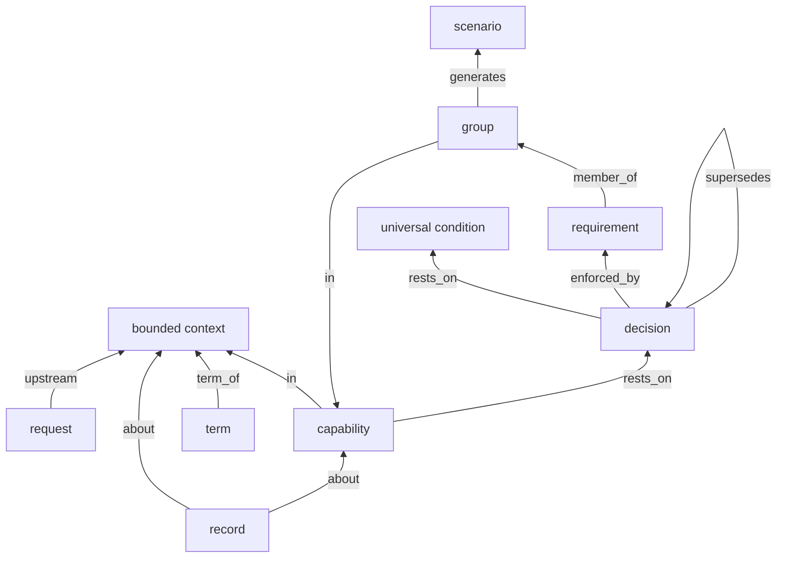

# What `model check` holds

This page is for the developer who has just met a code like `v_s1` or `w_example` from `model check` and wants to
know what it guards and what to do about it. It shows the things a bounded context keeps, how they point at each
other, and every rule `model check` holds them to.

`model rules` is the authority. The tables below are its output, word for word, grouped by what each rule guards;
where this page and the command differ, the command wins. The full catalogue, with a fact set each rule fires on and
one it passes, is [`grammar/rules.md`](../../grammar/rules.md), which `model rules --write` generates.

## A first look

Say you add a scenario to `features/backlog.feature` by hand, with no `@g<n>` tag, and run the check:

```console
$ model check --limit 1
v_s1  a scenario names no group  (1)
    features/backlog.feature:`work backlog` prints nothing for an empty backlog
warning w_example  a requirement holds example data: a code or quoted string that names no declared constant  (41)
    capability/missingmass.io/shopsystem/shopsystem-bdd/analysis-tools#r37, .venv/bin/python
    ... and 40 more
warning w_uncited_obs  an observation no initiative cites  (16)
    observation/missingmass.io/shopsystem/shopsystem-bdd/2026-10-15-closed-before-formulated
    ... and 15 more
1 violations, 57 warnings, 0 unresolved references, 0 file problems
```

Each block is one rule: its code, its label, how many things break it, then those things by id. `v_s1` says every
scenario must come from a group of requirement lines. The fix is to write the line (with Claude, as an item) and let
`features generate` write its scenario. A hand-written scenario has no line behind it, so nothing would keep it true.

A few things to know about the output:

- **`v_` codes are violations.** Any one of them makes `model check` exit 1.
- **`w_` codes are warnings.** They are printed, but the exit code stays 0. This repository lives with 57 of them.
- **Unresolved references** are ids that name nothing, such as a `rests_on:` naming a decision that does not exist.
  Each one also exits 1.
- **File problems** are files `model` cannot read: a missing id, a status outside its lifecycle, a block it cannot
  parse. Each one exits 1 too.
- `--limit` sets how many rows each rule shows; `--json` gives the same report as one object.

## What a context keeps

`model` reads your files into a graph, and the rules are statements about that graph. `model facts` prints it, one
fact a line. Here is one group of `spec/capabilities/backlog.md`, as it prints it (cut to the lines that matter):

```console
$ model facts
...
node("capability/missingmass.io/shopsystem/shopsystem-bdd/backlog#g36", "requirement-group").
in("capability/missingmass.io/shopsystem/shopsystem-bdd/backlog#g36", "capability/missingmass.io/shopsystem/shopsystem-bdd/backlog").
node("capability/missingmass.io/shopsystem/shopsystem-bdd/backlog#r36", "requirement").
member_of("capability/missingmass.io/shopsystem/shopsystem-bdd/backlog#r36", "capability/missingmass.io/shopsystem/shopsystem-bdd/backlog#g36").
parsed("capability/missingmass.io/shopsystem/shopsystem-bdd/backlog#r36").
generates("capability/missingmass.io/shopsystem/shopsystem-bdd/backlog#g36", "features/backlog.feature:`work backlog` prints every item with its title, status, provenance and ratings").
...
```

Read it as: group g36 is in the backlog capability, requirement r36 is a member of it, r36 parses, and g36 generates
one scenario. The kinds of node `model facts` gives, and where each lives:

| kind | where it lives |
|---|---|
| `bounded-context` | `spec/index.md`, one per repository |
| `capability` | `spec/capabilities/<name>.md` |
| `requirement-group` | a `### [g<n>]` heading in a capability's `## Behaviour` |
| `requirement` | a `- [r<n>]` line under a group |
| `scenario` | a `Scenario:` in `features/<capability>.feature` |
| `term` | a bullet of `spec/index.md`'s `## Glossary` or a capability's `## Terms` |
| `universal-condition` | a `- [U<n>]` line of `spec/universal.md` |
| `design-decision` | `spec/decisions/<nnnn>-<slug>.md` |
| `request` | `.shop/requests/q<n>.md` |
| a record: `analysis`, `design`, `measurement`, `review-finding`, `decision-argument`, `observation`, `initiative-archive` | `.shop/records/` (its frontmatter's `kind:` names which) |

The first eight are **standing**: they are what the context is. A record is not standing; it is written about
something standing, and its `about:` must name one.

Items, batches and quotes (`.shop/backlog/`, `.shop/batches/`, `.shop/quotes/`) are not in the graph. `work` checks
those files itself each time it reads one, and refuses a malformed one, naming the file and the field.

The edges, as `model facts` gives them:



In words: a capability is in the bounded context, and so is each term. A group is in a capability; each requirement
is a member of one group, and each group generates one scenario. A capability rests on decisions. A decision may
supersede another, be enforced by requirements, and rest on universal conditions. A record is about the context, a
capability or a decision. A request names the context it is asked of as its upstream. (`model facts` names the
decision edges `enforced_req` and `decision_rests_on`.)

## The rules

Each table gives the code and label as `model rules` prints them, then what to do when the rule fires. Run
`model rules` to see the list for your release.

### Ids

Ids are never reused, so a scenario's `@r<n>` tag always means one line. Let `work line` hand out ids; never number
a line by hand.

| code | `model rules` says | when it fires |
|---|---|---|
| `v15a` | a requirement has no id | Give the line its `[r<n>]`. A line added through `work line` gets one. |
| `v15b` | two requirements share an id | Give one of them the next free id with `work line`. |
| `v15c` | a retired id is used again | The id is in the capability's `retired:`. Take a new one. |
| `v15d` | a requirement id outside its capability | Move the line into a group of the capability its id names. |
| `v15g` | a group has no id, or shares one | Give the group its own `[g<n>]`. |
| `v15h` | a universal condition has no id, or shares one | Give the `[U<n>]` a number no other condition has. |
| `v15i` | an id is used again: retired, or added though live | A retired `g<n>` is back; take a new group id. |
| `v15j` | a group restates an id 0.29 did not have | Fix its `Restates:`; the 0.29 ids are in `spec/restated.json`. |

To change a delivered line, retire it: `work line <item> --retires backlog#r38 "<new line>"` gives the new line a
new id and puts the old one under `retired:`.

### Groups and scenarios

A group is one requirement line and the one scenario generated from it.

| code | `model rules` says | when it fires |
|---|---|---|
| `v15k` | the statements of a group differ in trigger or condition | Split the group: one trigger and condition a group. |
| `v15l` | a group has more than one statement | Join them into one line, `shall A and B`, or split the group. |
| `v15m` | a given line is not example data | Write it as `the <words> <name> holds` with one code span, or `holds:` with a table or docstring under it. |
| `v15n` | two groups of a capability share features, condition and trigger | Join the two lines into one: `shall A and B`. |
| `v_s1` | a scenario names no group | Delete the hand-written scenario; write a line and run `features generate`. |
| `v_s2` | a scenario is generated from more than one group | Run `features generate` to write the feature again. |
| `v_s3` | a group has no scenario | Run `features generate`. If the group still has none, its line holds a construct the step words cannot say yet; reword it. |
| `v_s4` | a requirement of a codified capability is in no group, or in two | Put each `- [r<n>]` under exactly one `### [g<n>]`. |

### The parse

Every line of the spec is parsed in the context's grammar. A line that does not parse cannot become a scenario.

| code | `model rules` says | when it fires |
|---|---|---|
| `v_p0` | a spec file is not codified (no `language: codified-2`, or a capability in `codified-1`): run `migrate upgrade` | Run `migrate upgrade`, then reword what it reports. See [upgrading](../upgrading.md). |
| `v_p1` | a requirement does not parse | Run `model parse "<line>"`: it shows where the parse stopped and the words that may follow. Reword the line under a new id. |
| `v_p2` | a requirement parses to more than one tree | The line can be read two ways. Reword it until `model parse` prints one tree. |
| `v_p3` | a line of a group's given block does not parse in the step grammar | Reword the given line in the glossary's words. |

[Writing requirements](../writing-requirements.md) has the common refusals and their fixes.

### The glossary

The glossary is the lexicon every line is parsed with, so its entries are checked before any line is.
`model lexicon --check` checks the glossary alone, before any line: it prints v_t4-v_t15, among them v_t7-v_t10, which
`model rules` does not list (they are in [`grammar/rules.md`](../../grammar/rules.md)).

| code | `model rules` says | when it fires |
|---|---|---|
| `v_t1` | a word the glossary avoids | A line or scenario uses a word listed after a term's `Not:`. Use the term. |
| `v_t2` | a term has two entries, other than the senses of one verb | Merge the two entries into one. |
| `v_t3` | an avoided word is a term | Drop the word from the other entry's `Not:`, or rename one term. |
| `v_t4` | a term of a typed glossary does not name its part of speech | Write it in the bullet: `- **<term>** (<part of speech>): ...`. |
| `v_t5` | a value names no attribute, or more than one | List the value under exactly one attribute's `Values:`. |
| `v_t6` | two terms are written the same | Rename one of them. |
| `v_t11` | a verb's entry gives no frame: the kinds of its subject and object, or that it takes no object | Add a `Frame:` field to the verb's entry. |
| `v_t12` | a condition names another kind with `the`: a relation between two kinds is a verb | Make the relation a verb with a frame, or a row of `## Relations`. |
| `v_t13` | a verb's Frame: does not read as its subject, the verb and the kinds it takes | Rewrite the `Frame:` as subject, verb, then the kinds it takes. |
| `v_t14` | a verb's entry says neither state nor action | Write its part of speech as `(verb, state)` or `(verb, action)`. |
| `v_t15` | two entries of one verb take, in every slot, the same kind or one kind under the other | Make the senses' frames differ, or keep one entry. |
| `v_t16` | a term an imported pack defines too has no `Redefines:` naming the pack | Add `Redefines: <pack>` to the entry, or drop the entry and use the pack's. |
| `v_t17` | `spec/index.md` imports a pack that neither the plugin nor the bounded context has | Fix the name under `imports:`; the plugin's packs are in [`grammar/packs/`](../../grammar/packs/). |

### Decisions

| code | `model rules` says | when it fires |
|---|---|---|
| `v12a` | a decision has no summary | Add `summary:`. `work decision` refuses to write one without it. |
| `v12b` | a supersedes cycle | Two decisions supersede each other, directly or around a loop. Break the loop. |
| `v13` | a revisit signal no one reads | Point `revisit_signal:` at a measurement record, or `requests`. |
| `v_d6` | a check decision names no test | Add the pytest node id that checks it to `enforced_by:`. |
| `v_d7` | a requirement decision names no requirement | Add the `<capability>#r<n>` that enforces it to `enforced_by:`. |
| `v_d8` | an accepted decision supersedes one still accepted | Set the old decision's status to `superseded`. |
| `v_d9` | a decision names a verification route outside the four | `verified_by:` takes `scenario`, `check`, `judgement` or `monitor`. |
| `w_untiered` | a decision in force gives no tier | Add `tier:` (`check`, `requirement` or `judgement`). |
| `w_unrouted` | a universal condition no decision routes | Write a decision that rests on the `U<n>` with a `verified_by:` route. |

`model decisions --check` runs the tests each check decision names.

### Records and requests

| code | `model rules` says | when it fires |
|---|---|---|
| `v10a` | a source that is not an origin | A `source:` must name an observation, a measurement or a review finding. |
| `v10b` | a record is about nothing | Add `about:`. `work record` writes it (default: the bounded context). |
| `v10c` | a record is about something that is not standing | Point `about:` at the context, a capability or a decision. |
| `v3` | a request's resolution names something that is not a requirement of the spec | Name requirement ids (`<capability>#r<n>`) in the resolution, never scenarios. |
| `v17` | a request that is part of no job-thread, cites no origin and is raised for no request | Give the request the origin it came from. Requests written by `work request` have one. |
| `v18d` | an id of a kind kept in .shop/work/ with another context's path, other than the request a request is raised for | Remove the reference to another context's frozen work. |
| `v_d4` | a delivered request has an accepted line its resolution does not name | Name, in the resolution, the requirement each accepted line became. |
| `w_many_requests` | more than five open requests to one upstream | A hint to settle some before raising more. |
| `w_uncited_obs` | an observation no initiative cites | A note, nothing to fix. It is how 1.x observations without a plan show up. |

### Example data in a line

| code | `model rules` says | when it fires |
|---|---|---|
| `w_example` | a requirement holds example data: a code or quoted string that names no declared constant | Move the sample value into the group's given block (`work line --given`), or make it a term if it is a real constant. |

A line says what is true for every value; the given block holds the value a scenario runs with.

### Kept from the 1.x graph

Plugin 1.x kept jobs, seams, job-threads and pinned dependencies between contexts. These rules still guard those
edges. A 4.0 repository writes none of them, so in practice only the parts on today's kinds can fire.

| code | `model rules` says | when it fires |
|---|---|---|
| `v2` | a standing edge touches something that is not standing | An `in`, `member_of`, `generates`, `rests_on` or `supersedes` names a record or another non-standing node. Point it at a standing one. |
| `v4` | a depends_on that no using gives | 1.x only. |
| `v5` | a using against the pin | 1.x only. |
| `v6` | a crossing names no seam | 1.x only. |
| `v6b` | a job-thread is mapped with a crossing that names no seam | 1.x only. |
| `v7` | a request between two contexts is across no seam between them | Judged only once the repository maps seams. |
| `v7c` | an upstream names a downstream client | 1.x only. |
| `v11` | a capability without exactly one narrator | Give the capability file one `narrator:`. |
| `v_d2` | a built job-thread has a request not delivered | 1.x only. |
| `w_unserved_cap` | a capability serves no job | Judged only once the repository has jobs. |
| `w_unserved_job` | a job nothing serves | 1.x only. |
| `w_seam_unused` | a seam nothing crosses | 1.x only. |

## A rule is a line too

Most rules are themselves requirements of this repository's `design-model-check` capability, so the check is
checked by its own scenarios. Here is `v15c`'s, `design-model-check#r177`, with its meaning:

```reading
While a capability violates `v15c`, if the person runs `model check`, then `model` shall exit with an error naming `v15c`.
shall [x2: rule `v15c` (parameter), x3: agent the person (constant), x4: command `model check` (parameter), x5: tool `model` (constant)]
  while [x1: capability]
    violate(subject: x1, object: x2)
  if
    run(e1, subject: x3, object: x4)
  response
    exit(e2, subject: x5, with an error naming: x2)
```

`grammar/rules.md` lists, under each rule, the lines that cite it.

## Where this came from

The graph began as design model v5 (2026-11-03), written for plugin 1.x. That document is kept as it was in
[`docs/history/design-model-v5/`](../history/design-model-v5/); it explains the 1.x kinds above, but its workflow and
language are retired. The rules themselves live in `scripts/model.lp`, solved with clingo.

Next: [how it works](../how-it-works.md), [the capability file](capability-file.md),
[commands](commands.md).
