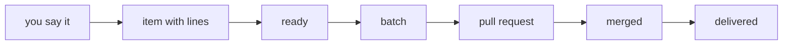
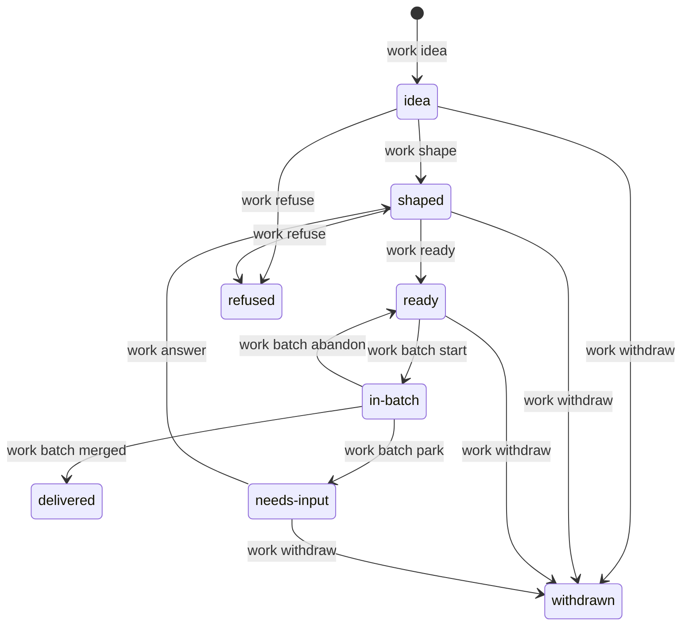

<!--
Every output on this page is pasted from one real run, on 2026-11-10, of plugin 4.0.0 at commit 7f60e57de (main),
in a throwaway clone with a local bare remote as origin and tests/scripts/stub_gh.py as $SHOPSYSTEM_WORK_GH.
Paths into the scratch directory are cut to `...`. In that run `work quote` was given `--transcript` with a
two-message transcript of the conversation below, because no live session's hook had kept one; in a session the
hook does that for you. The merge in stop 8 was made by hand on the bare remote, and $STUB_GH_STATE told the
stand-in gh that pull request #1 was merged at that commit.
-->

# A tour: one feature from an idea to a merged batch

This page is for everyone. It follows one small feature all the way round the loop: from a sentence you say to
Claude, to a requirement line, to a scenario, to a reviewed pull request, to a delivered item. You'll see what you
say, what Claude does, every command it runs and what each one printed.

The feature is real, and it lives in this repository's own `backlog` capability:

> `work show` prints the status of an item, not only its title.

The whole tour ran in a throwaway clone of this repository, with a local bare repository as `origin` and the
test suite's stand-in for `gh` (`tests/scripts/stub_gh.py`), so the batch, the pull request and the merge are real
but never touch GitHub.



Commands are written as `work backlog` for short. [Getting started](getting-started.md) shows how to run them
yourself; on this tour, Claude runs them.

## Stop 1: the idea

**You say:**

> When I run `work show` on an item I only get its title. I'd like it to print the status too, so I can see at a
> glance whether it's ready.

**Claude does:** it writes the idea down as an item, keeps your words, and shapes the item, because you've said
clearly what you want.

```console
$ work idea "work show prints the status of an item"
b250 "work show prints the status of an item" idea
$ work quote "I'd like it to print the status too"
quote-24 "I'd like it to print the status too"
$ work shape b250 --note "quote-24: the person wants the status beside the title"
b250 "work show prints the status of an item" shaped
```

**What happened.** An *item* is one piece of work in the backlog: the file `.shop/backlog/b250.md`, committed
and pushed by each command. `work quote` copied your message, with the message around it, into
`.shop/quotes/24.md`, so the reason for this item is kept in your own words. `work shape` moved the item from
`idea` to `shaped`: it's understood well enough to write its lines. Nothing has been built, and nothing will be
until the item is `ready`.

## Stop 2: the line

**Claude does:** it writes the requirement line, the one sentence that says what `work` must do. First it looks up
the words it may use.

```console
$ model lexicon
actor (39)
  the person
  ...
  `work`
  ...
kind (210)
  ...
  item
  ...
  title
  ...
attribute (38)
  ...
  status (of item): `shaped` (adjective), `ready` (adjective), `in-batch` (adjective), `delivered` (adjective), `refused` (adjective), `withdrawn` (adjective), `idea` (noun), `needs-input` (noun)
  ...
event (95)
  run  [pack cli]
  print  [pack cli]
  ...
```

Everything it needs is there: *the person*, the tool `work`, an *item*, its *title*, its *status*, and the verbs
*run* and *print*. A line can only use words the lexicon has.

### A first attempt, refused

Thinking of the item in front of you, the first draft says "a shaped item":

```console
$ model parse 'When the person runs `work show` on a shaped item, `work` shall print the status of the item.'
refused: the verb run takes as its object command or command or command or command or command or command or a kind of it: agent runs command; agent runs command with option; agent runs command on thing; agent runs command with option on thing; agent runs command without option; agent runs command without option on thing
  parsed up to: When the person runs `work show` on a
  nearest words: shaped, shape, `shaped`, shapes, shadowed
  may follow: agent, answer, batch, capability, capability-proposal, command, comment, dependency, design-decision, entry, feature, file, frame, glossary-proposal, initiative, issue, item, ledger, measurement, note, number, pack, parse, repository, request, requirement, result, review, role, round, route, rule, scenario, section, session, stage, step, task, term, test, tool, transition, trial, work-item
```

Read the refusal from the middle. `parsed up to:` shows where the parser stopped: after "on a". `may follow:` lists
what could come next, and `item` is there but `shaped` isn't. The first line names the verb's frames: what *run*
can take around it. In this language a state isn't an adjective on a noun. It goes in its own clause, **While**.

### The reword, read back

```reading
While an item is `shaped`, when the person runs `work show` on the item, `work` shall print the status of the item.
shall [x2: agent the person (constant), x3: command `work show` (parameter), x4: tool `work` (constant)]
  while [x1: item]
    status(x1) = `shaped`
  when
    run(e1, subject: x2, object: x3, on: x1)
  response [x5: status]
    status(x1) = x5
    print(e2, subject: x4, object: x5)
```

That parses. The lines under it are its *form*, what `model parse --form` says the line means. Read in plain
words: *while* there's an item x1 whose status is `shaped`, *when* the person runs `work show` on x1, `work` prints
x1's status.

Reading the form shows the catch. This line promises the status only for shaped items, and you wanted it for every
item. A line that parses can still say the wrong thing, which is why Claude reads the form, not only the verdict.
So the While clause goes.

### One trigger, one line

There's one more thing to settle. The backlog capability already has a line with the same trigger:

```reading
When the person runs `work show` on an item, `work` shall print the title of the item.
shall [x1: agent the person (constant), x2: command `work show` (parameter), x4: tool `work` (constant)]
  when [x3: item]
    run(e1, subject: x1, object: x2, on: x3)
  response [x5: title]
    of(x5, x3)
    print(e2, subject: x4, object: x5)
```

That's `backlog#r15`. Two lines with one trigger and one condition become one line that says both things, so the
new line replaces r15 rather than sitting beside it. A requirement is never edited in place: the new line gets a
new id, and r15's id is retired.

```reading
When the person runs `work show` on an item, `work` shall print the title of the item and the status of the item.
shall [x1: agent the person (constant), x2: command `work show` (parameter), x4: tool `work` (constant)]
  when [x3: item]
    run(e1, subject: x1, object: x2, on: x3)
  response [x5: title, x6: status]
    of(x5, x3)
    print(e2, subject: x4, object: x5)
    status(x3) = x6
    print(e3, subject: x4, object: x6)
```

In plain words: when the person runs `work show` on any item x3, `work` prints x3's title and prints x3's status.
That's what you asked for.

```console
$ work line b250 --into backlog --retires backlog#r15 --group '`work show` names an item by its title and its status' 'When the person runs `work show` on an item, `work` shall print the title of the item and the status of the item.'
b250 "work show prints the status of an item": backlog#r43 retires backlog#r15
```

**What happened.** The line went into the item's `## Requirements`, not into `spec/` yet. It was given the
next free id of the capability, `r43`, in a new group `g43`, with `retired: [r15]` beside it. The spec itself only
changes when a batch lays the line, in stop 5. [Writing requirements](writing-requirements.md) has the do's and
don'ts this stop ran into.

## Stop 3: rate and ready

**Claude does:** it rates the item, then asks the readiness bar whether it can be built.

```console
$ work rate b250 --value medium-value --urgency medium-urgency --size small
b250 "work show prints the status of an item" shaped
$ work ready b250
b250 "work show prints the status of an item" ready
```

**What happened.** The rating gives the item its place in the backlog. `work ready` is the readiness bar: on a
copy of `spec/` with b250's lines laid in, it checked that each line parses, that `model logic` finds no clash with
the rest of the spec, and that `features generate` can write the group's scenario with no bracketed placeholder.
All three held, so the item moved to `ready`. Had one failed, `work ready` would have refused and named the reason.

Claude doesn't ask you to approve the line. The bar is the check, and readying is the decision to build. If you'd
rather look first, say so; you can read every line in the item file or in the pull request.

## Stop 4: the backlog

```console
$ work backlog
## needs-input (1)
...

## ready (1)

| rank | item | title | provenance | value | urgency | size | score | waiting on |
|---|---|---|---|---|---|---|---|---|
| 1 | b250 | work show prints the status of an item | own | medium-value | medium-urgency | small | 4.00 | - |

## shaped (29)
...
```

**What happened.** Nothing changed: `work backlog` only reads. It prints one table a state, each in rank order
by score (value and urgency over size), with what each item waits on. b250 is the only `ready` item, and nothing
blocks it. When you say "build what's ready", this table is what Claude picks from.

## Stop 5: the batch starts

**You say:** "Build what's ready."

**Claude does:** it starts a batch.

```console
$ work batch start
batch-34 building: t1 b250 "work show prints the status of an item"
batch brief: .../repo/.shop/worktrees/batch-34-driver/brief.md
```

**What happened.** A *batch* is ready items built together on one branch and closed by one pull request.
`work batch start` picked the ready items in rank order (here, one), moved b250 to `in-batch`, and made the branch
`batch-34` in its own worktree. On that branch, one commit laid the item's lines into
`spec/capabilities/backlog.md`: group g15 and line r15 out, g43 and r43 in, and `r43` added to the capability's
`unbuilt:` list. The same commit regenerated `features/backlog.feature`, where r15's scenario gave way to this one:

```gherkin
  @g43 @r43
  Scenario: `work show` names an item by its title and its status
    When the person runs `work show` on the item i1
    Then the item i1 has the title t1
    And `work` prints the title t1
    And `work` prints the status of the item i1
```

Nobody wrote this scenario. `features generate` read it off the line's form: the When from the trigger, a Then for
each thing `work` prints. The tags `@g43 @r43` tie it to its group and line. It's the item's acceptance test.

The last line of the output is the *batch brief*: one file holding the batch, its task, its worktree and branch, the
rules every subagent follows, and where to stop.

## Stop 6: the build

**Claude does:** the session hands the brief to one fresh agent, the batch's *driver*. The driver runs
`work batch resume`, which gives each task its worktree, then sends one subagent to each task.

```console
$ work batch resume batch-34
batch-34 building: plan .shop/batches/34/plan.md
t1 b250 "work show prints the status of an item": running in .shop/worktrees/batch-34-t1 on batch-34-b250: build backlog#r43; then work batch done batch-34 t1, or work batch park batch-34 b250 --question <text>
```

The task's subagent works in `.shop/worktrees/batch-34-t1`. It starts with red. While `r43` is in `unbuilt:`, its
scenario runs as an expected failure:

```console
$ python3 -m pytest -q tests/scenarios/test_backlog.py -m r43
x                                                                        [100%]
1 xfailed in 2.11s
```

It takes `r43` out of `unbuilt:` and runs the scenario again. Now it fails for real, on its last Then:

```text
E       AssertionError: ('`work` prints the status of the item i1', 'b1 "Title of i1"\n  status: idea\n  provenance: own\n  value: medium-value\n  urgency: medium-urgency\n  size: medium\n  depends on: -\n')
FAILED tests/scenarios/test_backlog.py::test_work_show_names_an_item_by_its_title_and_its_status
1 failed in 2.13s
```

Look at the output in that message: `work show` was already printing `status: idea`. The step's handler didn't know
how to read `work show`'s fields, only `work backlog`'s table. So the build here is on the test side: the handler
learns to check a `work show` field, and the grammar's corpus gets r43's reading in place of r15's.

```python
    elif " of the item " in np and W.runs(step)[-1]["args"][1:2] == ["show"]:
        attribute, item = np[4:].split(" of the item ")
        wanted = W.field(B.item_file(step, item), attribute)
        assert "  %s: %s" % (attribute, wanted) in stdout.splitlines(), (step.text, stdout)
```

The scenario passes, and the subagent commits. `r43` leaves `unbuilt:` in the same commit that makes it pass, and
the message ends with the item it builds:

```text
a066f2764 work show prints the status of an item (backlog r43)

Item: b250

 grammar/corpus/spec/backlog.md       | 10 ++++++----
 spec/capabilities/backlog.md         |  2 +-
 tests/scenarios/backlog_handlers4.py |  4 ++++
 3 files changed, 11 insertions(+), 5 deletions(-)
```

Then the driver marks the task done:

```console
$ work batch done batch-34 t1
batch-34 t1 b250 "work show prints the status of an item": done
```

**What happened.** `work batch done` refuses a task until it's finished. It checked that the worktree is
clean, that every commit cites `Item: b250`, that nothing under `.shop/` changed, that `r43` is no longer
`unbuilt:`, and that the whole suite passes in the worktree. A refusal names which one failed and why. A question
the subagent can't settle doesn't come to you mid-build: the driver parks the item with `work batch park`, the rest
of the batch carries on, and you answer it later with `work answer`.

## Stop 7: the pull request and its review

**Claude does:** the driver merges the tasks into the batch branch, opens the pull request and has it reviewed once.

```console
$ work batch review batch-34
next: work batch brief batch-34, the pr-reviewer on it, then work batch reviewed batch-34
https://github.com/ex/ctx/pull/1
$ work batch brief batch-34
.shop/worktrees/batch-34-review-1/brief.md
```

`work batch review` merged each task's branch into `batch-34`, ran the tests, pushed, and opened a draft pull
request. (The URL is the stand-in gh's; on GitHub it's your repository's.) `work batch brief` wrote what the
reviewer reads: the batch's own commits and diff, each item's lines, the `tier: judgement` design-decisions, and
the runs of the repository's checks.

A fresh [`pr-reviewer`](../agents/pr-reviewer.md) agent reads the brief and replies with a findings file. Every
finding gets a grade (Critical, Important, Minor) and a triage (fix now, observation, drop). Here is the one this
batch got, saved at the brief's findings path:

```markdown
## Verdict

The batch builds b250: r43 replaces r15 and its scenario passes. No finding holds the merge.

## Findings

### Minor observation: the code already printed the status
- item: b250
- where: scripts/backlog_cli.py:203
`work show` printed `status:` before this batch, so the change is the line, its scenario and the handler's check of `work show`'s fields. Nothing to fix: the status is now promised and tested, where before it was only printed.
```

```console
$ work batch reviewed batch-34
batch-34 review 1: 1 finding -> awaiting-merge; the pull request https://github.com/ex/ctx/pull/1 is ready for the person's merge
```

**What happened.** `work batch reviewed` numbered the finding `f1`, recorded the review as
`.shop/batches/34/review-1.md`, posted it on the pull request, and marked the pull request ready. An observation
doesn't hold the merge, so the batch went to `awaiting-merge`. A *fix now* finding would have sent it back to
`building`: the fix goes on the item's branch with `Finding: f1` beside `Item: b250`, and the next review reads only
the fix. The driver stops here. It never merges.

## Stop 8: your part

**You do:** read the pull request and merge it. This is the one step that's always yours.

**Claude does:** once you say it's merged, it records the merge.

```console
$ work batch merged batch-34
batch-34 merged
$ work show b250
b250 "work show prints the status of an item"
  status: delivered
  provenance: own
  ...
```

`work batch merged` asked gh whether the pull request is merged, checked that its merge commit is in `main`, then
moved b250 to `delivered` and the batch to `merged`, and removed the batch's worktrees and branches. And there's
the feature, describing itself: `work show` on b250 now promises its status, and the status is `delivered`.

Then Claude measures the batch:

```console
$ measure batch batch-34
.shop/records/measurements/2026-11-10-batch-34.md
$ measure show .shop/records/measurements/2026-11-10-batch-34.md
totals
total             | value
------------------+---------------------
wall time         | 2 minutes 49 seconds
...
review findings by grade
grade     | findings
----------+---------
Critical  | 0
Important | 0
Minor     | 1
...
knobs
knob          | value
--------------+-----------
batch_size    | 4
items         | 1
changed_lines | 35
size_limit    | 1000
reviews       | 1
readiness_bar | mechanical
...
```

`measure batch` reads the batch's window from git and its sessions from Claude Code's transcripts. The tour's
clone had no sessions to read, so its token and cost rows are all zero. Here is the same table from a real batch of
this repository, batch-32 (one item, b197, merged as pull request #46):

```text
cost by role
role         | sessions | session time          | output tokens | new input tokens | cache-read tokens | cost
-------------+----------+-----------------------+---------------+------------------+-------------------+-----
planning     | 2        | 4 minutes 31 seconds  | 8749          | 92153            | 2107797           | 1.06
implementing | 1        | 13 minutes 56 seconds | 72574         | 241907           | 19264287          | 6.51
review       | 1        | 1 minute 39 seconds   | 9455          | 106803           | 754237            | 0.87
fixing       | 0        | 0 seconds             | 0             | 0                | 0                 | 0
```

So "what did that batch cost?" has an answer: here, 8.45 in all, most of it the implementing.

## Stop 9: looking back

Here's where everything from the tour now lives:

| what | where |
|---|---|
| your words | `.shop/quotes/24.md` |
| the line, `backlog#r43`, in group g43 | `spec/capabilities/backlog.md`, with `r15` in its `retired:` |
| its scenario, `@g43 @r43` | `features/backlog.feature` |
| the item, now `delivered`, with its history in `git log` | `.shop/backlog/b250.md` |
| the batch, its task table and its review | `.shop/batches/34/plan.md`, `.shop/batches/34/review-1.md` |
| what it cost | `.shop/records/measurements/2026-11-10-batch-34.md` |

And this is the path b250 took, among all the ones an item can take. Each arrow is the command that moves it:



b250 went straight down the middle: `idea`, `shaped`, `ready`, `in-batch`, `delivered`. An item that raises a
question mid-batch goes to `needs-input`, and your answer sends it back to `shaped`, so its lines are checked again
before it's built. An abandoned batch puts its items back to `ready`.

Look at what you did on the whole tour: you said one sentence, and you merged one pull request. Everything between
was Claude, checked at each step by a tool that could refuse it.

**Next:**

- [Talking with Claude](talking-with-claude.md): what to say, and what happens when you say it.
- [Concepts](concepts.md): items, batches, lines and the rest, each in one place.
- [Writing requirements](writing-requirements.md): the language this tour's line is written in, with its do's and
  don'ts.
- [Recipes](recipes.md): short answers to "how do I ...".
