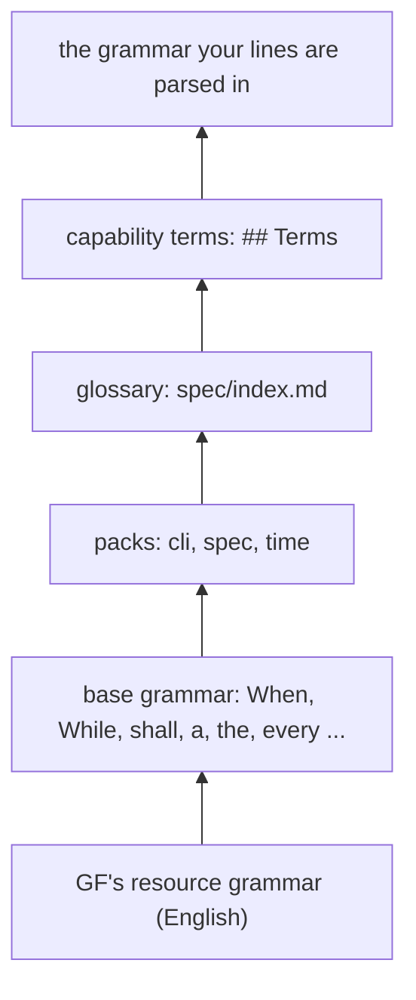

# Writing requirements in the controlled language 4

This page is for you if you write requirement lines, or review them on a pull request. It is a guide: it shows the
shapes a line takes, where its words come from, the mistakes most writers make first, and how to read what the
tools say back. The reference is [`grammar/language.md`](../grammar/language.md), and each rule below links to it.

Every line on this page comes from this repository's own spec, or is checked against it. The docs test parses each
one, so what you read here is what the plugin does today.

Here is a line, and what the plugin reads it as:

```reading
While an item is `shaped` and the item passes the readiness bar, when the person runs `work ready` on the item, `work` shall set the status of the item to `ready`.
shall [x2: readiness bar "the readiness bar of the plugin that runs the command" (indexical), x3: agent the person (constant), x4: command `work ready` (parameter), x5: tool `work` (constant)]
  while [x1: item]
    status(x1) = `shaped`
    pass#2(subject: x1, object: x2)
  when
    run(e1, subject: x3, object: x4, on: x1)
  response
    initiates(e2, subject: x5, status(x1) = `ready`)
```

That is readiness r23. The top half is English a person reads. The bottom half is its meaning: **while** an item
`x1` is shaped and passes the bar, **when** the person runs `work ready` on that same item, `work` **shall** make
its status `ready`. The plugin turns that meaning into a Gherkin scenario, and the scenario is the test.

## 1. The shape of a line

A line is one sentence. It says who must do what, and when. The language has seven shapes; most of the spec uses
the first four.

### Event-driven: When

Something happens, and a tool answers. *When* is the moment it happens ([R9](../grammar/language.md#r9-when-is-an-edge-while-a-level-if-an-unwanted-event-first)).

```requirement
When the person runs `work idea`, `work` shall write an item whose status is `idea` and commit the item.
```

### State-driven: While

*While* is a state that holds when the trigger comes. It goes before the trigger.

```requirement
While an item is `idea`, when the person runs `work shape` on the item, `work` shall set the status of the item to `shaped`.
```

### Unwanted behaviour: If ... then

*If* is the trigger of something that should not happen; *then* says how the tool answers it.

```requirement
While an item is not `idea`, if the person runs `work shape` on the item, then `work` shall refuse the command and name the status of the item.
```

### Prohibition and restriction: shall not, shall ... only

*shall not* forbids an act. *only* restricts what an act may touch ([R5](../grammar/language.md#r5-x-shall-v-only-ks-that-p-every-k-that-x-vs-meets-p)).
Universal U14 and trials r7:

```requirement
A session shall not write a transition.
`trial-runner` shall read only files in the target of a trial.
```

A line that obliges with no trigger, like these, is allowed for *shall not* and *only*. A plain *shall* with no
trigger is refused ([R12](../grammar/language.md#r12-a-line-that-obliges-with-no-trigger-and-neither-always-nor-never-is-refused)).

### Necessity: always, never

*always* and *never* say what holds at every moment. They take a state verb (one marked `verb, state` in the
glossary). This spec has no such line yet; this one parses against it:

```requirement
A commit always cites an item.
```

`model logic` does not reason with necessities yet ([Modality](../grammar/language.md#modality-shall-may-always-and-never)).

### Permission: may

*may* permits; it obliges nothing, so it needs no trigger. No line of this spec permits anything yet; this one
parses:

```requirement
A session may run `work batch park` on an item.
```

"may not" is refused: it reads as "is not allowed to" and as "is allowed not to". Say "shall not".

### Optional feature: Where

*Where* is a feature the product is built with, not a state of the moment. It is rare. This one parses:

```requirement
Where a remote of this repository exists, when the person runs `work idea`, `work` shall write an item whose status is `idea`.
```

### Clause order

The clauses come in one order: **Where**, **While**, **When** or **If**, then **shall**. A While after the trigger
is refused at the word *while*:

```refused
When the person runs `work shape` on an item, while the item is `idea`, `work` shall set the status of the item to `shaped`.
```

All four together:

```requirement
Where a remote of this repository exists, while an item is `idea`, when the person runs `work shape` on the item, `work` shall set the status of the item to `shaped`.
```

## 2. Words

### The glossary is the lexicon

A line may use only words its context declares. There is no dictionary behind the grammar: if `spec/index.md`'s
`## Glossary` (or a capability's `## Terms`) does not list a word, the line is refused at it. Each entry is one
bullet with its part of speech in brackets. These are real entries of this repository:

| part of speech | entry |
|---|---|
| `noun` | `- **dependency** (noun): one item's need of another item, written in the item that needs it. Plural: dependencies. Kind of: text.` |
| `proper noun` | ``- **`work`** (proper noun): the command that writes statuses, transitions and requests. Kind of: tool.`` |
| `attribute of K` | ``- **size** (attribute of item): Values: `small`, `medium`, `large`.`` |
| `verb, action` | ``- **pick** (verb, action): `work batch start` takes a ready item into the batch it writes. Forms: picks, picked. Frame: `work` picks item.`` |
| `verb, state` | `- **check out** (verb, state): a repository has a git branch as the one its working tree is on. Forms: checks out, checked out. Frame: repository checks out git branch.` |
| `artifact` | ``- **the comment form** (artifact): one fenced block of fields, `~~~shop-request` to `~~~`, of `<name>: <value>` lines that the comment's step names, above any free text.`` |

A few fields do a lot of work:

- **`Kind of:`** puts a noun under another. An item is a text, so anything said of a text can be said of an item.
- **`Frame:`** says who does a verb to what. `Frame: `work` picks item.` means only `work` picks, and only items.
  A line that breaks a frame is refused, naming the verb and its frames.
- **Action or state.** An action verb happens (it goes in When, If and the response). A state verb holds (it goes
  in While, in a relative clause, and after always or never).
- **`Values:`** lists an attribute's values. Each value belongs to one attribute of one kind: `` `shaped` `` is an
  item's status, not a batch's.
- **`This:`** names the run's own thing. The glossary's `bounded context` has one, so "this bounded context" means
  the one the command runs in ([R11](../grammar/language.md#r11-this-k-and-an-unbound-the-k-whose-entry-has-this-are-the-runs-own-k)).

### Packs

Some words every command-line context needs. They come in packs, which `spec/index.md` imports in its
frontmatter (`imports: [cli, spec]` in this repository):

- [`cli`](../grammar/packs/cli.md): tool, command, option, reason, output, artifact; run, print, exit, change,
  refuse, conform, name.
- [`spec`](../grammar/packs/spec.md): requirement, construct, rule; use, violate.
- [`time`](../grammar/packs/time.md): moment, duration, the units, clock; reach.

A context that defines a pack's word its own way marks the entry `Redefines: <pack>.` This repository's `tool` is
"any of the commands `work`, `features`, ...", so its entry ends `Redefines: cli.`

### Relation rows

Prepositions are words too. A `## Relations` table row says that one kind may stand in a relation to another:

| from | word | to | cardinality |
|---|---|---|---|
| dependency | on | item | one |
| task | of | batch | one |

The first row is why "a dependency on the item" parses. The second, with cardinality `one`, makes "the task of the
batch" a definite: a task belongs to one batch, so "the batch of the task" names it.

### How the layers stack

Your context's grammar is built in layers. Each layer adds words; the one above can redefine what the one below
said.



### Finding the words: `model lexicon`

`model lexicon` prints every word you can use, by category. A shortened run in this repository:

```console
$ model lexicon
actor (39)
  the person
  `work run`
  `work`
...
attribute (38)
...
  status (of item): `idea`, `shaped`, `ready`, `in-batch`, `delivered`, `needs-input`, `refused`, `withdrawn`
...
event (95)
  run  [pack cli]
  print  [pack cli]
...
condition (26)
...
  passing (of item)
  clean (of pull request)
```

Look here before writing a line, and again when a line is refused at a word. If the word you need is not there,
it is a new glossary entry, never a nearby word that means something else. The
[capability file reference](reference/capability-file.md#terms) shows where terms go.

## 3. Do and don't

This is the heart of the page. Each pair is a line writers try first, and the line that says it. Some don'ts are
refused by `model parse`. Others parse but break a writing rule; those sit in a plain block, and the sentence above
says why.

### A state in the trigger: move it to While

A state like "shaped" is not part of the act of running a command. The trigger's noun phrase can't hold it.

```refused
When the person runs `work ready` on a shaped item, `work` shall set the status of the item to `ready`.
```

Say the state in a While clause, and refer back to it with "the item":

```requirement
While an item is `shaped` and the item passes the readiness bar, when the person runs `work ready` on the item, `work` shall set the status of the item to `ready`.
```

### The passive: name who acts

Every trigger and every response says who does it. "is readied" hides the actor, and the grammar has no passive
trigger.

```refused
When an item is readied, `work` shall set the status of the item to `ready`.
```

```console
$ model parse "When an item is readied, `work` shall set the status of the item to `ready`."
does not parse at item (token 3 of 17)
  parsed up to: When an
  nearest words: item, items, term, stem, cite
  may follow: (none)
```

The person runs a command; the line above (readiness r23) says so.

### An option as a feature: put it in the trigger

Where is for how the product is built. A command's option is part of running the command.

```refused
Where `--json` is given, when the person runs `work backlog`, `work` shall print one JSON object.
```

```console
$ model parse "Where `--json` is given, when the person runs `work backlog`, `work` shall print one JSON object."
refused: the verb give takes a subject, which a passive leaves out: agent gives thing to text
  parsed up to: Where `--json` is
  nearest words: given, give, gives, given block, agent
  may follow: (none)
```

The `cli` pack's *run* takes an option ([constructs](../grammar/language.md#runs-c-with-the---x-option-an-option-with-its-argument)). Backlog r27:

```requirement
When the person runs `work backlog` with the `--json` option, `work` shall print one JSON object and exit successfully.
```

### A long refusal: refuse the command and name X

This parses, but it says what is already said elsewhere:

```text
While an item is not `idea`, if the person runs `work shape` on the item, then `work` shall exit with an error naming the status of the item and change nothing.
```

Write "refuse the command and name X". The rest follows from the `cli` pack's definition of refuse and from
universal U12, and `model explain` shows it:

```console
$ model explain backlog#r24
backlog#r24  While an item is not `idea`, if the person runs `work shape` on the item, then `work` shall refuse the command and name the status of the item.
which also means:
  `work` shall exit with an error (by the definition of refuse in the pack cli)
  `work` shall change nothing (by U12)
  `work` shall exit with an error (by U12)
```

### "the item" from nowhere: give it first

"the K" points back at something the line already named. It never means "the only K there is"
([R2](../grammar/language.md#r2-the-k-binds-to-something-the-line-gave-else-it-is-refused)).

```reading
When the person runs `work show`, `work` shall print the title of the item.
refused: "the item" has no antecedent: no earlier noun phrase, functional relation or declared indexical gives an item
```

Give the item in the trigger, then point back at it. Backlog r15:

```requirement
When the person runs `work show` on an item, `work` shall print the title of the item.
```

### "does not V a K" in a condition: say which you mean

In a While clause, "does not cite an item" reads two ways: it cites no item at all, or there is an item it does not
cite ([R4](../grammar/language.md#r4-does-not-v-a-k-in-a-condition-is-refused-under-shall-not-a-k-is-any-k)).

```reading
While a git branch of a task of a batch has a commit that does not cite an item, if the person runs `work batch review` on the batch, then `work` shall refuse the command and name the commit.
refused: the While clause says "does not cite an item", which reads two ways: say "cites no item" or "an item that the commit does not cite"
```

Batches r30 picks the first:

```requirement
While a git branch of a task of a batch has a commit that cites no item, if the person runs `work batch review` on the batch, then `work` shall refuse the command and name the commit.
```

### A coined adjective: use the structure that holds it

A new adjective is a state with its structure missing. "unrated" is no word here:

```refused
While an item is unrated, when the person runs `work backlog`, `work` shall print the item.
```

Say what makes it so, in words the glossary has:

```requirement
While an item has no size, when the person runs `work backlog`, `work` shall print the item.
```

A few adjectives stay, each defined by a sentence of the grammar, such as `passing` in the glossary: "An item is
passing when the item is well-formed and every request line of the item is settled."

### A sample value: move it to the given block

This parses, but `` `m2` `` is example data, a name only one scenario uses. `model check` warns of it
(`w_example`):

```text
When the person runs `measure show` on `m2`, `measure` shall print every stage row of `m2`.
```

The line names kinds; the group's given block holds the sample. Batch-measurement g24, as its capability file has it:

````markdown
### [g24] `measure show` prints the stage rows of a measurement whose stage row has no round trip without a round trip
- [r24] When the person runs `measure show` on a measurement that has a stage row that has no round trip, `measure` shall print every stage row of the measurement and not print a round trip.

```given
the measurement `m2` holds:
  {"stages": [{"work-item": "cart-1", "stage": "research", ...}], ...}
```
````

(The given block is shortened here.) On an item, a given block goes in with `work line --given`.

### Two lines, one trigger: join them with and

Both of these parse, and that is the trouble: two lines with one trigger and one condition are one behaviour, cut
in two.

```text
When the person runs `work backlog` with the `--json` option, `work` shall print one JSON object.
When the person runs `work backlog` with the `--json` option, `work` shall exit successfully.
```

Write one line, `shall A and B`:

```requirement
When the person runs `work backlog` with the `--json` option, `work` shall print one JSON object and exit successfully.
```

### A compound: say "the T of X"

"the batch status" happens to parse, because `status` is an attribute of batch:

```text
When the person runs `work batch status` on a batch, `work` shall print the batch status.
```

But the compound does not stretch. "the task status of the batch" is refused:

```refused
When the person runs `work batch status` on a batch, `work` shall print the task status of the batch.
```

"the T of X" always works, and nests:

```requirement
When the person runs `work batch status` on a batch, `work` shall print the status of the batch.
When the person runs `work batch status` on a batch, `work` shall print the status of every task of the batch.
```

A compound that is a thing of its own ("pull request", "git branch") is a declared noun, and that's fine.

## 4. Reading a refusal

`model parse` refuses in two ways. Either the words stop fitting the grammar at some token, or the line parses and
a reading rule turns it down. Both say where.

**A token that does not fit.** Here *never* wants a state verb, and *write* is an action:

```console
$ model parse "A session never writes a transition."
does not parse at writes (token 4 of 7)
  parsed up to: A session never
  nearest words: writes, write, rewrites, written, rewrite
  may follow: cite
```

- `does not parse at writes (token 4 of 7)`: the first word that did not fit.
- `parsed up to:` everything before it was fine. Reword from here.
- `nearest words:` words of the lexicon spelled like the token. They are spelling neighbours, not advice: *writes*
  is the first, and it is the word that failed.
- `may follow:` what the grammar would take in its place. Here it is the one state verb a session can do, *cite*.
  That tells you the slot wants a state.

**A frame.** The words fit, but a noun is of the wrong kind for its verb:

```console
$ model parse "When the person runs `work ready` on a shaped item, `work` shall set the status of the item to `ready`."
refused: the verb run takes as its object command or command or command or command or command or command or a kind of it: agent runs command; agent runs command with option; agent runs command on thing; agent runs command with option on thing; agent runs command without option; agent runs command without option on thing
  parsed up to: When the person runs `work ready` on a
  nearest words: shaped, shape, `shaped`, shapes, shadowed
  may follow: act, agent, answer, antecedent, artifact, backlog, batch, ...
```

- The first line names the verb (*run*) and lists its frames. (It repeats "command" once a frame; that is the
  tool's wording, not yours.)
- `parsed up to:` stops after "on a": the thing run on must be a noun, and *shaped* is no noun.
- `may follow:` lists the kinds that could come next. *item* is among them, with no adjective before it. Move the
  state to While.

**A reading rule.** The line parses, but means two things. The refusal names the rule's words and gives you both
readings to pick from:

```reading
While a batch does not hold an item, when the person runs `work batch status` on the batch, `work` shall print the batch.
refused: the While clause says "does not hold an item", which reads two ways: say "holds no item" or "an item that the batch does not hold"
```

Pick the one you mean:

```requirement
While a batch holds no item, when the person runs `work batch status` on the batch, `work` shall print the batch.
```

The rest of the refusals, one by one, are in [troubleshooting](troubleshooting.md#a-line-is-refused).

## 5. Reading a line's meaning

A line that parses is not done. A parse says the words fit; the meaning says what they claim. Read it with
`model parse --form`:

```console
$ model parse --form "When the person runs `work backlog`, `work` shall print an item."
shall [x1: agent the person (constant), x2: command `work backlog` (parameter), x3: tool `work` (constant)]
  when
    run(e1, subject: x1, object: x2)
  response [x4: item]
    print(e2, subject: x3, object: x4)
```

How to read it:

- The first line is the **modality** (`shall`) and the **referents** no clause makes: actors and tools as
  constants, codes as parameters, the run's own things as indexicals.
- Each box (`where`, `while`, `when` or `if`, `response`) lists the referents it makes in brackets, then what holds
  of them.
- Here `x4` is made in the response: "a K" in a response is *some* K
  ([R1](../grammar/language.md#r1-a-k-any-k-in-a-condition-or-a-trigger-a-new-k-in-a-response)). This line asks
  `work` to print one item, any item.

If you meant every item, say so, and the form shows an `every` box:

```reading
When the person runs `work backlog`, `work` shall print every item.
shall [x1: agent the person (constant), x2: command `work backlog` (parameter), x3: tool `work` (constant)]
  when
    run(e1, subject: x1, object: x2)
  response
    every [x4: item]
      scope
        print(e2, subject: x3, object: x4)
```

Check which referent each "the" landed on. In backlog r26 there are two items, and "the item" binds to the
latest one before it, `x3` (the other item, the one with the dependency):

```reading
While an item is not `delivered` and a dependency on the item exists and another item has the dependency, when the person runs `work backlog`, `work` shall print the item and the dependency.
shall [x4: agent the person (constant), x5: command `work backlog` (parameter), x6: tool `work` (constant)]
  while [x1: item, x2: dependency, x3: item]
    not
      status(x1) = `delivered`
    on(x2, x1)
    exists(x2)
    distinct(x3, x1)
    of(x2, x3)
  when
    run(e1, subject: x4, object: x5)
  response
    print(e2, subject: x6, object: x3)
    print(e3, subject: x6, object: x2)
```

That is what its group's title says: it prints an item with its dependency on an item that is not delivered. If
the form had bound to `x1`, the line would mean something else, and only the form would tell you.

For a line already in a capability, `model explain` adds what the line also means (through a pack or a universal
condition, as under §3) and which lines take precedence over it in some state:

```console
$ model explain readiness#r23
readiness#r23  While an item is `shaped` and the item passes the readiness bar, when the person runs `work ready` on the item, `work` shall set the status of the item to `ready`.
taking precedence over it, where its state holds:
  intake#r10  While an item is `shaped` and a request line of the item is not `accepted`, `refused` or `withdrawn`, if a session runs `work ready` on the item, then `work` shall refuse the command and name the request line.
  readiness#r24  While an item is `shaped` and the item does not pass the readiness bar, if the person runs `work ready` on the item, then `work` shall refuse the command and name every bar check of the readiness bar that the item does not meet.
  readiness#r25  While an item is not `shaped`, if the person runs `work ready` on the item, then `work` shall refuse the command and name the status of the item.
  readiness#r36  While an item is `shaped` and a term in the item violates a rule, if the person runs `work ready` on the item, then `work` shall refuse the command and name the term and the rule.
```

Each of those refusals wins over r23 in the state it names. Reading them tells you the whole behaviour of
`work ready`, not one line of it.

## 6. What the language cannot say yet

The language has gaps, and [`grammar/language.md`](../grammar/language.md#what-the-language-cannot-say-yet) lists
each one with the lines that meet it. These are the four writers meet most:

- **#8, a change of an attribute's value.** You can set a status to a value you name ("set the status of the item
  to `shaped`"), but not say "change the status" to any value, or "not change" it. Meanwhile, name the thing the
  change stands for: this repository says "write a transition", where a transition is a noun of its glossary.
  [More](../grammar/language.md#8-a-change-of-an-attributes-value).
- **#10, for each X, its Y.** "print every item with its title" has no form: an `every` in a response does not pair
  one thing with its own Y. Meanwhile, say each `every` apart ("print every item and every title of an item"), and
  leave the pairing to the capability's Implementation section. [More](../grammar/language.md#10-for-each-x-its-y).
- **#16, time and liveness.** *When* is the next step; "eventually" and "within 60 seconds" have no form. Meanwhile,
  say the next-step obligation, or the plain state: backlog r33 says "the remote of this repository does not answer
  the push of the command", and the timeout stays in the Implementation section.
  [Liveness](../grammar/language.md#16-liveness), [an answer within a time](../grammar/language.md#16-an-answer-within-a-time).
- **#17, a default value.** "a repository with no version file is on `0.23.1`" is no construct. Meanwhile, say what
  the default makes the tool do: migration-tools r38 prints every upgrade step when there is no plugin version file.
  [More](../grammar/language.md#17-a-default-value).

When you meet a gap, don't bend a line onto words that mean something else. Say the nearest true thing, put the
rest in the capability's `## Implementation, may change`, and tell whoever owns the language.

## Where to look next

- [`grammar/language.md`](../grammar/language.md): the reading rules R1-R12, modality, time and every construct,
  each with tested lines.
- [`grammar/constructs.md`](../grammar/constructs.md): the catalogue of constructs by code, each with an example
  and its reading.
- The packs: [`cli`](../grammar/packs/cli.md), [`spec`](../grammar/packs/spec.md), [`time`](../grammar/packs/time.md).
- [The capability file](reference/capability-file.md): where terms, relation rows, groups and given blocks go.
- [Troubleshooting](troubleshooting.md#a-line-is-refused): every refusal, what it means, what to do.

## Next

- [Recipes](recipes.md): add a word, a relation row or a given block to an item.
- [How it works](how-it-works.md): from a line to a test.
- [Concepts](concepts.md): the words of the workflow.
