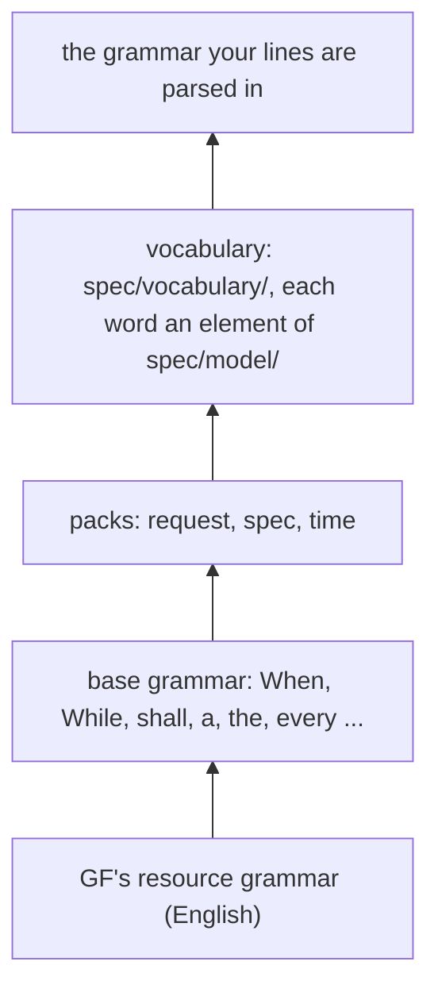

# Writing requirements in the controlled language 4

This page is for you if you write requirement lines, or review them on a pull request. It is a guide: it shows the
shapes a line takes, where its words come from, the mistakes most writers make first, and how to read what the
tools say back. The reference is [`grammar/language.md`](../grammar/language.md), and each rule below links to it.

Every line on this page comes from this repository's own spec, or is checked against it. The docs test parses each
one, so what you read here is what the plugin does today.

Here is a line, and what the plugin reads it as:

```reading
While an item is `shaped` and the item meets the readiness bar, when the person readies the item, the backlog service shall set the status of the item to `ready`.
shall [x2: readiness bar "the readiness bar of the plugin that runs the command" (indexical), x3: agent the person (constant), x4: service the backlog service (constant)]
  while [x1: item]
    status(x1) = `shaped`
    meet(subject: x1, object: x2)
  when
    request(e1, backlog.ready, subject: x3, object: x1)
  response
    initiates(e2, subject: x4, status(x1) = `ready`)
```

That is items r1. The top half is English a person reads. The bottom half is its meaning: **while** an item `x1`
is shaped and meets the bar, **when** the person asks the backlog service to ready that same item, the service
**shall** make its status `ready`. The plugin turns that meaning into a Gherkin scenario, and the scenario is the
test. The line says what is asked and what is answered; which command asks it is the CLI adapter's business
([adapter contracts](reference/adapters.md)).

## 1. The shape of a line

A line is one sentence. It says who must do what, and when. The language has seven shapes; most of the spec uses
the first four.

### Event-driven: When

Someone makes a request, or something happens, and a service answers. *When* is the moment it happens ([R9](../grammar/language.md#r9-when-is-an-edge-while-a-level-if-an-unwanted-event-first)).

```requirement
When the person notes an idea, the backlog service shall keep an item whose status is `idea`.
```

### State-driven: While

*While* is a state that holds when the trigger comes. It goes before the trigger.

```requirement
While the status of an item is `idea`, when the person shapes the item, the backlog service shall set the status of the item to `shaped`.
```

### Unwanted behaviour: If ... then

*If* is the trigger of something that should not happen; *then* says how the service answers it.

```requirement
While the status of an item is not `idea`, if the person shapes the item, then the backlog service shall refuse the request and name the status of the item.
```

### Prohibition and restriction: shall not, shall ... only

*shall not* forbids an act. *only* restricts what an act may touch ([R5](../grammar/language.md#r5-x-shall-v-only-ks-that-p-every-k-that-x-vs-meets-p)).
Universal U18 and trials r12:

```requirement
A session shall not change an item.
`trial-runner` shall review only files in the target of a trial.
```

A line that obliges with no trigger, like these, is allowed for *shall not* and *only*. A plain *shall* with no
trigger is refused ([R12](../grammar/language.md#r12-a-line-that-obliges-with-no-trigger-and-neither-always-nor-never-is-refused)).

### Necessity: always, never

*always* and *never* say what holds at every moment. They take a state verb (one marked `verb, state` in the
vocabulary). This spec has no such line yet; this one parses against it:

```requirement
A kept change always cites an item.
```

`spec logic` does not reason with necessities yet ([Modality](../grammar/language.md#modality-shall-may-always-and-never)).

### Permission: may

*may* permits; it obliges nothing, so it needs no trigger. No line of this spec permits anything yet; this one
parses:

```requirement
A session may park an item.
```

"may not" is refused: it reads as "is not allowed to" and as "is allowed not to". Say "shall not".

### Optional feature: Where

*Where* is a feature the product is built with, not a state of the moment. It is rare. This one parses:

```requirement
Where the shared store exists, when the person notes an idea, the backlog service shall keep an item whose status is `idea`.
```

### Clause order

The clauses come in one order: **Where**, **While**, **When** or **If**, then **shall**. A While after the trigger
is refused at the word *while*:

```refused
When the person shapes an item, while the status of the item is `idea`, the backlog service shall set the status of the item to `shaped`.
```

All four together:

```requirement
Where the shared store exists, while the status of an item is `idea`, when the person shapes the item, the backlog service shall set the status of the item to `shaped`.
```

## 2. Words

### The vocabulary names the model

A line may use only words its context declares. There is no dictionary behind the grammar: if the context's
vocabulary (`spec/vocabulary/<area>.md` and `shared.md`) does not list a word, the line is refused at it. Each entry is
one bullet with its part of speech in brackets and, after the arrow, the element of the
[domain model](reference/domain-model.md) it names. These are real entries of this repository:

| part of speech | entry |
|---|---|
| `noun` | `- **dependency** (noun) → object dependency. One item's need of another item, written in the item that needs it. Plural: dependencies.` |
| `proper noun` | `- **the backlog service** (proper noun) → service backlog.` |
| `attribute` | `- **size** (attribute) → attribute item.size.` |
| `adjective` | `- **small** (adjective) → value item.size small.` |
| `verb, action` | `- **open** (verb, action) → operation batches.open. Forms: opens, opened. Frame: <actor> opens <batch>.` |
| `verb, state` | `- **supersede** (verb, state) → relation design-decision.supersedes ...` |

A few things do a lot of work:

- **The model** says what each word may combine with. `object item kind of file` puts an item under a file, so
  anything said of a file can be said of an item; `operation open(batch)` says what the person may ask the batches
  service, with which parameters.
- **A verb that names an operation** is a request: "the person opens a batch" asks the batches service for
  `open`. Its parameters follow its object, "with a note", "with the tier `check`", "without a summary".
- **`Frame:`** is thin: word order and prepositions. `Frame: <actor> opens <batch>.` means an actor opens, and what it
  opens is a batch. A line that breaks a frame is refused, naming the verb and its frames.
- **Action or state.** An action verb happens (it goes in When, If and the response). A state verb holds (it goes
  in While, in a relative clause, and after always or never). A state verb names a relation of the model.
- **Adjective or noun values.** Each value belongs to one attribute of one object: `` `shaped` `` is an item's
  status, not a batch's. An adjective (`shaped`, `in-batch`) may be said the short way, "an item is `shaped`"; a
  noun (`idea`, `needs-input`) only the full way, "the status of an item is `idea`" or "an item whose status is
  `idea`". The short way of a noun is refused, naming the full way:

  ```refused
  While an item is `idea`, when the person shapes the item, the backlog service shall set the status of the item to `shaped`.
  ```
- **`This:`** names the request's own thing. The vocabulary's `bounded context` has one, so "this bounded context"
  means the one the request is made in ([R11](../grammar/language.md#r11-this-k-and-an-unbound-the-k-whose-entry-has-this-are-the-runs-own-k)).

### Packs

Some words every context needs. They come in packs, which `spec/index.md` imports in its frontmatter (`imports:
[request, spec]` in this repository):

- [`base`](../grammar/packs/base.md): text, file, version, repository, bounded context: the kinds most contexts name
  and none owns. In a context with a domain model a kind of an imported pack is a declared object, so a relation, an
  attribute or a parameter may name it. `migrate init` imports it beside `request`.
- [`request`](../grammar/packs/request.md): request, parameter, service, reason, response, check, artifact; refuse,
  name, return, notify, complete, fail, keep, change, conform, start.
- [`spec`](../grammar/packs/spec.md): requirement, construct, rule; use, violate.
- [`time`](../grammar/packs/time.md): moment, duration, the units, clock; reach.

A context that defines a pack's word its own way marks the entry `Redefines: <pack>.` The `cli` pack (tool, command,
option; run, print, exit) is retired: a line no longer names a command or an option, and `imports: [cli]` is refused
(see [upgrading](upgrading.md#0380-the-domain-contract)).

### Relations

Prepositions are words too. A relation of the model says that one object may stand in a relation to another:

```model
object dependency kind of text
  relations: on → item (one)
object batch
  relations: has → task (many); holds → item (many)
```

`on → item` is why "a dependency on the item" parses. `has → task` gives "the task of the batch", and with one
batch to a task, "the batch of the task" is a definite. `holds → item` gives "a batch holds an item" and "an item is
in a batch".

### How the layers stack

Your context's grammar is built in layers. Each layer adds words; the one above can redefine what the one below
said.



### Finding the words: `spec lexicon`

`spec lexicon` prints every word you can use, by category. A shortened run in this repository:

```console
$ spec lexicon
actor (45)
  the person
  ...
  the backlog service
...
attribute (38)
...
  status (of item): `shaped` (adjective), `ready` (adjective), `in-batch` (adjective), `delivered` (adjective), `refused` (adjective), `withdrawn` (adjective), `idea` (noun), `needs-input` (noun)
...
event (138)
  refuse  [pack request]
  ...
  return  [pack request]
...
  shape
  show
...
```

Look here before writing a line, and again when a line is refused at a word. If the word you need is not there,
it is a new vocabulary entry naming a new model element, never a nearby word that means something else.
[Recipes](recipes.md#add-a-word-to-the-vocabulary) shows how one arrives on an item.

## 3. Collections, counts, comparisons and orders

### Membership: holds, is in, holds exactly, holds nothing

A relation row whose word is `in` makes one kind a collection of another. This repository's `item | in | batch`
gives "a batch holds an item", and from the member's side, "an item is in a batch"
([`holds-relation`](../grammar/constructs.md#holds-relation), [`is-in`](../grammar/constructs.md#is-in)):

```requirement
When the person monitors a batch, the batches service shall return every item that the batch holds.
While an item is in a batch, if the person shapes the item, then the backlog service shall refuse the request and name the batch.
```

"holds exactly the Ks that P" says both halves: every K that meets P is held, and no K that does not is
([`holds-exactly`](../grammar/constructs.md#holds-exactly)). The form shows the two boxes:

```reading
When the person opens a batch, the batches service shall keep a batch that holds exactly the items whose status is `in-batch`.
shall [x1: agent the person (constant), x3: service the batches service (constant)]
  when [x2: batch]
    request(e1, batches.open, subject: x1, object: x2)
  response [x4: batch]
    every [x5: item]
      status(x5) = `in-batch`
      scope
        in(x5, x4)
    not [x6: item]
      not
        status(x6) = `in-batch`
      in(x6, x4)
    keep(e2, subject: x3, object: x4)
```

"holds nothing" is an empty collection: no thing of any kind its rows let it hold
([`nothing`](../grammar/constructs.md#nothing)). "holds no item" says only that no item is in it.

Each of these reads on the object of any act of a response, `keep` as above, `return`, or a verb of your own whose
frame names the collection's kind, and "holds exactly" with a value, a negated value or a relative clause over one row
or state to a thing of its own ("that a session keeps"); a relative clause that reaches a second thing ("that cover
the line of a stage") is not read yet. A holds-exactly scenario gives the K that fails the restriction and the Then that the collection
does not hold it; "holds nothing" on a response's object gets the Then "the batch b1 holds nothing", and "holds no
item" the Then "the batch b1 holds no item" with an item the batch does not hold.

```requirement
While a batch holds nothing, when the person monitors the batch, the batches service shall return the batch.
```

### Size: at least, at most, exactly, the number of Ks

A count before a number and a plural noun bounds how many: "at least", "at most", "exactly", "more than", "fewer
than" ([R7](../grammar/language.md#r7-one-k-is-exactly-one-a-k-at-least-one), [`count`](../grammar/constructs.md#count)).
"one K" alone is exactly one.

```requirement
When the person opens a batch, the batches service shall keep a batch that holds at least one item.
When the person opens a batch, the batches service shall keep a batch that holds at most three items.
```

"the number of Ks" is the count as a value, to return or to compare
([the number of Ks](../grammar/language.md#the-number-of-ks-that-p-a-count-as-a-value)):

```requirement
When the person monitors a batch, the batches service shall return the number of items that the batch holds.
```

A generated scenario of every and of only gives a thing that fails the restriction, with a negated Then. A count
on what a response prints, with an upper bound, gets one thing past the bound, and its Then states the count
("the batches service returns at most three items"), which a handler checks by counting the items in the output. A count that
restricts a thing the response keeps, as in the lines above, gets no counter-example.

### Comparing two things' values

"the T of X is after the T of Y", "is before", and "is the same as" compare two things' values of one attribute
([`value-compare`, `value-same`](../grammar/language.md#the-t-of-x-is-after-the-t-of-y-is-the-same-as-the-t-of-y-one-things-value-compared-with-anothers)).
Upgrades r28, where a repository's release and the plugin's are two elements one word names:

```requirement
While the release of this repository is after the release of the plugin, when a session starts, the upgrades service shall notify the session of `update the plugin`.
While the release of this repository is the same as the release of the plugin, when the person upgrades this repository, the upgrades service shall change nothing.
```

"after" and "before" need a **value order** on the attribute: its entry's `Order: by number.` or `Order: as
listed.`, or a `Type:`, `number`, `time` or `text`, whose values are any literal of the type
([A value order](../grammar/language.md#a-value-order-order-or-type)). In the model, values written `a < b < c` are
ordered (by number, for versions): the releases are. "is the same as" takes any attribute. An attribute with no value order is refused, naming it.

### An order

", ordered by T, in ascending order" or "in descending order" says the order of a collection a response's act
takes as its object, returned or kept, or of a returned every ([`order-by`](../grammar/constructs.md#order-by), [`order-by-every`](../grammar/constructs.md#order-by-every)):

```reading
When the person queries this repository, the upgrades service shall return every upgrade step, ordered by release, in ascending order.
shall [x1: agent the person (constant), x2: repository "the repository the request is made in" (indexical), x3: service the upgrades service (constant)]
  when
    request(e1, upgrades.query, subject: x1, object: x2)
  response
    every [x4: upgrade step]
      scope
        return(e2, subject: x3, object: x4)
        ordered(x4, release, ascending)
```

After a collection that holds its members ("a worktree that holds a file, ordered by version, ..."), the order is
the members': the form puts `ordered` on an every box over the files in the worktree, not on the worktree.
An order on a collection is a property of a response's object, whatever the act; "every K, ordered by ..." reads
after any verb whose frame takes K, `return` or another. In a While clause, in the trigger, or after
"shall not" it is refused, and so is an order by an attribute with no value order. An item's status has none:

```refused
When the person monitors a batch, the batches service shall return the batch, ordered by status, in ascending order.
```

A position ("the first item", the top three) and a second key are not said yet.

## 4. Do and don't

This is the heart of the page. Each pair is a line writers try first, and the line that says it. Some don'ts are
refused by `spec parse`. Others parse but break a writing rule; those sit in a plain block, and the sentence above
says why.

### A state in the trigger: move it to While

A state like "shaped" is not part of the request. The trigger's noun phrase can't hold it.

```refused
When the person readies a shaped item, the backlog service shall set the status of the item to `ready`.
```

Say the state in a While clause, and refer back to it with "the item":

```requirement
While an item is `shaped` and the item meets the readiness bar, when the person readies the item, the backlog service shall set the status of the item to `ready`.
```

### The passive: name who acts

Every trigger and every response says who does it. "is readied" hides the actor, and the grammar has no passive
trigger.

```refused
When an item is readied, the backlog service shall set the status of the item to `ready`.
```

```console
$ spec parse "When an item is readied, the backlog service shall set the status of the item to \`ready\`."
refused: the verb ready takes a subject, which a passive leaves out: agent readies item
  parsed up to: When an
  nearest words: item, items, `item`, term, stem
  may follow: (none)
```

The person makes the request; the line above (items r1) says so.

### A command or an option: say the request

A line says what is asked of the domain, not how an interface asks it. A command, an option, an exit code or a
printed layout belongs to an adapter ([adapter contracts](reference/adapters.md)), so a line that names one is
refused, and so is an option made a feature with Where:

```refused
Where `--json` is given, when the person lists the backlog, the backlog service shall return every item.
```

```console
$ spec parse "Where \`--json\` is given, when the person lists the backlog, the backlog service shall return every item."
refused: the verb give takes a subject, which a passive leaves out: agent gives directive
  parsed up to: Where `--json` is
  nearest words: given, give, gives, given step, given steps
  may follow: (none)
```

Say the request and what the service returns; `--json` is the CLI's rendering of every response. A parameter that
the domain has is said after the operation's object: "shapes the item with a note", "enters a design-decision with
the tier `check`", "without a summary".

```requirement
When the person lists the backlog, the backlog service shall return every item.
```

### A long refusal: refuse the request and name X

This parses, but it says what is already said elsewhere:

```text
While the status of an item is not `idea`, if the person shapes the item, then the backlog service shall refuse the request, name the status of the item and change nothing.
```

Write "refuse the request and name X". The rest follows from universal U17, and `spec explain` shows it:

```console
$ spec explain items#r15
items#r15  While the status of an item is not `idea`, if the person shapes the item, then the backlog service shall refuse the request and name the item.
which also means:
  the backlog service shall change nothing (by U17)
  the backlog service shall name a reason (by U17)
```

### "the item" from nowhere: give it first

"the K" points back at something the line already named. It never means "the only K there is"
([R2](../grammar/language.md#r2-the-k-binds-to-something-the-line-gave-else-it-is-refused)).

```reading
When the person lists the backlog, the backlog service shall return the title of the item.
refused: "the item" has no antecedent: no earlier noun phrase, functional relation or declared indexical gives an item
```

Give the item in the trigger, then point back at it. Items r12:

```requirement
When the person shows an item, the backlog service shall return the title of the item.
```

### "does not V a K" in a condition: say which you mean

In a While clause, "does not cite an item" reads two ways: it cites no item at all, or there is an item it does not
cite ([R4](../grammar/language.md#r4-does-not-v-a-k-in-a-condition-is-refused-under-shall-not-a-k-is-any-k)).

```reading
While a workspace of a task of a batch holds a kept change that does not cite an item, if the person submits the batch, then the batches service shall refuse the request and name the kept change.
refused: the While clause says "does not cite an item", which reads two ways: say "cites no item" or "an item that the kept change does not cite"
```

Batches r4 picks the first:

```requirement
While a workspace of a task of a batch holds a kept change that cites no item, if the person submits the batch, then the batches service shall refuse the request and name the kept change.
```

### A coined adjective: use the structure that holds it

A new adjective is a state with its structure missing. "unrated" is no word here:

```refused
While an item is unrated, when the person lists the backlog, the backlog service shall return the item.
```

Say what makes it so, in words the vocabulary has:

```requirement
While an item has no size, when the person lists the backlog, the backlog service shall return the item.
```

An adjective is a value of an attribute in the model; a word that names no element is refused (`v_m1`).

### A sample value: move it to the given block

This parses, but `` `m2` `` is example data, a name only one scenario uses. `spec check` warns of it
(`w_example`):

```text
When the person views `m2`, the measurement service shall return every stage row of `m2`.
```

The line names kinds; the group's given block holds the sample. Measurement g6, as its capability file has it:

````markdown
### [g6] A measurement viewed gives no round trip of a stage row that has none
Restates: batch-measurement#r56@0.29.
- [r6] When the person views a measurement that has a stage row that has no round trip, the measurement service shall return every stage row of the measurement and not return a round trip.

```given
the measurement `m2` holds:
  {"stages": [{"work-item": "cart-1", "stage": "research", ...}], ...}
```
````

(The given block is shortened here.) On an item, a given block goes in with `work line --given`.

### Two lines, one trigger: join them with and

Both of these parse, and that is the trouble: two lines with one trigger and one condition are one behaviour, cut
in two.

```text
When the person opens a batch, the batches service shall keep a batch brief.
When the person opens a batch, the batches service shall return a batch brief.
```

Write one line, `shall A and B` (batches r51):

```requirement
When the person opens a batch, the batches service shall keep a batch brief and return the batch brief.
```

### A compound: say "the T of X"

"the batch status" happens to parse, because `status` is an attribute of batch:

```text
When the person monitors a batch, the batches service shall return the batch status.
```

But the compound does not stretch. "the task status of the batch" is refused:

```refused
When the person monitors a batch, the batches service shall return the task status of the batch.
```

"the T of X" always works, and nests:

```requirement
When the person monitors a batch, the batches service shall return the status of the batch.
When the person monitors a batch, the batches service shall return the status of every task of the batch.
```

A compound that is a thing of its own ("pull request", "git branch") is a declared noun, and that's fine.

## 5. Reading a refusal

`spec parse` refuses in two ways. Either the words stop fitting the grammar at some token, or the line parses and
a reading rule turns it down. Both say where.

**A token that does not fit.** Here *never* wants a state verb, and *keep* is an action:

```console
$ spec parse "A session never keeps an item."
does not parse at keeps (token 4 of 7)
  parsed up to: A session never
  nearest words: keeps, keep, kept, takes, steps
  may follow: cite
```

- `does not parse at keeps (token 4 of 7)`: the first word that did not fit.
- `parsed up to:` everything before it was fine. Reword from here.
- `nearest words:` words of the lexicon spelled like the token. They are spelling neighbours, not advice: *keeps*
  is the first, and it is the word that failed.
- `may follow:` what the grammar would take in its place. Here it is the one state verb a session can do, *cite*.
  That tells you the slot wants a state.

**A frame.** The words fit, but a noun is of the wrong kind for its verb:

```console
$ spec parse "When the person readies a shaped item, the backlog service shall set the status of the item to \`ready\`."
does not parse at shaped (token 6 of 21)
  parsed up to: When the person readies a
  nearest words: shaped, shape, `shaped`, shapes, mapped
  may follow: item
```

- `parsed up to:` stops after "readies a": what is readied must be an item, the operation's object, and *shaped* is
  no noun.
- `may follow:` lists the kinds that could come next: *item*, with no adjective before it. Move the state to While.
  When a noun of the wrong kind is there instead, the first line names the verb and its frame: "the verb show takes
  as its object item or a kind of it: agent shows item".

**A reading rule.** The line parses, but means two things. The refusal names the rule's words and gives you both
readings to pick from:

```reading
While a batch does not hold an item, when the person monitors the batch, the batches service shall return the batch.
refused: the While clause says "does not hold an item", which reads two ways: say "holds no item" or "an item that the batch does not hold"
```

Pick the one you mean:

```requirement
While a batch holds no item, when the person monitors the batch, the batches service shall return the batch.
```

The rest of the refusals, one by one, are in [troubleshooting](troubleshooting.md#a-line-is-refused).

## 6. Reading a line's meaning

A line that parses is not done. A parse says the words fit; the meaning says what they claim. Read it with
`spec parse --form`:

```console
$ spec parse --form "When the person lists the backlog, the backlog service shall return an item."
shall [x1: agent the person (constant), x2: backlog "the backlog of this bounded context" (indexical), x3: service the backlog service (constant)]
  when
    request(e1, backlog.list, subject: x1, object: x2)
  response [x4: item]
    return(e2, subject: x3, object: x4)
```

How to read it:

- The first line is the **modality** (`shall`) and the **referents** no clause makes: actors and services as
  constants, codes as parameters, the request's own things as indexicals ("the backlog of this bounded context").
- Each box (`where`, `while`, `when` or `if`, `response`) lists the referents it makes in brackets, then what holds
  of them.
- Here `x4` is made in the response: "a K" in a response is *some* K
  ([R1](../grammar/language.md#r1-a-k-any-k-in-a-condition-or-a-trigger-a-new-k-in-a-response)). This line asks
  the backlog service to return one item, any item.

If you meant every item, say so, and the form shows an `every` box:

```reading
When the person lists the backlog, the backlog service shall return every item.
shall [x1: agent the person (constant), x2: backlog "the backlog of this bounded context" (indexical), x3: service the backlog service (constant)]
  when
    request(e1, backlog.list, subject: x1, object: x2)
  response
    every [x4: item]
      scope
        return(e2, subject: x3, object: x4)
```

Check which referent each "the" landed on. In this line there are two items, and "the item" binds to the
latest one before it, `x3` (the other item, the one with the dependency):

```reading
While an item is not `delivered` and a dependency on the item exists and another item has the dependency, when the person lists the backlog, the backlog service shall return the item and the dependency.
shall [x4: agent the person (constant), x5: backlog "the backlog of this bounded context" (indexical), x6: service the backlog service (constant)]
  while [x1: item, x2: dependency, x3: item]
    not
      status(x1) = `delivered`
    on(x2, x1)
    exists(x2)
    distinct(x3, x1)
    of(x2, x3)
  when
    request(e1, backlog.list, subject: x4, object: x5)
  response
    return(e2, subject: x6, object: x3)
    return(e3, subject: x6, object: x2)
```

That is what its group's title says: it returns an item with its dependency on an item that is not delivered. If
the form had bound to `x1`, the line would mean something else, and only the form would tell you.

For a line already in a capability, `spec explain` adds what the line also means (through a universal condition, as
under §4) and which lines take precedence over it in some state:

```console
$ spec explain items#r1
items#r1  While an item is `shaped` and the item meets the readiness bar, when the person readies the item, the backlog service shall set the status of the item to `ready`.
taking precedence over it, where its state holds:
  items#r10  While an item is `shaped` and a requirement group in the item violates a rule, if the person readies the item, then the backlog service shall refuse the request and name the requirement group and the rule.
  items#r2  While an item is `shaped` and the item does not meet the readiness bar, if the person readies the item, then the backlog service shall refuse the request and name every bar check that the item does not meet.
  items#r3  While an item is not `shaped`, if the person readies the item, then the backlog service shall refuse the request and name the item.
  items#r30  While an item is `shaped` and a request line of the item is not `accepted`, `refused` or `withdrawn`, if a session readies the item, then the backlog service shall refuse the request and name the request line.
  items#r5  While an item is `shaped` and a term in the item violates a rule, if the person readies the item, then the backlog service shall refuse the request and name the term and the rule.
  items#r6  While an item is `shaped` and a requirement in the item has no translation, if the person readies the item, then the backlog service shall refuse the request and name the requirement.
  items#r7  While `universal` does not exist and an item is `shaped` and a universal condition in the item has no translation, if the person readies the item, then the backlog service shall refuse the request and name the universal condition.
  items#r8  While an item is `shaped` and a requirement in the item has no parse and a different requirement in the item has no translation, if the person readies the item, then the backlog service shall refuse the request and name every requirement in the item that has no parse and every requirement in the item that has no translation.
```

Each of those refusals wins over r1 in the state it names. Reading them tells you the whole behaviour of readying
an item, not one line of it.

## 7. What the language cannot say yet

The language has gaps, and [`grammar/language.md`](../grammar/language.md#what-the-language-cannot-say-yet) lists
each one with the lines that meet it. These are the four writers meet most:

- **#8, a change of an attribute's value.** You can set a status to a value you name ("set the status of the item
  to `shaped`"), but not say "change the status" to any value, or "not change" it. Meanwhile, name the thing the
  change stands for, or the values it may take: this repository sets a status to a value it names.
  [More](../grammar/language.md#8-a-change-of-an-attributes-value).
- **#10, for each X, its Y.** "return every item with its title" has no form: an `every` in a response does not pair
  one thing with its own Y. Meanwhile, say each `every` apart ("return every item and every title of an item"), and
  leave the pairing to the capability's Implementation section. [More](../grammar/language.md#10-for-each-x-its-y).
- **#16, time and liveness.** *When* is the next step; "eventually" and "within 60 seconds" have no form. Meanwhile,
  say the next-step obligation, or the plain state: the shared store is `unreachable`, and the timeout stays in a
  design-decision or the Implementation section.
  [Liveness](../grammar/language.md#16-liveness), [an answer within a time](../grammar/language.md#16-an-answer-within-a-time).
- **#17, a default value.** "a repository with no version file is on `0.23.1`" is no construct. Meanwhile, say what
  the default makes the service do: the upgrades service returns every upgrade step when there is no plugin version
  file.
  [More](../grammar/language.md#17-a-default-value).

When you meet a gap, don't bend a line onto words that mean something else. Say the nearest true thing, put the
rest in the capability's `## Implementation, may change`, and tell whoever owns the language.

## Where to look next

- [`grammar/language.md`](../grammar/language.md): the reading rules R1-R12, modality, time and every construct,
  each with tested lines.
- [`grammar/constructs.md`](../grammar/constructs.md): the catalogue of constructs by code, each with an example
  and its reading.
- The packs: [`base`](../grammar/packs/base.md), [`request`](../grammar/packs/request.md), [`spec`](../grammar/packs/spec.md), [`time`](../grammar/packs/time.md).
- [The domain model](reference/domain-model.md): the model and its vocabulary, where every word comes from.
- [The capability file](reference/capability-file.md): where groups, lines and given blocks go.
- [Troubleshooting](troubleshooting.md#a-line-is-refused): every refusal, what it means, what to do.

## Next

- [Recipes](recipes.md): add a word, a relation or a given block to an item.
- [How it works](how-it-works.md): from a line to a test.
- [Concepts](concepts.md): the words of the workflow.
